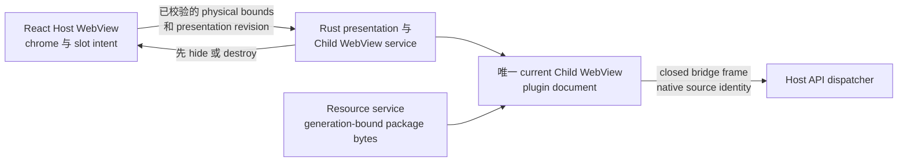
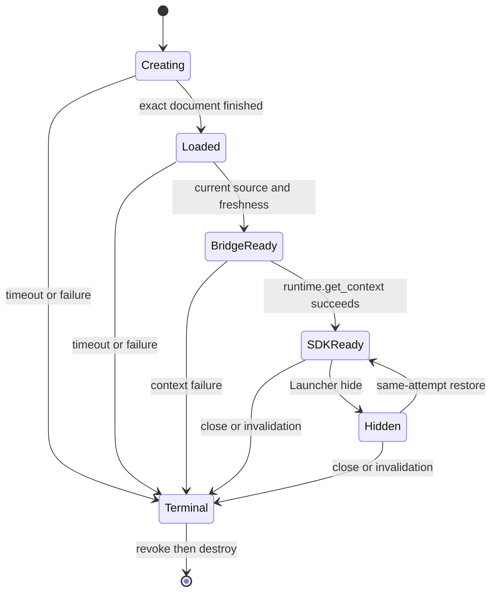

# Plugin Child WebView Runtime

## 已交付的 Surface Ownership

Launcher 在同一 native window 中保留一个可信 Host WebView，以及至多一个 current plugin
Child WebView。React 拥有 Page chrome、loading、retry、error、Settings 与测量后的内容 slot；
Rust 拥有 native create、bounds、visibility、focus、navigation、bridge ingress、resource
authority 与 destroy。插件不能提交 native bounds，也不能获取 Tauri object。

当可信的 current Page resolution 具有 `provider.kind: "plugin"` 时，React 会为
external、Development Mode 与 official 插件选择同一套 edge-to-edge Launcher body
布局。Host 将 Page chrome 保留在插件矩形之外，移除 body 的 inline/bottom inset 与
区域间 gap，并且不在 Runtime container 上叠加 inner radius。最外层 Launcher surface
继续拥有 native-window 裁切与圆角。Home、Search 和 Host-owned Page 保留既有布局；
plugin identity、Publisher、repository location、provenance 与 Runtime content 都不能
选择该状态。



Host 与插件 document 是 native sibling。正确性不假设 WebKit 将它们分配到不同 OS process。

共享 container 包含三个彼此不同的 identity。`Window("main")` 表示完整 native Launcher，拥有
size、visibility、show/hide、focus、window event 与 native-dialog parent；可信
`Webview("main")` 只表示 Host document，并且是 `launcher://activated` 的唯一目标。current plugin
Child WebView 使用独立的 generated identity，绝不会收到该 Host event。post-creation Launcher
操作不得把 native Window 重新转换成 single `WebviewWindow`。

## Session 与 Lifecycle

同一 attempt 将 native load、bridge ready 与 SDK Context ready 作为不同状态推进。所有 current
检查通过前，Child WebView 保持隐藏，由 Host 展示反馈。close、切换 Page、disable、uninstall、
replacement、upgrade、development reload、retry、disconnect、fatal bridge failure、Host reload、
app teardown 与 process exit 都进入同一 compare-current terminal path。

presentation 使用绑定 opaque current attempt 的一次 Host-private async readiness wait。它会在 bridge
ready、closed failure、timeout、destroy、replacement 或 app teardown 时 exactly-once settle。React
不再按固定间隔 polling；snapshot read 仅保留为 diagnostic，unmount 或 replacement 后的 late
completion 不能显示或复活 WebView。

公共 WebView SDK transport 会等待插件 document 的 load event，并跨过一个 task boundary 后才
发现 bridge 和报告 ready。这样由 native `Finished` load event 权威地推进到 `Loaded`，避免
module 或 React 提前启动并与该事件形成竞态。



只有 plugin、Page、entry、version、resource generation 与 native source 仍为 current 时，
hide/restore 才保留同一 attempt。真实 close 或 generation 变化会先 destroy，再 fresh reopen。
不存在 hidden Runtime、preload pool、background Page 或第二个 current plugin WebView。

Launcher action 会先解析所需的 native Window 与 Host WebView target，再改变 Child
presentation。hide 保持 Child-first、native-parent-second，避免 overlay 泄漏。如果 native parent
hide 失败，Rust 只恢复并重新聚焦同一个 compare-current Child；rollback 失败会 teardown 该
attempt，stale rollback 保持 inert。restore 会先 show/focus native parent，再恢复同一个 Child，
并保留当前用户调整后的尺寸。plugin Page close 会立即提交固定 `home`，因此 Child
teardown 异步完成期间 native Window 仍会返回 `650×320` 且不可调整；resize 不等待
single-WebviewWindow conversion。

每个规范化 Page 都携带有界初始逻辑尺寸和 `resizable`。Host 拥有完整原生 Window
转换与当前 monitor 约束。Window 和 scale 变化只为同一 Child WebView 生成可信 slot revision，
不会重载 document、Session、model 或 Worker。插件只能观察普通 Web viewport，不会获得
原生 size、position、monitor、constraint、maximize、fullscreen 或 Window handle method。
React 仍只测量 `.plugin-runtime-slot`：其 DOM rectangle、`ResizeObserver`、scale
conversion 与串行 latest-wins presentation revision 会进入既有、由 Rust 校验的 physical-bounds
路径。edge-to-edge 布局不会新增 payload field、Tauri command、native setter、Runtime reload
或 Session replacement 路径。

## 原生编辑快捷键

启用 Tauri `unstable` feature 后，初始 Host `main` WebView 和插件 WebView 都使用
原生 `WindowChild` 创建路径。共享原生布局不会改变各自的 document 身份或权限。
Host 搜索框、普通外部 Web 控件和 ConfigLens 因此使用同一原生编辑边界。

macOS Wry adapter 仅在原生窗口可见且为 key window、Child 及其祖先可见，并且当前
first responder 是该 Child 子树中、属于同一窗口的可见原生 view 时，委托 Child
key equivalent。每次原生回调最多向 WKWebView 传递一次原事件和修饰键，并保留同步
返回值。该返回值可能只表示异步 Web 处理已开始，不证明最终处理完成。失焦、隐藏、
脱离、被替换或无法验证的 Child 不能抢回焦点、显示自身或接管其他目标。

共享 Tao 父视图仅在当前 first responder 是同一可见 key window 中的可见原生后代时，
将 `doCommandBySelector:` 交给 NSView superclass，原 selector 不经解释直接传播。
Tao 自身持有 raw-input 焦点时保留既有行为。这样恢复正常命令传播，使 WebKit 能识别
未处理命令并执行自身合法事件回流；既有应用菜单随后可匹配 accelerator、验证菜单项，
并向 responder 投递原生 action。Web 已处理或取消默认行为时不会额外执行默认编辑，
已完成的原生 action 也不会重复。Wry 的非 Child 委托行为保持不变。

该 adapter 不调用菜单，不增加第二条 `keyDown` 回退，不从同步 BOOL 推定最终处理，
也不实现 pending 状态、完成回调、事件队列、重放或延迟目标补偿。它不会跨回调保存
路由目标。完成与回流由 WebKit 所有，包括其既有焦点变化语义；每个 lensX guard 都
读取当前原生归属，不聚焦或恢复 view。

application-local monitor 继续拥有前台 `Cmd+W/Q` 的处理权：每个事件只消费一次，
分别进入可恢复 Hide 或完整 Quit。标准全选、复制、剪切、粘贴、撤销和重做复用原生
菜单／responder 契约；Find 和其他页面命令仍由 Web document 所有。插件身份、
Publisher、provenance、DOM selector 或 Monaco 类型均不会选择特殊路径。既有合规
外部插件只需更新 Host，无需改源码、重打包、更新 SDK 或新增剪贴板权限。不合成键盘
事件，不新增 Host API，也不暴露原生句柄。

[验证指南](../development/validation.md) 分别说明生产 Rust 策略测试、原生接线与
Cargo 编译、建模的普通控件 DOM 编辑，以及使用测试剪贴板数据的真实 Monaco handler。
任何一层都不能单独证明操作系统事件交付。当前 macOS 构建的一次临时调查确认了未处理
命令传播、WebKit 回流和既有菜单 action 的单次执行；移除调试器后，用户确认快捷键恢复。
该观察仅限于实际执行的构建与场景，不代表全部按键／控件矩阵或其他平台验收。仓库不维护
原生交互 harness 或诊断入口。

## 安全与 Web 能力

每个 generation 都有隔离的 origin、data-store identity、resource scope、native label 与 opaque
attempt。native ingress 提供 source identity；插件 frame 不能选择它。document 只获得冻结的
lensX bridge carrier。generic Tauri core/plugin/app command、global event、window/WebView 控制、
Host DOM、其他插件与旧 generation 都不可用。top-level escape、popup/new-window 与 download
全部拒绝。

页面可使用 package module、Dedicated Worker、Fetch/HTTPS、WebSocket、WASM 与 origin storage
等普通 Web 能力；它们是 browser capability，不是 Host grant。SharedWorker、ServiceWorker、
detached execution、device access 与 native API 不在承诺范围内。Publisher、repository、
provenance 与 CI 证据都不会增加 Runtime authority。

## 开发与 CI

external、development 与 official 插件都使用 Manifest `0.4.0`、
`runtime.kind: "webview"` 与 `@lensx/plugin-sdk/webview`。template 与 CLI
只构建这一路径。Development reload 在销毁旧 current attempt 前 staging 下一
generation；被拒绝的 staging 不改变 current attempt。直接插件与 external
插件使用相同的公共 Runtime、bridge/SDK、interaction 与 zero-residual teardown
边界；CI 不会赋予不同 Host 路径。

使用以下确定性命令：

```bash
pnpm run gate -- plugin-child-webview-runtime
pnpm run gate -- plugin-child-webview-session
pnpm run gate -- open-isolated-plugin-runtime
```

这些 Gate 验证 contract、状态机、source/generation binding、resource policy、
bridge adapter、lifecycle 竞态、cleanup 与恶意边界；它们不启动真实 WebView
或原生产品环境，也不声称提供此类证明。
## 确定性资源与生命周期检查

容器启动延迟和目标环境交互时延不再作为维护中的验证输出。ConfigLens bundle
与初始资源预算从 production build 产物检查。Runtime deadline、有界 frame、
single-instance ownership、cancellation、replacement、terminal cleanup 与
late-event suppression 继续由 Rust、TypeScript、React、package 和边界测试约束。
## 故障排查

1. Host 一直停留在 loading 时，区分 native load、bridge ready 与 SDK Context ready；按负责 stage
   排查而不是视为一个 timeout；应检查对应状态转换。
2. 内容隐藏或错位时，运行 slot/bounds gate，并校验 scale factor、presentation revision 与 Host
   overlay 顺序。
3. 如果 `Cmd+W`、focus loss 或 Page close 留下空白或尺寸错误的 Launcher，运行
   `pnpm run gate -- plugin-child-webview-window-lifecycle`。确认 post-creation path 解析
   `Window("main")`、Host activation 只解析 `Webview("main")`，并在改变 teardown timing 前检查
   native-hide rollback。
4. Web 能力失败时，使用 browser feature detection 并检查插件 CSP；不要增加 Host permission 或
   native fallback。
5. reload 或 replacement 失败时，验证 teardown 前的 staging，并确认旧 generation 不能发送 late
   callback。
6. 确定性断言变化时，审查产品不变量并更新对应 unit、state、package 或 boundary test。

Resource Service 保留 process-local、32 MiB/256-entry 的 verified byte cache，key 包含 entry、
installed/development payload variant、resource generation 与 normalized path。miss 只有在完整
path/file/read 与 final-currentness proof 后才 publish；hit 仍检查 scope、Manager projection、payload
ownership、generation、current attempt/source 与前后 identity。Development snapshot 在首次完整 tree
proof 后使用 bounded metadata seal。lifecycle generation 变化会撤销 eligibility 并淘汰 stale entry。
`Cache-Control: no-store` 保持不变：browser cache 不是 authority。

## 旧协议迁移

Manifest `0.3.x` 与更早 package（包括旧 iframe package）仅作为不兼容迁移输入。它们不会执行、重写或
进入 fallback。请使用当前 template 与公共 WebView SDK transport 重新构建。
