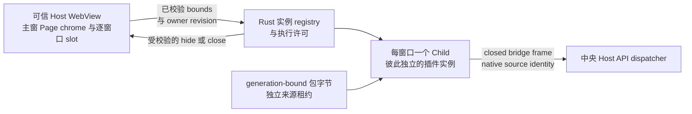
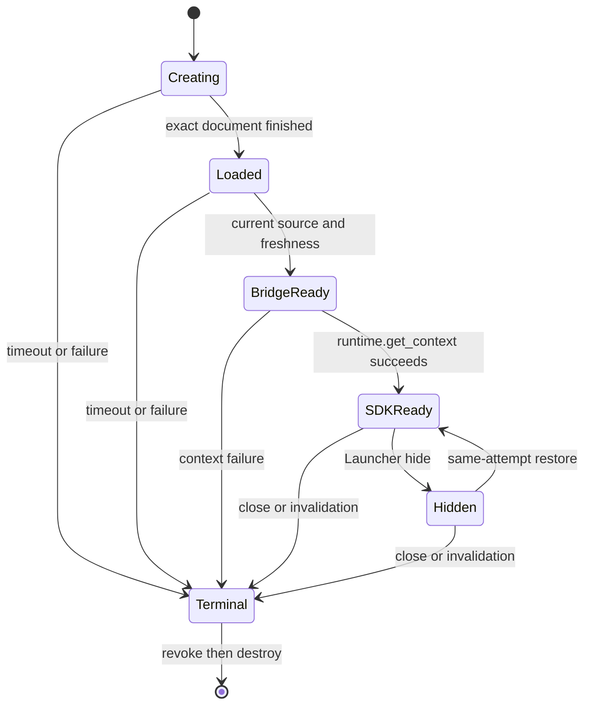

# Plugin Child WebView Runtime

## 已交付的 Surface Ownership

Launcher 在同一 native window 中保留一个可信 Host WebView，以及至多一个 current plugin
Child WebView。React 拥有 Page chrome、loading、retry、error、Settings 与测量后的内容 slot；
Rust 拥有 native create、bounds、visibility、focus、navigation、bridge ingress、resource
authority 与 destroy。插件不能提交 native bounds，也不能获取 Tauri object。

当可信的 current Page resolution 具有 `provider.kind: "plugin"` 时，React 会为
external、Development Mode 与 official 插件选择同一套 edge-to-edge Launcher body
布局。Host 将 Page chrome 保留在插件矩形之外，移除 body 的 inline/bottom inset 与
区域间 gap，并且不在 Runtime container 上叠加 inner radius。Host CSS 只裁剪自己的 DOM；
macOS 上由 Rust 裁剪下文所述的共同原生内容容器。Home、Search 和 Host-owned Page 保留既有布局；
plugin identity、Publisher、repository location、provenance 与 Runtime content 都不能
选择该状态。



Host 与插件 document 是 native sibling。正确性不假设 WebKit 将它们分配到不同 OS process。

共享 container 包含三个彼此不同的 identity。`Window("main")` 表示完整 native Launcher，拥有
size、visibility、show/hide、focus、window event 与 native-dialog parent；可信
`Webview("main")` 只表示 Host document，并且是 `launcher://activated` 的唯一目标。current plugin
Child WebView 使用独立的 generated identity，绝不会收到该 Host event。post-creation Launcher
操作不得把 native Window 重新转换成 single `WebviewWindow`。

## 实例与呈现所有权

原生 registry 以进程内唯一的 attempt 索引存活实例，并单独维护每个 surface 至多一个实例
的绑定。实例终止后不得复用原生 source label。主窗口兼容操作只选择 `main`；来源入口、
RPC、readiness 和 teardown 均解析具体 attempt，应用退出清理全部实例。

私有 owner 包含原生 window label 与单调递增的 ownership revision。Presentation
`0.3.0` 和 slot `0.2.0` 请求在 attempt 与 slot revision 之外携带该 owner。Rust
核验真实调用 Host WebView 及其原生父窗口，再原子检查 registry owner。payload 中的
label 不授予权限。移交接纳会预留目标并冻结旧呈现操作；单次 migration token 阻止
重复提交与过期回滚。native adapter 与可信窗口控件使用同一归属边界。

应用命令权限与 native invoke handler 使用同一份按 feature 选择的命令清单。`build.rs`
在 Cargo 忽略的 `OUT_DIR` 中生成 main Host grant，并保留单独维护的窄 detached-shell
grant。重新生成前只清理 Tauri 忽略的 `permissions/autogenerated` 输出，避免先前的开发
构建把开发命令名称或 grant 留在生产产物中。capability 选择具体 Host WebView，不向
原生 Window 的全部 Child 授权。
Tauri 开发 watcher 忽略该生成目录及其中的文件。它仍监视受维护的权限文件、命令清单和
原生配置，在这些输入变更时触发重新构建。

呈现操作还会把可撤销的执行许可传入主线程 native callback。bounds、hide、show 与 focus
在 registry 状态提交前确认真实父窗口和原生结果。移交、终止、更新的 intent 与超时使旧
许可失效；即使回到同一个源 Window 也不会重新启用。执行原生操作或等待前释放 registry
锁。Retina 显示器的物理 bounds 保留小数逻辑坐标，并保留仍有效的后代 responder，不把焦点
强制移动到 WebView root。

应用级 TypeScript lifecycle service 分别持有 Runtime 与 presentation lease。
释放几何观察器和 React slot 不释放已移交 Runtime。显式 owner handoff 在释放旧呈现
lease 前安装当前终止清理 adapter；普通 Page 导航仍终止自身实例。Host reload 与应用
teardown 经中央协调器终止全部实例。公共 Context、Manifest 和 SDK payload 不包含这些
标识。

## 分离事务策略

迁移 driver 预留目标窗口，同时保留原 attempt、source、Session、Worker 与请求空间。
其 adapter 契约要求在捕获源快照前建立原生执行屏障。driver 准备隐藏目标、等待可信
shell，再检查原生输入接纳条件并移动同一 WebView。目标保持不可交互时，先确认 bounds/
裁剪并取得导航/Home 准备 ACK。最终一个受 guard 约束的主线程批次应用 native Home、
显示/聚焦目标、隐藏 main 并发布归属；目标获焦后不再等待 JS ACK。每个 callback 都检查
transfer token 与执行许可；等待原生或 shell 确认时不持 registry
锁。前向执行与回滚各有十秒预算。native adapter 将该 driver 接入可信 shell 与保留的
WebView 事务。策略测试和 adapter 编译分别验证该路径的不同部分，不代表已观察运行中
桌面应用的交互。

在 macOS 上，主窗与独立窗口都在当前归属有效时于主线程设置内容尺寸和内容约束。
Host 以同一内容坐标读回实际值后才提交呈现状态。隐藏 shell 在订阅得到确认且布局提交后
主动上报首次 slot，即使订阅返回的 revision 与启动快照相同也如此。后续 resize 更新该 slot。

普通 Host 尺寸或分离操作失败时，插件 Page 不展示通用 Action 错误、窗口操作错误横幅或
检查状态按钮。回滚后开发诊断保留原始失败步骤与有界原因，补偿失败时也标明恢复阶段。
下文的明确修复控件仅针对仍存活的恢复 ticket。

原始 hierarchy、frame 与 responder 快照必须覆盖整个事务，包括原生移动成功但后续阶段
失败的情况。重新捕获快照的反向移动不等于恢复原快照。前向失败且补偿成功时，先恢复原
实例与导航，再释放目标并发布更新后的 source-owner revision。回滚也先取得 DOM/导航
ACK，再在最终原生批次使 source 恢复可交互。

原生补偿本身也可能失败。已接受的 `recovery_required` 是明确失败状态，绝不表示分离或
回滚成功。它保留原实例、事务和回滚上下文，冻结归属变化与重复分离，并保持可信 main
修复/退出界面可见。不得重载、重放打开 Action，或销毁可能仍承载原 WebView 的窗口。
显式恢复只重试补偿；显式关闭实例或退出应用终止同一个 attempt。已提交插件失效仍撤销
全部受影响 authority。其他请求和 Session 继续绑定原实例，并持续接受原生来源与资源租约
校验；依赖归属的 `actions.open` 只进行有界等待，恢复未解决时返回 `unavailable`。
main Host 提供本地化恢复状态及明确恢复、关闭、Quit 控件。恢复进行中仍可关闭或退出；
状态读取失败时保留已有恢复 ticket，不能隐藏唯一修复入口。控件使用权威 native 状态与
精确 attempt/token，替换后的迟到响应不产生效果。

主窗口插件 Page 显示上下文胶囊及关闭按钮。用户在快捷键设置中配置分离，并使用应用内组合键（默认 `Cmd+D`）操作。Rust 在接纳按键前校验实际 key window、实例、responder、modal、录制及输入法组合状态。清除绑定后，需重新设置组合键才可分离。

macOS 独立窗口使用原生标题栏，隐藏标题文字，仅显示标准关闭、最小化和全屏按钮。辅助功能和窗口切换仍能取得语义 Page 名称。插件从 `(0, 0)` 填满标题栏下方完整内容区。系统标题栏拖动与按钮作用于所属窗口。单击绿色按钮可进入 macOS 原生全屏，包括普通窗口模式下尺寸固定的 Page。再次单击会恢复原来的窗口尺寸。如果用户在全屏期间切换了 Page，Host 随后应用当前 Page 请求的普通窗口尺寸。最小化保留实例，关闭终止对应实例。

确定性 adapter 覆盖效果顺序、阶段失败、deadline、终止 barrier、原 model/Worker/request
identity 与清理次数。原生编译和读回策略是独立证据。这些检查不测量实际 AppKit 焦点、
输入法组合或 WebKit 调度；仓库不维护 GUI 或原生交互验证入口。

## 原生圆角内容

独立窗口的系统边框负责标题栏和外圆角，内容根视图执行矩形裁剪。主窗下文的 18 点圆角不应用到独立窗口内容与标题栏的接缝。独立窗尺寸按内容区计算，拟合工作区时计入系统边框。

macOS 上，Rust 解析完整 `Window("main")` 及其当前 `NSWindow.contentView`，后者是
Host 与插件 native sibling 的共同祖先。在主线程启用 layer backing 后，Rust 为既有
layer 设置 18 逻辑点半径和 `masksToBounds = true`，再读回确认状态。该操作裁剪四角，
不替换 content view 或 layer，不添加 wrapper，也不改变 first responder 或 view 顺序。
layer 不添加背景填充、遮角或投影。既有 `NSWindow` 原生投影与内容裁剪保持独立。

该半径对应 `.launcher-surface` 的 18 CSS px，不乘 backing scale。layer 的隐式 bounds
mask 随 resize 和 monitor 变化跟随当前内容边界。surface 配置在固定/可调整状态转换及
工作区适配后重新确认策略；不添加独立的物理 mask path、resize polling 或插件几何通道。
surface command 与合并后的 monitor/scale refresh 在主线程之外运行，同时保留既有串行
事务与回滚顺序。原生事件回调只调度工作，不会因等待事务而阻塞主线程确认；refresh 期间
到达的通知保留到下一轮处理。Child 仍接收原有矩形 physical bounds 和 latest-wins slot
revision，其 viewport 与 resize 权限保持不变。

macOS 主窗口先隐藏创建。Host view 建立后、插件 service 能呈现内容前，Rust 建立裁剪。
首次显示由主线程在启动回调返回后执行，包括快捷键注册失败的情况。原生窗口、content view、
layer 缺失或裁剪确认失败时，启动窗口保持隐藏并返回有界 setup 错误。已确认可见后发生
焦点拒绝时，主窗口保持可用，并允许一次受当前归属约束的重试。隐藏创建
与首次显示属于同一生命周期变更；回滚时必须与原生裁剪一起撤回，否则可能留下永久隐藏
的窗口。

当前 Child 首次显示、同 attempt 恢复及父窗口恢复前，Rust 重新确认同一 Window 级策略。
队列投递成功不等于确认成功：调度操作必须返回真实主线程执行结果，呈现才能继续。
主线程调用直接执行，不等待自身队列。Child registry 在确认期间释放锁，并在显示或失败
隐藏前重新检查 attempt、native handle、readiness 和最新的私有 visibility intent。
后续 hide 或 reveal 会取代旧的待完成操作，不改变 slot 的 wire revision。裁剪操作不会
加载 document、创建 Session、Worker 或 model，也不会获取焦点。既有 load、bridge、
SDK readiness 和 compare-current 检查仍控制 Child 呈现。

运行期确认失败时，呈现不能报告显示成功，也不能暴露未确认的 Child。仍可确认的安全
裁剪会保留；否则受影响内容保持隐藏，并沿既有窗口/Runtime 失败路径处理。只有 Host
仍可安全显示时，既有本地化导航、重试和关闭控件才保持可用。原生指针、对象标签和平台
诊断不进入插件数据或产品文案，不新增用户配置或公开协议字段。

裁剪归 Window 所有，Child teardown 不会移除它。官方、外部和 Development Mode 插件
遵循相同规则；来源、背景透明度、语言和主题都不会选择另一条原生路径。

| 呈现或转换 | 共同裁剪与保留行为 |
| --- | --- |
| Home、Search、Host Page 或 Settings overlay | Host 内容保持在同一外轮廓内；既有 padding、overlay 顺序、键盘行为和焦点目标仍由 Host 拥有。 |
| 插件 loading、ready、空白、不透明、failed 或 retry | edge-to-edge 矩形不添加内部上圆角或 inset；既有 readiness 与失败 UI 保持权威。 |
| Hide 与同 attempt 恢复 | 确认先于显示，同时保留原 document、Session、Worker、model 和用户调整后的尺寸。 |
| Close/reopen 或 A 替换为 B | Close 销毁旧 attempt；A 晚到的更新、ready 事件和 teardown 不能移除 Window 裁剪或操作 B。 |
| Resize burst、工作区适配或 scale 变化 | 共同内容 bounds 驱动裁剪，半径保持 18 逻辑点，既有 physical-bounds revision 独立收敛。 |

确定性策略、生命周期、接线和编译检查的职责见
[验证指南](../development/validation.md#原生圆角内容验证)。这些检查不证明 macOS 最终
合成像素、抗锯齿、原生投影外观或边缘 hit-test。其他平台保留既有窗口行为。

## Session 与 Lifecycle

同一 attempt 将 native load、bridge ready 与 SDK Context ready 作为不同状态推进。所有 current
检查通过前，Child WebView 保持隐藏，由 Host 展示反馈。close、切换 Page、disable、uninstall、
replacement、upgrade、development reload、retry、disconnect、fatal bridge failure、Host reload、
app teardown 与 process exit 都进入同一 compare-current terminal path。

presentation 使用绑定 opaque current attempt 的一次 Host-private async readiness wait。它会在 bridge
ready、closed failure、timeout、destroy、replacement 或 app teardown 时 exactly-once settle。React
不再按固定间隔 polling；snapshot read 仅保留为 diagnostic，unmount 或 replacement 后的 late
completion 不能显示或复活 WebView。

公共 WebView SDK transport 会等待插件 document 的 load event，并跨过一个 task boundary 后才
发现 bridge 和报告 ready。这样由 native `Finished` load event 权威地推进到 `Loaded`，避免
module 或 React 提前启动并与该事件形成竞态。



只有 plugin、Page、entry、version、resource generation 与 native source 仍为 current 时，
hide/restore 才保留同一 attempt。真实 close 或 generation 变化会先 destroy，再 fresh reopen。
不存在无所属 surface 的 hidden Runtime、preload pool、background Page，或同一 surface 内
第二个 current plugin WebView。

Launcher action 会先解析所需的 native Window 与 Host WebView target，再改变 Child
presentation。hide 保持 Child-first、native-parent-second，避免 overlay 泄漏。如果 native parent
hide 失败，Rust 只恢复仍为当前 owner 的同一 Child。暂时无法获得焦点时，已确认可见的
Child 和 Session 继续保留。主窗口成为 key window 后，仅在 owner 和可见性 revision 仍有效时
重试一次焦点请求。真正的原生呈现失败按 owner 清理，迟到的旧回复不产生效果。
restore 会先 show/focus native parent，再恢复同一个 Child，
并保留当前用户调整后的尺寸。plugin Page close 会立即提交固定 `home`，因此 Child
teardown 异步完成期间 native Window 仍会返回 `650×320` 且不可调整；resize 不等待
single-WebviewWindow conversion。

实例 close、retry 与 failure 只取消该 attempt。已提交插件失效会影响其全部相关 generation
实例；Host reload/exit 清理全部实例。插件级共享持久化 storage 与每 attempt 的浏览器和
业务状态保持独立。

每个规范化 Page 都携带有界初始逻辑尺寸和 `resizable`。Host 拥有完整原生 Window
转换与当前 monitor 约束。Window 和 scale 变化只为同一 Child WebView 生成可信 slot revision，
不会重载 document、Session、model 或 Worker。插件只能观察普通 Web viewport，不会获得
原生 size、position、monitor、constraint、maximize、fullscreen 或 Window handle method。
React 仍只测量 `.plugin-runtime-slot`：其 DOM rectangle、`ResizeObserver`、scale
conversion 与串行 latest-wins presentation revision 会进入既有、由 Rust 校验的 physical-bounds
路径。edge-to-edge 布局不会新增 payload field、Tauri command、native setter、Runtime reload
或 Session replacement 路径。

## Action 调用与快捷键激活

Host Action dispatcher 为每个已接纳调用创建冻结的 invocation，包含独立 ID 和
`normal` 或 `shortcut` 来源。UI 选择与插件 `actions.open` 始终创建 normal 调用。
只有当前有效的原生 Action 绑定在原生 Show 并原子认领其绑定 revision 后，才能创建
shortcut 调用。普通 Launcher 快捷键仍执行 Toggle；Action 保留自己的行为，包括最终 Hide。

原生交付先安装 listener，再声明 Host ready，并按 invocation 顺序合并握手批次与同时到达
的事件。重复原生 ID 共享一次认领。等待准入最多 32 个 invocation，期限为 10 秒；超载、
陈旧绑定、目标不可用和过期均产生安全失败反馈。dispatcher 在排队快捷键开始执行时再次核对绑定 revision 和 active 状态，
检查当前 Action Registry，每次成功 invocation 只通知一次最近使用记录，不受插件回调业务结果影响。

`ActivePage` 仍严格只有 `owner_id`、`page_id` 和 `opened_by_action_id`。
独立的 Page attempt activation 通道将调用交给当前 Session。重复进入同一可用 Page
会更新 opening Action 并聚焦当前 Child，不改变 React key、Runtime identity、surface
attempt、输入、选区或业务状态。Runtime 替换、关闭、可用性失效或显式重试会撤销旧通道；
重试从空通道开始，不重放旧调用。

私有 native-to-Host dispatch envelope 携带原生 presentation attempt ID。只有该 attempt
与当前 Page presentation 匹配后，Host 才绑定 activation provider；提前到达的请求可等待
presentation 创建，晚到的旧请求不能认领新 Page 通道。该 ID 不进入公开 Activation、
Runtime Context、URL 参数或插件请求权限。

Host API `0.4.0` 通过独立的 `actions.get_activation`、`actions.subscribe_activations`
方法和 `actions.activated` 事件提供激活事实。Activation 只有插件局部 `actionId`、在
Page attempt 内递增的正安全整数 `invocationId` 和 `source`。Session 原子开启单一流，
缓存最多 32 次调用的初始批次；重复订阅返回相同批次，缓存不占用后续事件流容量。
最新快照会在事件发出前更新。初始通道在 10 秒内无法开启时，其 Runtime attempt 失败；
显式重试从新状态开始。Context 保留既有四字段，仅在实际 provider 可用时声明激活方法。

SDK `0.5.0` 即使没有业务回调也消费该通道。可选工厂参数 `onShortcutActivated` 只对
shortcut 调用执行，并且执行时 SDK 已 ready。它不会自动翻译、格式化、清空输入、重置
结果，也不等待上一个回调 Promise；业务并发由插件拥有。尝试开启 activation 流之后的
初始化失败会终止该 SDK transport 和 Session，不在同一个 attempt 上重放。disposal
阻止未来回调并处理晚到的 Promise 拒绝，不宣称撤销回调已经发起的外部工作。

这些保证由 `launcher-shortcuts` 与既有 Child WebView Gate 中的确定性 Action、导航、
Session、SDK 和生产组合检查覆盖，不证明真实键盘投递、系统权限交互或真实 WebView 运行。

## 原生编辑快捷键

启用 Tauri `unstable` feature 后，初始 Host `main` WebView 和插件 WebView 都使用
原生 `WindowChild` 创建路径。共享原生布局不会改变各自的 document 身份或权限。
Host 搜索框、普通外部 Web 控件和 ConfigLens 因此使用同一原生编辑边界。

macOS Wry adapter 仅在原生窗口可见且为 key window、Child 及其祖先可见，并且当前
first responder 是该 Child 子树中、属于同一窗口的可见原生 view 时，委托 Child
key equivalent。每次原生回调最多向 WKWebView 传递一次原事件和修饰键，并保留同步
返回值。该返回值可能只表示异步 Web 处理已开始。已脱离原生视图层级的 Child
不能抢回焦点、显示自身或接管其他目标。失焦、隐藏、被替换或无法验证的 Child
也受相同限制。挂载在插件独立窗口中的 Child 遵循该窗口的焦点规则。

共享 Tao 父视图仅在当前 first responder 是同一可见 key window 中的可见原生后代时，
将 `doCommandBySelector:` 交给 NSView superclass，原 selector 不经解释直接传播。
Tao 自身持有 raw-input 焦点时保留既有行为。这样恢复正常命令传播，使 WebKit 能识别
未处理命令并执行自身合法事件回流；既有应用菜单随后可匹配 accelerator、验证菜单项，
并向 responder 投递原生 action。Web 已处理或取消默认行为时不会额外执行默认编辑，
已完成的原生 action 也不会重复。Wry 的非 Child 委托行为保持不变。

该 adapter 不调用菜单，不增加第二条 `keyDown` 回退，不从同步 BOOL 推定最终处理，
也不实现 pending 状态、完成回调、事件队列、重放或延迟目标补偿。它不会跨回调保存
路由目标。完成与回流由 WebKit 所有，包括其既有焦点变化语义；每个 lensX guard 都
读取当前原生归属，不聚焦或恢复 view。

唯一 application-local monitor 处理已配置分离键（默认 `Cmd+D`）和前台 `Cmd+W/Q`，
在 worker 分发前捕获真实 key Window 与当前实例。分离要求 main 实例已就绪、原生 Host/
Child 焦点有效、无 marked text、overlay 或录制，且 Launcher 恢复已确认。已接纳物理手势及
其重复事件直到释放前都被消费，即使焦点已转到独立窗口；新的不适用手势保留普通 Web 行为。
可分离 main 中，分离优先于 Monaco 同键命令；独立窗口保留自己的 `Cmd+D` 行为。

W 隐藏可恢复的 main，或只关闭接纳时捕获的独立实例；过期目标不回退到新焦点。Q 先拒绝
新工作，在原生事件循环仍运行时取消并清理全部实例，再退出一次；录制不禁用 W/Q。
应用内分离与 chord 录制不需要全局 Input Monitoring 权限，也不将 detach 注册为全局命令。
标准全选、复制、剪切、粘贴、撤销和重做复用原生
菜单／responder 契约；Find 和其他页面命令仍由 Web document 所有。插件身份、
Publisher、provenance、DOM selector 或 Monaco 类型均不会选择特殊路径。既有合规
外部插件只需更新 Host，无需改源码、重打包、更新 SDK 或新增剪贴板权限。不合成键盘
事件，不新增 Host API，也不暴露原生句柄。

[验证指南](../development/validation.md) 分别说明生产 Rust 策略测试、原生接线与
Cargo 编译、建模的普通控件 DOM 编辑，以及使用测试剪贴板数据的真实 Monaco handler。
任何一层都不能单独证明操作系统事件交付。当前 macOS 构建的一次临时调查确认了未处理
命令传播、WebKit 回流和既有菜单 action 的单次执行；移除调试器后，用户确认快捷键恢复。
该观察仅限于实际执行的构建与场景，不代表全部按键／控件矩阵或其他平台验收。仓库不维护
原生交互 harness 或诊断入口。

## 安全与 Web 能力

每个有效 generation scope 都有隔离 origin。每个 attempt 拥有独立的非持久化原生 data store、
来源租约、native label 与 Session，即使兄弟实例共用 origin 字符串。最后一个来源租约和
有界创建预留释放后 scope 永久退休，后续创建使用新 scope。资源与缓存操作前后均检查来源。native ingress 提供 source identity；插件 frame 不能选择它。document 只获得冻结的
lensX bridge carrier。generic Tauri core/plugin/app command、global event、window/WebView 控制、
Host DOM、其他插件与旧 generation 都不可用。top-level escape、popup/new-window 与 download
全部拒绝。

页面可使用 package module、Dedicated Worker、Fetch/HTTPS、WebSocket、WASM 与 origin storage
等普通 Web 能力；它们是 browser capability，不是 Host grant。SharedWorker、ServiceWorker、
无所属窗口的后台执行、device access 与 native API 不在承诺范围内。Publisher、repository、
provenance 与 CI 证据都不会增加 Runtime authority。

独立的公共 `http.request` method 由 source-bound Rust provider 处理公网 HTTPS 文本请求。
它复用当前 Session 及取消/终止边界，保留私有原生传输，并把服务签名与业务逻辑留在插件。
浏览器 Fetch 继续遵循自身 CORS/CSP 规则，不关闭 WebKit 安全选项。目的地址、DNS 固定、
header/body、期限和并发边界见 [Host HTTP 契约](../plugin-development/host-api.md#httprequest)。

## 开发与 CI

external、development 与 official 插件都使用 Manifest `0.4.0`、
`runtime.kind: "webview"` 与 `@lensx/plugin-sdk/webview`。template 与 CLI
只构建这一路径。Development reload 先 staging 下一 generation，再终止全部受影响旧
generation attempt；被拒绝的 staging 保留全部当前实例，无关插件实例保持有效。直接插件与 external
插件使用相同的公共 Runtime、bridge/SDK、interaction 与 zero-residual teardown
边界；CI 不会赋予不同 Host 路径。

使用以下确定性命令：

```bash
pnpm run gate -- plugin-child-webview-runtime
pnpm run gate -- plugin-child-webview-session
pnpm run gate -- open-isolated-plugin-runtime
```

这些 Gate 验证 contract、状态机、source/generation binding、resource policy、
bridge adapter、lifecycle 竞态、cleanup 与恶意边界；它们不启动真实 WebView
或原生产品环境，也不声称提供此类证明。
## 确定性资源与生命周期检查

容器启动延迟和目标环境交互时延不再作为维护中的验证输出。ConfigLens bundle
与初始资源预算从 production build 产物检查。Runtime deadline、有界 frame、
per-surface instance ownership、cancellation、replacement、terminal cleanup 与
late-event suppression 继续由 Rust、TypeScript、React、package 和边界测试约束。
## 故障排查

1. Host 一直停留在 loading 时，区分 native load、bridge ready 与 SDK Context ready；按负责 stage
   排查而不是视为一个 timeout；应检查对应状态转换。
2. 内容隐藏或错位时，运行 slot/bounds gate，并校验 scale factor、presentation revision 与 Host
   overlay 顺序。
3. 如果 `Cmd+W`、focus loss 或 Page close 留下空白或尺寸错误的 Launcher，运行
   `pnpm run gate -- plugin-child-webview-window-lifecycle`。确认 post-creation path 解析
   `Window("main")`、Host activation 只解析 `Webview("main")`，并在改变 teardown timing 前检查
   native-hide rollback。
4. Web 能力失败时，使用 browser feature detection 并检查插件 CSP；不要增加 Host permission 或
   native fallback。
5. reload 或 replacement 失败时，验证 teardown 前的 staging，并确认旧 generation 不能发送 late
   callback。
6. 确定性断言变化时，审查产品不变量并更新对应 unit、state、package 或 boundary test。

Resource Service 保留 process-local、32 MiB/256-entry 的 verified byte cache，key 包含 entry、
installed/development payload variant、resource generation 与 normalized path。miss 只有在完整
path/file/read 与 final-currentness proof 后才 publish；hit 仍检查 scope、Manager projection、payload
ownership、generation、current attempt/source 与前后 identity。Development snapshot 在首次完整 tree
proof 后使用 bounded metadata seal。lifecycle generation 变化会撤销 eligibility 并淘汰 stale entry。
`Cache-Control: no-store` 保持不变：browser cache 不是 authority。

## 旧协议迁移

Manifest `0.3.x` 与更早 package（包括旧 iframe package）仅作为不兼容迁移输入。它们不会执行、重写或
进入 fallback。请使用当前 template 与公共 WebView SDK transport 重新构建。
