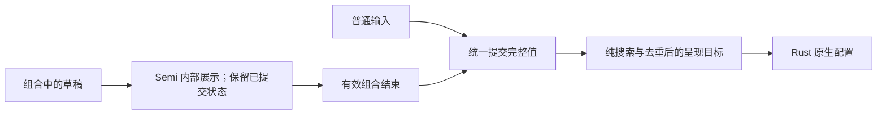

# Design

## Context

动机和产品范围见 [proposal.md](proposal.md)。本设计对应 [搜索输入 delta](specs/launcher-action-search/spec.md) 与 [窗口生命周期 delta](specs/launcher-window-lifecycle/spec.md)，已按本设计实施，并根据用户请求于 2026-10-02 完成英文稳定 specs 同步与归档。

实施前的实现与已确认事实：

- `src/App.tsx` 使用同一个 Semi Input 展示首页/搜索输入，`handleQueryChange` 直接更新 `query`；窗口目标由规范化 `query` 是否非空决定。输入框不会因首页/搜索切换而重挂载。
- 所用 Semi UI/Foundation `2.101.1` 支持 `composition`，默认关闭；默认处理会在组合期间通知应用 `onChange`。已用安装版本的 Foundation 调用验证第一个拼音字母会通知应用。
- `src-tauri/src/launcher_surface.rs` 的呈现配置在保护阶段和最终阶段均调用可调整大小 setter；首页与搜索两端本来均为 `false`。
- 锁定的 Tao `0.35.3` 会写入内部 `resizable` 状态，然后设置 AppKit style mask。其原样式 helper 无条件调用 `makeFirstResponder` 指向初始化时的 Tao view，而 Wry 已用自己的父视图和 WKWebView 替换主窗口内容。
- `Window::set_resizable` 的返回值只确认运行时消息投递，不确认后续 AppKit responder 操作。现有确定性测试不能证明实机输入法候选框行为。

架构约束：React 管输入草稿、查询和交互；Rust 及受治理的依赖适配层管原生窗口和响应者。保持现有严格 tagged surface payload、固定尺寸、插件身份和 compare-current 生命周期，不把组合文本或 native responder 作为跨边界参数。

## Goals / Non-Goals

**Goals:**

- 把草稿变化、查询提交和原生窗口变更分成可确定验证的边界。
- 消除未变化的样式设置和显式切向错误 Tao view 的焦点请求。
- 保留真实可调整大小变更、部分成功后的回滚和当前 Host/Child 输入身份。

**Non-Goals:**

- 不把恢复焦点改为每次 query 更新的 effect，不增加 debounce、定时器或 blur 后轮询。
- 不扩展公共 Tauri/Plugin API，不新增原生输入法桥接、运行时依赖或组件库。
- 不重写一般窗口生命周期，也不改变搜索算法或应用的主题、语言选择。

## Decisions

### 1. 通过 Semi 的组合输入支持保留草稿，应用只提交最终查询

启用现有 Input 的 `composition` 支持。组合过程中让组件显示内部草稿，应用的 `query` 只表示已提交完整输入值。`compositionstart` 建立同步的组合会话标记；`compositionend` 使用事件给出的完整值完成收敛。沿用 Semi 的结束通知而不同时增加第二个无条件提交入口；如果需要显式结束 handler，仅让它处理会话边界和统一提交协调。

统一提交逻辑对等值最终通知去重：结束事件与尾随 `change` 的同值通知不能再次产生语义查询更新、选择重置或原生目标切换。普通 change、粘贴和删除仍立即提交，空白归一化和匹配继续使用已有纯搜索服务。

组合取消不通过 `event.data` 猜测。最终完整输入值回到原查询时不提交新草稿；最终值变为空或合法普通文本时，按该值执行既有搜索语义。已有已提交查询不变时，组合期间保留原结果、选择及呈现；独立的 Registry 更新仍可按既有搜索规则处理。

Host 清空、成功执行后的重置、页面切换和卸载取消当前组合会话。同步引用记录会话有效性/代次，统一重置同时使草稿与 query 收敛，迟到的旧结束通知不得恢复查询；新 `compositionstart` 或新的普通输入恢复正常处理。实施使用已安装 Semi `2.101.1` 的类型化 Input class ref，重置其本地 Foundation value 和 `compositionEnter`，保留同一输入 DOM。已失效会话的组合来源 InputEvent（`isComposing` 或 composition `inputType`）也会在结束通知前被拒绝；旧节点、迟到结束和重复同值尾随通知不能重新提交。普通编辑或新组合会话可继续输入。这些状态只属于输入协调，不引入第二个 Shell store。

替代方案：保持默认每字搜索会继续让草稿触发原生配置；仅延期窗口切换会让结果和无结果反馈仍基于未确认拼音；新增输入组件会增加已有 Semi 已能避免的维护成本。

### 2. IME 判定先于全部搜索快捷键

输入的 keydown 首先检查同步组合标记、`nativeEvent.isComposing` 及 IME `keyCode === 229`。任一成立就保留输入法处理，不执行 `preventDefault`、clear、Action dispatch 或结果导航。229 仅作为浏览器兼容标记，不用于普通按键识别；继续以 `event.key` 驱动普通快捷键。

这覆盖组合结束先于确认 keydown 到达、但该按键仍携带 IME 标记的序列。对下一次独立且未标记的 Enter/Escape 不增加时间窗口屏蔽。指针执行仍走原 Dispatcher；成功执行或页面切换统一使旧组合会话失效。

替代方案：现有只在 Escape 之后检查 `isComposing` 会误清空；按固定毫秒窗口吞键会误吞用户随后的真实 Action 操作。

### 3. 原生呈现基于实际状态省略冗余可调整大小设置

在 `LauncherSurfaceWindow` 边界提供可确定验证的当前可调整大小状态读取；真实实现使用当前原生窗口状态，FakeWindow 同样存储该值。呈现保护阶段仅在当前实际为可调整大小时关闭它，最终阶段仅在状态与目标不同且确实需要时再设置。首页/搜索/Host Page 的 fixed→fixed 只调整必要尺寸和约束，不改 style mask。

Tauri setter 可能排队执行，因此去重不依赖一次投递后的立即读取或仅依赖 `last_successful`：协调器按本次计划记录已成功投递的阶段，依赖既有串行消息顺序，实际 Tao 执行点再根据当前 mask 做幂等检查。下一次操作的 guard 同时考虑先前已成功投递但仍在途的 resizable enable。部分失败后的 rollback 重新核对可读取的实际状态并重放所需目标；最后执行点的幂等保护保证不会因观察时序额外扰动响应者。不能假定公开 setter 返回已经确认 AppKit 变更完成。

维持现有保护、放宽约束、应用尺寸、收紧约束、最终 resizable 和失败回滚语义。`last_successful` 仍表示完整成功目标，不取代实际原生状态；重复 target 不重做配置。失败 rollback 会使成功缓存失效，并独立保留不确定的在途 resizable 状态；即使紧急关闭投递也失败，下一次修复仍重申 guard。移动和 scale-factor refresh 使用同一策略。

### 4. 在当前版本 Tao 的实际样式边界消除错误响应者切换

将现有传递依赖 `tao 0.35.3` 的同版源纳入 `vendor/frame-aware-navigation/tao`，通过 `src-tauri/Cargo.toml` 的 `[patch.crates-io]` 选择并更新 lockfile 来源。保留原 package 元数据、许可证和版本；不修改非 macOS adapter，不增加运行时依赖。扩展既有 vendored 完整性清单和源码断言来治理新增补丁。

补丁范围限定为 macOS `set_resizable` 和其私有的保留响应者样式 helper：

1. 继续正确更新 Tao 内部 resizable 状态，保留 fullscreen 期间的延后生效规则。
2. 在实际主线程执行点比较当前和目标 style mask；无变化不调用样式 setter，更不重设响应者。
3. 必要变更在同一个主线程操作内读取并保留当前实际响应者，应用 style mask。当前响应者仍相同时不调用 `makeFirstResponder`；确有变化时仅考虑仍属于同一窗口的原有效响应者。
4. 全路径禁止无条件把焦点交给初始化的旧 Tao view。nil、已移除/失效目标不触发 Host/Child 强制聚焦、窗口激活或旧页面恢复。
5. 拒绝恢复时保持安全状态并提供有界开发诊断；不虚构已完成恢复。普通生命周期的显式激活与页面关闭焦点策略继续负责各自的输入目标。

仅让 `set_resizable` 使用新私有 helper，避免改变 minimizable、closable、decorations 等无关 API 的共有 helper 行为；仍增加 fullscreen 状态/退出回归以确认内部状态一致。恢复 current firstResponder 与消除显式旧视图接管可以确定验证；AppKit 自身在真实样式变化期间对 marked text 的影响保持未实机验证的表述。

没有新增把 AppKit responder 的布尔恢复结果传回 Tauri command 的传输协议。既有窗口状态读取、消息投递、尺寸、约束和 rollback 错误继续沿用 `LauncherSurfaceError`；原生 helper 的恢复拒绝属于开发诊断，不声称公开 setter 可同步报告该错误。

替代方案：在原 setter 外捕获后恢复会先执行错误的 responder 切换，组合会话可能已经中断；在 runtime-wry 绕开 Tao 只改 AppKit mask无法更新它私有的 resizable 状态，会与 fullscreen/decorations 策略分叉；升级未知版本或新增整个窗口实现扩大风险。同版本有界补丁直接处理现有问题且可审阅回滚。

### 5. 保持现有产品与扩展边界

保持同一 Semi 输入 DOM、combobox/listbox 关系、active descendant、live region、i18n 和 light/dark tokens。草稿不作为新搜索状态宣布；提交后的结果、空状态与错误仍使用英文默认及简体中文资源。不增加新文案或样式时，直接验证现有双语/主题集成。

Rust surface 命令仍接受既有严格 target；查询、composition 标记、原生句柄和任意尺寸均不增加到 payload。只配置完整 `main` Window，不把 Child WebView 焦点强制交给 Host，不发额外 activation event。旧 Child 拆除与回滚保留 compare-current 行为；真实窗口失焦照常隐藏。

### 6. 用稳定 Gate 组织确定性验证

当前 registry 没有完整覆盖搜索组合输入与原生焦点策略的 Gate。新增 `launcher-input-focus`，在 `scripts/validation/catalog.ts` 注册稳定说明、结构化 steps、平台和安全元数据；复用 `frame-aware-navigation-dependency-drift` 与 `plugin-child-webview-window-lifecycle` 依赖，不把开发进程启动 Gate 用作输入验收。

- Rstest：首个拼音草稿、已有查询、结束/取消、等值通知、失效会话、IME 按键顺序、普通文本、错误恢复及双语/主题；source-policy 断言补丁只走允许范围。
- Cargo：带实际 resizable/focus 状态的纯 fake 验证幂等、必要变更、刷新与每个部分失败后的 rollback；Tao 私有 helper 的策略通过无 AppKit 交互的适配/fake 单测验证，并在 Gate 中显式执行，不能仅依赖 source 字符串断言证明焦点策略。
- 回归依赖：Child Window lifecycle、严格 payload、vendored 版本与内容漂移；修改补丁后的 Cargo check/build确认真实 native adapter 接线可编译。
- 清洁工作区准备：沿用 workspace build graph，先构建所需 public Contract；不得依赖残留 `dist`，也不得以源码 alias 绕过 package exports。

所有 TS/TSX 仓库断言进入现有 Rstest discovery，跨层步骤由 Gate 编排；不加根子集脚本。只有审阅完整补丁后，使用现有 `pnpm run generate -- frame-aware-navigation-dependency-drift --write` 更新来源基线；Gate 只读检查该结果。聚焦 Gate 不能代替最终 frontend/workspace、Rust、CI 与 OpenSpec 完整验证。

验证遵守 [维护的验证边界](../../../../docs/en/development/validation.md)：不启动 GUI、真实 WebView、浏览器、Launch Services 或原生交互，不生成候选框截图/视觉基线，也不增加 optional/manual 入口。完成报告应说明状态和调用契约的验证范围，不能宣称已验证实机候选框。

## Risks / Trade-offs

- [同版本 Tao 增加 vendored 维护面] → 只改两个 macOS 接线/私有 helper 文件，保留来源、许可证、版本、完整差异与漂移检测；上游替换须验证等价焦点策略后统一撤销本地 patch。
- [重渲染、组合结束与尾随 change 顺序不同] → 真实 Semi 组件事件序列、同步会话引用、等值提交去重和失效会话测试，避免只调用内部函数证明 UI 行为。
- [Tauri 投递与 AppKit 生效时序不同] → 实际 native 执行点幂等，串行阶段规划与 rollback 断言，不把 setter 返回值当原生生效确认。
- [旧 Child responder 已移除] → 恢复前验证当前窗口归属和目标有效性，不保留跨消息延迟的原生指针；页面关闭仍由当前 Host 策略聚焦。
- [过度去重漏掉部分失败的 resize 状态] → fake 保存实际状态并对 guard/最终设置/每个 rollback 阶段注入失败，保留最后完整安全呈现。
- [纯 fake 不能证明候选框原生绘制] → 验证报告保持确定性边界与未实机验证说明，不建立已退役环境验证路径。

## Migration Plan

1. 按 tasks 顺序加入当前 Tao 同版本 patch 和焦点/窗口状态保护，补齐对应纯策略测试及 vendored 完整性治理；审阅补丁后在同一任务组显式更新完整性基线并验证。
2. 加入 Semi 组合输入与统一提交/重置逻辑，补齐 UI 回归；登记 Gate 和双语维护文档。
3. 运行聚焦 Gate 和完整最终验证；修复新增警告及错误并重跑，Gate 保持只读。
4. 无持久化格式或公共 API 迁移。需要回滚时，原生补丁、path/lockfile来源、完整性基线、前端状态机、测试和文档作为同一 Change 回退，避免留下不同版本契约。
5. 实施验收后先保持 Change 未归档；2026-10-02 根据用户显式请求，将 delta 内容转换为英文并核对现有 Requirement 标题、全部场景及完整实施与验证证据，先同步稳定 specs，再归档。
