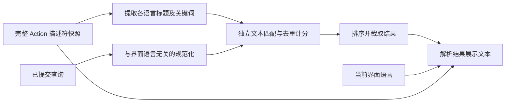

# Design

## Context

动机和产品范围见 [proposal.md](proposal.md)。以下记录变更开始时的实现基线：当时已具备完整的多语言描述符，但搜索与展示共用了一次按界面语言解析的中间结果。

- `src/app/launcher/actions/search.ts` 先调用 `resolveLauncherActionMetadata(descriptor, locale)`，再构造单语言的可搜索标题、描述和关键词。
- `src/app/launcher/actions/validation.ts` 的展示解析使用当前语言优先、英文回退；关键词也是数组选择而非多语言并集。
- 搜索规范化使用 `toLocaleLowerCase(locale)`；查询词项按空白拆分，描述子串可获得 100 分。
- `src/app/plugins/actions/mapper.ts` 已原样保留 Action 的各语言标题、描述和关键词，Registry 快照也保留这些字段，因此无需新增数据来源或修改原生边界。
- 现有稳定规格明确要求当前语言搜索和描述匹配；本变更通过 `launcher-action-search` 增量替换这些行为，并同步修订 `plugin-action-projection` 对统一搜索的约束。

创建设计是因为本次需要在领域搜索、展示解析和 App 输入调用之间明确边界，并固定跨语言重复命中的计分语义；仅修改关键词数组合并不足以满足需求。

## Goals / Non-Goals

**Goals:**

- 在纯 TypeScript 搜索层建立与界面语言无关的搜索文本视图，保持入口、结果的类型化和可序列化边界。
- 以现有字段及权重完成跨语言搜索，保证每词和完整标题奖励都不因翻译副本数量而膨胀。
- 保持展示回退、插件投影、Registry、Dispatcher 及输入生命周期的职责，避免改变共享解析器影响 Home 或页面上下文。

**Non-Goals:**

- 不新增缓存系统、外部搜索依赖、后台索引、遥测或原生能力。
- 不改变描述字段的验证、传输和展示能力，也不自动把描述改写为关键词。
- 不重构 App Shell 状态机、选中项策略、IME 或插件会话；只调整共享规范化函数的必要调用边界。
- 不修改 Manifest/Host API/SDK 版本和支持语言集合，不改变关键词在 Manifest 校验阶段的同语言唯一性要求。

## Decisions

### 1. 搜索文本与展示解析分离

对每个有效描述符遍历现有受支持语言集合，分别提取显式存在的 `title` 和 `default_keywords`。用独立的只读标题集合、关键词集合保存规范化文本；不从展示解析结果构建搜索范围，也不读取描述、插件名称、Page 标题或 ID 作为搜索文本。

`resolveLauncherActionMetadata()` 保持当前展示职责。搜索可继续接受 `locale` 以生成标题、可选描述和图标等结果展示字段，但匹配、分数与排序过程不得依赖该参数。先计算匹配及分数，再为结果解析当前语言展示文本；结果中保留描述并不意味着描述可搜索。

**替代方案：**把英文补到当前语言的展示解析结果中，会把显示回退、Home 元数据及搜索含义混为一体，也会继续让中文空关键词数组遮蔽英文。直接使用完整描述符可避免这些问题，且无需调整公共契约。

### 2. 使用固定规范化规则，保持字段边界

查询、每个标题和每条关键词统一执行 NFKC、`toLowerCase()`、trim 和 Unicode 空白折叠。查询继续按空白拆词；不新增中文分词，也不改变重复查询词项的既有处理方式。

标题与关键词各自按规范化字符串去重，但保持两类集合分离以保留字段优先级。各文本独立匹配，不能把它们 join 为一个长字符串，否则会产生跨语言或跨关键词边界的虚假子串、完整标题命中。缺失某语言或该语言关键词为空数组，只意味着该语言没有对应文本，不会遮蔽其他语言的声明。

独立规范化 helper 不再使用界面语言，相关 App 和测试调用同步调整；不改变应用的展示语言、HTML `lang` 或 Semi locale。

**替代方案：**按每个文本语言分别大小写转换仍会引入多套匹配规则；当前支持的中英文可以用统一语言无关转换满足已确认需求。未来新增语言属于独立契约评估，本期不扩展。

### 3. 保留已有权重，通过最大值限制重复贡献

保留现有八项非描述权重：

| 项目 | 分值 |
| --- | --- |
| 完整查询等于任一完整标题 | 1200 |
| 完整查询是任一标题前缀 | 800 |
| 单词项等于任一完整标题 | 600 |
| 单词项等于任一关键词 | 500 |
| 单词项是任一标题前缀 | 400 |
| 单词项是任一关键词前缀 | 350 |
| 单词项是任一标题子串 | 250 |
| 单词项是任一关键词子串 | 200 |

移除描述子串的 100 分匹配分支。完整查询标题奖励取所有独立标题中的最大值一次；每个查询词项取所有标题、关键词匹配中的最大值一次；将标题奖励与各词项最佳分相加。任一词项分数为零则排除该 Action。

去重与最大值共同保证重复语言文本、同词命中多个字段、大小写或 NFKC 等价副本不会重复加分。不同查询词项仍可跨语言、跨字段分别命中，并各贡献其最佳分数。

结果继续先排除 disabled，再按分数降序及稳定 Action ID 升序，最后截取上限；不对当前界面语言、Host/插件来源或翻译数量增加权重，一个 Action 至多出现一次。

**替代方案：**分别对每种语言调用旧搜索再合并，会重复计分，且无法正确表达跨语言词项 AND；按语言分别提前截断还可能漏掉应进入前八项的结果，因此不采用。

### 4. 保持来源与展示边界

Host 内建与投影插件 Action 均从同一 Registry 快照进入搜索。插件 mapper 已保留所需字段，原则上无需改变投影生产逻辑；通过测试证明描述保留、各语言搜索一致及失效插件撤销规则即可。

语言切换仅重新解析结果展示文本和反馈，不改变相同快照、查询和上限下的 Action ID、分数及次序。现有 `en-US` 默认、`zh-CN` 回退、图标、combobox/listbox、键盘导航、明暗主题及执行失败恢复继续复用，不新增 UI 组件或产品文案入口。

### 5. 验证聚焦行为，不增加根命令

| 现有测试落点 | 计划验证 |
| --- | --- |
| `tests/launcher-action-search.test.ts` | 语言不变性、双向语言查询、混合词项 AND、所有剩余权重、最佳分去重、独立字段边界、描述排除与描述修改不变性、缺失/空关键词、空查询、禁用及截断 |
| `tests/launcher-action-search-ui.test.tsx` | 中英文展示与英文回退、同查询身份/次序一致、仅描述命中的空结果反馈，以及现有键盘/主题回归 |
| `tests/launcher-action-search-boundary.test.ts` | 搜索只消费描述符公开文本，展示描述与搜索字段解耦、无执行器或私有元数据读取 |
| `tests/plugin-action-mapper.test.tsx`、`tests/plugin-action-projection.test.ts` | 已投影多语言 Action 与内建 Action 共用算法；描述保留；提供者失效后移除结果 |

现有搜索测试中依赖描述命中 `local`、描述计分及按 locale 选择搜索语料的断言，需要改为新契约；不以新增测试掩盖仍然存在的旧断言。

复用 `pnpm run gate -- plugin-action-projection` 及 `pnpm run gate -- launcher-input-focus`；领域和 UI 新断言仍放在现有 `tests/**/*.test.{ts,tsx}` 发现范围。最终执行完整前端/工作区与 Rust 生命周期，不把 focused Gate 当作全量验证的替代。不新增根脚本、Generate 目标或环境验证路径。

Rust、原生插件 Runtime、Manifest Schema 和持久化不受影响，Rust 检查用于确认跨层无回归；无需为未改变的 Rust 行为编造新测试。验证覆盖确定性逻辑、状态和编译，不声称观察了真实桌面、WebView 或目标环境性能。

## Risks / Trade-offs

- 仅在描述中出现的旧搜索词不再返回结果 → 在架构和作者文档中明确行为变化；作者按需维护关键词，本期不自动补写任何插件关键词。
- 多语言文本重复导致得分膨胀 → 覆盖每词最佳分、完整标题最佳奖励及规范化等价副本，断言实际数值而非只比较有无结果。
- 标题或关键词拼接导致虚假命中 → 文本独立匹配，设置跨边界反例。
- 将展示结果整体相等误当成语言不变性 → 测试分别断言 `(action_id, score)` 序列相同，以及展示标题按语言变化和英文回退。
- 全语言扫描多于单语言扫描 → 当前仅两个受支持语言，继续使用纯同步、有界的描述符扫描；不引入未经需求验证的缓存或环境性能矩阵。
- 仓库其他稳定规格已有过长需求等历史严格校验问题 → 记录基线并限制本变更新增问题为零，不扩展为无关规格清理。

## Migration Plan

1. 在 apply 阶段按任务顺序修改搜索、相关调用和确定性测试，再更新英文文档及同路径中文镜像。
2. 保留描述符与公共包格式，用户偏好、Recent/Pinned 和插件存储无需迁移；已有插件包仍有效。
3. 面向作者说明描述退出搜索、关键词覆盖所有受支持语言，以及界面语言只影响展示；不要求插件版本或 Host API 升级。
4. 若需回滚，成套恢复搜索实现、测试和文档至当前语言规则，不改变用户数据或插件安装记录。
5. Apply 实施搜索、测试及双语文档；稳定规格同步及归档单独进行。未来同步或归档时，所有进入稳定规格的规范文本需先转换为英文。
