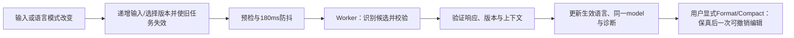

# Design

## Context

动机、初始五项范围与后续接受的界面修正见 `proposal.md`；可观察行为由本变更的三份 delta 定义。本设计必要，因为改动横跨插件 UI、Worker 协议、Monaco 资源和 macOS 通用原生事件路径。

当前证据：

| 位置 | 已观察到的行为及影响 |
| --- | --- |
| `plugins/config-lens/src/ConfigLensPage.tsx` | 默认 `json`，只支持手选；Footer 渲染空／有效／处理中状态；页面只显式处理 `Ctrl/Cmd+Enter`。 |
| `plugins/config-lens/src/editor/monaco.ts` | 仅加载 `editor.api.js` 并注册四种 language ID；依赖及现有产物中有核心全选命令，但没有 Find contribution 或语言 tokenizer。 |
| Monaco `0.56.0` 包内语言资源 | JSON 有 tokenization support，YAML／XML 有 Monarch definitions；没有 TOML definition。JSON 完整 language service 同时带入其他 providers，不能把它当作仅着色入口。 |
| `language/controller.ts`、`engine.ts`、`protocol.ts`、`limits.ts` | 已有 180ms 防抖、代次失效、Worker 终止、2 MiB／100,000 行预检、五秒截止和类型校验；当前协议要求确定语言，不能表达自动未识别。 |
| `vendor/frame-aware-navigation/wry/src/wkwebview/class/wry_web_view.rs` | Child 的 `performKeyEquivalent` 无条件返回 `NO`；注释说明其避免吞菜单键的代价是 Web 页面无法监听 `Cmd+key`。Cargo patch 和 `add_child` 链路确认当前产品使用该代码。 |
| `src-tauri/src/launcher_window.rs` | 原生 Edit 菜单已包含全选等操作；本地 monitor 仅处理前台 `Cmd+W/Q`。不能把问题归因为缺少 Edit 菜单。 |
| Monaco Find 的 `findWidget`、`findInputToggles` 和 `nls` 模块 | 原生面板的多处文案在模块求值时固化；切换全局 NLS 表或重建 editor view 都不能重新计算缓存常量。 |
| `plugins/config-lens/tests/ConfigLensPage.test.tsx` | 页面用 textarea test double 验证流程，不能证明实际 Monaco 搜索、tokenizer 或原生快捷键已接入。 |

上述是源码、已安装依赖及本地产物证据，不是用户运行实例的事件实测。现有规格明确要求手选、Footer 状态和高亮，分别对应需要修改的产品契约与需要补齐的实现缺口。

## Goals / Non-Goals

**Goals:**

- 用一个清晰的语言状态模型驱动选择器、同一 Monaco model、校验和显式操作。
- 将通用原生键盘交付与插件具体编辑命令分开；Host 只决定合法原生目标，Monaco 决定编辑语义。
- 利用已有依赖和包内资源完成原生搜索及四语言高亮，保持输入保真、资源预算和确定性验证。
- 消除 Footer 状态区域，同时保留可访问反馈和错误恢复。

**Non-Goals:**

- 不授予插件原生 API，不增加全局编辑快捷键或官方插件专属分支。
- 不更换编辑器、升级依赖、引入语言检测服务、LSP 或补全系统。
- 不新增配置文件、搜索历史或语言偏好的持久化，不自动重载页面来更新文案。
- 不维护新的浏览器、真实 WebView、GUI、截图、原生交互或性能验证路径。

## Decisions

### 1. 用选择模式和生效语言两个维度表达自动识别

页面选择状态使用区分联合：`auto` 或 `manual(language)`；另存 `effectiveLanguage: LanguageId | undefined`、输入版本、选择版本和当前分析状态。Monaco 显示语言从生效语言映射，`undefined` 对应 `plaintext`；不把 `auto` 伪装成一种可格式化语言传给 adapter。

| 事件 | 模式／生效语言 | 行为 |
| --- | --- | --- |
| 新 document | auto／undefined | 选择器显示本地化 Auto／自动，纯文本，禁止变换。 |
| 自动模式出现明确结构 | auto／识别结果 | 更新同一 model 的语言和诊断，不修改正文。 |
| 自动模式非空编辑暂时不明确 | auto／最后自动生效语言 | 保持语言并校验，避免正在输入时跳来跳去。 |
| 自动模式内容清空 | auto／undefined | 取消分析和诊断，不显示空提示。 |
| 手选某语言 | manual／选定语言 | 立即失效旧检测，锁定语言并重新校验。 |
| 手动模式修改或清空 | manual／原语言 | 不自动解锁。 |
| 从手动重新选择自动 | auto／undefined，重新分析 | 不把上一次手选当作检测证据。 |
| 仅隐藏／恢复 | 原状态 | 保留同一模型、模式、查询和撤销历史。 |
| 真正关闭后重开 | auto／undefined | 按原有临时内容契约重新开始。 |

选择器标签独立于内部生效语言：自动模式在空、pending、resolved 和 unresolved 状态均只显示 `Auto`／`自动`。手选项只显示 `JSON`、`YAML`、`TOML`、`XML`，不带版本；parser 仍按 JSON、YAML 1.2、TOML 1.0 和 XML 1.0 合同运行。选择器首选宽度为 120px，`min-width: 72px`、`max-width: 120px`、`flex: 0 1 120px`；替代原先扩展至 240px 的布局，窄布局允许收缩，不再扩展填满整行。保持原有键盘、焦点和 40/72px 响应式 Footer 高度。

输入一变即将旧分析标为过期；180ms 防抖期间可以保留旧高亮，但格式化不得使用尚未确认的输入版本。分析未识别与语法无效分开表达：前者没有可靠语言，后者可以有明确语言和可定位的语法错误。

备选“每次解析成功就自动切换”会把 XML／TOML 和残缺 JSON 错判为 YAML；备选“仍默认 JSON 加一次识别按钮”与已确认的默认自动不符，均不采用。

### 2. 在现有 Worker 内合并识别与校验

新增插件私有的 `analyze` 请求分支，携带 `requestId`、输入／选择版本、模式、当前 source 和允许的历史自动生效语言。响应显式区分 `resolved`、`unresolved`、`failed`，resolved 才能携带支持的 `effectiveLanguage`，并独立携带校验状态和安全诊断。Format／Compact 请求仍要求确定的支持语言，继续使用现有 adapters 和保真检查。

这些字段属于内部协议，不扩展公共 SDK。请求和响应验证器要同步覆盖 enum、版本、可选字段组合、位置边界和未知语言；测试验证真实协议，不只给测试 double 增加属性。

识别按有界、确定性规则生成候选，再调用已有解析器确认结构和生成诊断：

1. XML declaration、元素、注释、DOCTYPE 等明确 XML 开头选 XML；不支持的外部扩展构造仍走现有拒绝规则。
2. 严格 JSON 对象／数组优先 JSON，避免与 YAML 重叠；单个 JSON 标量不作为首次自动识别依据。
3. TOML 赋值、合法表名／数组表等强特征选 TOML；例如 `[server]` 不按失败的 JSON 数组降级为 YAML。
4. 带双引号键的 JSON 对象或明确 JSON 数组前缀即使残缺，也保留 JSON 候选；`{"a": 1,}` 不切成 YAML。
5. YAML 映射、序列、指令、文档边界或其结构化解析结果可选 YAML。普通字符串、孤立标量和普通注释本身不够；合法 YAML flow collection 与 JSON 前缀必须有冲突样例。
6. 无可靠新候选时沿用最后自动生效语言，首次则 unresolved。格式正确与否不反向覆盖明确的结构判断。

这不是对任意文本意图的证明；歧义由可见手选解决。规则顺序和关键歧义作为 fixtures 固化，而不是以依赖返回的第一个成功结果决定。

整次分析复用 2 MiB／100,000 行预检、五秒总截止和 200 诊断上限。候选不能各自获得五秒，也不能在页面依次调用四次现有 `run`，因为它会取消上一个请求。按候选延迟加载 adapter，共享一次请求生命周期，输入不进入日志、网络或存储。

内容、模式、生效语言、Runtime 上下文或操作版本变化均拒绝迟到结果。Locale／theme 更新不解锁手选；若使在途分析失效，应对当前输入重新安排分析，避免永久保留“处理中”。Compact 只在当前版本通过严格 JSON 校验后启用，按钮和快捷键共享可执行性判断。

### 3. 按需加载高亮，不引入第二套校验和格式化

在现有单次 Monaco loader 内完成语言资源注册，先注册后创建 model；异步切换需检查当前语言／生命周期，避免旧加载结果覆盖新选择。

- JSON：复用当前包的 `languages/features/json/tokenization`，用公开 token provider 接口接入。无需启用完整 JSON service 的诊断、格式化、schema 请求或 JSON Worker。
- YAML、XML：复用 `languages/definitions` 的配置和 Monarch 规则，通过公开语言注册接口安装。
- TOML：在插件 `editor/` 下维护轻量 Monarch 定义和语言配置，覆盖裸键／引用键、表／数组表、单双／多行字符串、数字／布尔、日期时间和注释。多行 token state 必须有真实输入测试。
- 高亮处理不完整内容，不决定格式是否合法。所有严格语法、安全和保真判断仍由既有语言 Worker 负责。

按锁定版本隔离依赖内导入；不得复制一整套第三方解析器或通过 CDN 加载。全量 `editor.main` 或完整语言服务虽然省配置，却会无意带入其他功能和 Worker，增加预算及行为冲突，因此不采用。

### 4. 使用原生 Find contribution，并明确本地化生命周期

用户已确认采用 Monaco 原生搜索面板，原生面板文案在实际关闭并重开 ConfigLens 后采用新的应用界面语言；这里的 locale 与 JSON／XML 等配置语言无关。

每个 document 在首次有效 Runtime Context 到达时锁定 `editorLocale`，在导入 Monaco API、Find 和原生菜单 contributions 前载入包内相应 NLS。英语使用默认消息，简体中文使用当前包内消息。`main.tsx` 的预加载与 `MonacoSurface` 的初始化共同向 loader 传递这一初始上下文，避免无 locale 的提前 import。此初始化与 `loadMonaco` 保持 single-flight，SDK 重试不通过重复 import 假装刷新已求值的常量。Host 后续 locale 更新仍即时更新 ConfigLens catalog、Select、按钮与诊断消息，但不重建页面/model 来刷新原生文案；theme 则立即使用现有 Monaco 主题机制更新。NLS 生命周期覆盖原生搜索、菜单及诊断交互框架的文案，不能把后者误写为即时切换；ConfigLens 提供的具体诊断消息仍即时更新。

加载锁定版本的 Find、所需菜单及编辑器诊断交互 contributions，并在真实编辑器创建前完成注册。`Cmd/Ctrl+F` 通过 `actions.find` 打开原生 widget，移除底部 Search 按钮及其页面回调接线；加入可见全选菜单入口，复用核心 `editor.action.selectAll`，不在整个 document 绑定抢占所有输入的全选 handler。

原生 Find 图标使用 Monaco 包内 Codicon 字体。原产物已有字体和图标样式，但字体 URL 相对于嵌套 CSS 解析错误，且 Host 静态资源 MIME 不支持该 TTF。插件构建采用 CSS extract loader 的 `publicPath: 'auto'`，使资源 URL 相对于其样式表解析到包内独立字体文件；纯 Node 产物检查验证该路径和字体字节与锁定 Monaco 包一致。

Host 固定 MIME 表仅补齐 `ttf => font/ttf`，大小写扩展名共用现有 ASCII case-insensitive 规则。GET／HEAD 使用相同 scope、路径、生命周期、长度和安全响应头验证；GET 返回原字节，HEAD 无正文。此补充适用于所有符合既有资源契约的插件，不新增权限、不放宽 CSP，也不更改资源授权。

已验证但不采用字体 data URL 内嵌：140,956-byte Codicon TTF 使产物 CSS 增至 1,118,946 bytes，超过既有 1,048,576-byte 样式表预算。保持原预算与无关 CSS，不以压缩或移除其他样式回避资源交付问题。

保留原生面板的查询、前后定位、大小写／整词／正则选项和匹配上限，不另做一套搜索算法或替换 UI。原生面板附带的显式替换属于普通编辑器编辑：如用户使用，应走同一个 model 的内容变更、撤销和分析失效路径；查找本身不能改正文，不新增独立替换入口或格式化链路。搜索输入获得焦点时全选只作用于查询；Escape 先关闭 widget 并回到编辑器，不关闭插件 Page。

Find 布局修复限定在 `plugins/config-lens/src/styles.less`：`.config-lens-editor .monaco-editor .find-widget` 使用 `margin-top: 0`，使 widget 与 Monaco 原生顶部占位一致；其 `.button:not(.toggle)` 恢复 `box-sizing: content-box`，保持原生按钮的垂直对齐。打开 Find 或展开 Replace 后，编辑器滚到顶部时首行不被遮挡，关闭 widget 时由 Monaco 释放占位。保留 `find.addExtraSpaceOnTop` 的默认 `true`、现有 editor padding、共享 Plugin UI reset、Monaco 版本与 Host；不把局部修复扩散到其他插件。

显式保持 `find.globalFindClipboard: false`，保留 standalone 的内存 storage 服务，不将查询或选区写入系统共享 Find clipboard、浏览器存储或 Host API。卸载时释放 widget、动作订阅和 model，所有资源仍随包交付。

已评估但不采用：

- 只补 `Cmd+F` DOM handler：不能补回缺失 contribution，也不能修复原生未投递事件。
- 切 NLS 全局表后重建 view：模块常量缓存使文案仍旧，不能兑现动态本地化。
- 自建 Semi 查找面板：可支持即时文案更新，但用户选择原生面板。
- 双 Monaco 实例图、内部 DOM 翻译或自动 reload：维护成本、包大小或内容生命周期代价超出目标。

### 5. Footer 删除状态，错误和忙碌仍有明确归属

从 `ConfigLensPage.tsx` 和 `styles.less` 删除状态节点、专用样式和布局占位；语言左侧、操作右侧的弹性布局保持。Select 在自动模式下只显示 `Auto`／`自动`，识别结果只参与内部语言状态，不以原状态区的新文字代替删除。

Format 使用现有 Button 的 `loading`／`disabled`，页面或操作组提供 `aria-busy`；错误仍转为 model markers 和编辑器内可访问反馈。Worker 失败、超限和不支持但无精确位置时，映射到 model 起始有效范围并使用安全消息键，不能静默失败或恢复 Footer 摘要。无错误的普通未知文本保持内部未识别与纯文本状态，选择器仍显示 `Auto`／`自动`，不人为添加语法错误。

Footer 仅包含语言选择器、Format 和 Compact，不再提供 Search 按钮。空输入和语言未识别时仍可通过 `Cmd/Ctrl+F` 打开搜索。正常 40px、受限 72px Footer 通过现有响应式条件保持，搜索 widget 限于 content 内部，不新增第三个顶层区域。沿用 Semi 支持的主题、LocaleProvider 与英文／简体中文 catalog；不引入新组件库。

### 6. 通用原生策略只向有效聚焦 Child 委托

在受审查的 Wry macOS 补丁中提取可单测的 key-equivalent 决策／调用策略，由生产 Objective-C 适配器采集原生窗口、可见性、first responder 及其对该 Child 的归属。归属来自真实 native view 层级，不来自插件消息、DOM 选择器或 Monaco 类型；无法确认时不接管。

非 Child 保持 superclass 行为；Child 仅在仍属于窗口、可见且包含当前有效 first responder 时，将原事件委托 WKWebView 一次，并原样返回处理结果。隐藏／销毁的当前性继续由既有 compare-current 生命周期保证，不为按键增加第二个插件注册表或强行聚焦行为。未处理事件遵循原生传播；无效、未聚焦 sibling 不调用 superclass 抢键。

Host 的前台本地 `Cmd+W/Q` monitor 保持权威，原事件消费一次后不能再进入插件。测试需同时覆盖生产 monitor 与 Child 策略组合，保留当前 `launcher-window-lifecycle` 的 Hide、Quit、前台隔离和恢复条件。普通 `A/F/C/X/V/Z/Shift+Z/Enter` 不由 Host 按命令白名单解释。

不采用给所有 Child 无条件调用 superclass 的简单删除方案：上游 workaround 正是因 Child 可能吞掉菜单键而存在，必须加入原生焦点归属约束。也不通过 Rust `eval` 合成 DOM 键盘事件，不增加 SDK／权限或 ConfigLens 私有 bridge。

### 7. Vendor 更新沿用受审查完整性流程

保持现有 Tauri/Wry/Tao 版本和 Cargo patch 链路。实施时将实际修改的 Wry 文件与新生产策略 helper 加入 `scripts/frame-aware-navigation-dependency-drift.ts` 的 reviewed paths，更新 `vendor/frame-aware-navigation/README.md` 的补丁范围和上游替代退出条件。

根 Cargo formatting 不覆盖完整 vendored crate；现有 dependency Gate 的定制格式范围只有 Tao，必须在该 Gate 中补上本次 Wry 文件的匹配格式检查。生产纯 Rust 策略通过现有 `rustc --test` 模式执行，fake adapter 记录调用和返回值；根 Rstest 覆盖接线、registry 和边界；Cargo check/build 验证真实 Objective-C 适配器编译。

审阅同版本 upstream diff 后，实施阶段显式运行 `pnpm run generate -- frame-aware-navigation-dependency-drift --write` 更新完整性基线。只读 Gate 不得顺便刷新基线。本提案阶段不执行任何生成或 vendor 写入。

### 8. 验证覆盖实际接入，保持确定性边界

| 层面 | 证据 |
| --- | --- |
| 检测与协议 | 真实四语言 fixtures、歧义／残缺／空白、手选锁定、清空差异、请求预算、错形响应及迟到结果竞态。 |
| Monaco | 在支持的 DOM 模型环境中检查实际已注册动作和 tokenizer；核心全选、搜索焦点／关闭、语言切换与 model/undo 保留。不能仅用 textarea double 证明模块存在。 |
| 本地化与布局 | 两个独立模块初始化上下文分别验证 en-US／zh-CN 原生文案；运行中替换验证外层即时更新、原生文案保留、theme 即时更新；样式和产物验证固定 Footer、无状态占位、ConfigLens 局部 Find 对齐与原生顶部占位的打开／展开／关闭生命周期。 |
| 原生 | 生产策略 fake responder 决策、调用次数、修饰键、返回值、无焦点／隐藏／替换／Host 焦点及 W/Q；接线、锁定依赖和 macOS 编译。 |
| 构建／包 | 真实模块图有 Find、三语言资源和 TOML tokenizer，而非仅有四个字符串；保持本地 Workers、无远程入口、无第二解析链路及既有 bootstrap／包预算。 |
| 资源服务 | 固定 MIME 表提供 `.ttf`／`.TTF` 的 `font/ttf`；GET／HEAD 字节、长度、安全响应头和 scope／路径／生命周期约束保持一致。 |

复用现有稳定 Gate：`ci-plugins` 覆盖插件生命周期和纯 Node 产物检查；`plugin-resource-service` 覆盖 MIME、GET／HEAD 及资源边界；`plugin-child-webview-runtime` 与 `plugin-child-webview-window-lifecycle` 覆盖通用 Runtime；`launcher-input-focus` 回归响应器行为；`frame-aware-webview-navigation-policy` 和 `frame-aware-navigation-dependency-drift` 覆盖隔离与 vendor。所有聚焦 Gate 证据与完整前端／Rust／CI 最终验证分开记录，根脚本保持不变。

## Risks / Trade-offs

- [语法重叠或编辑中误判] → 明确结构优先、严格 JSON 容器优先、无证据不首选 YAML、保留最后自动语言并提供手选锁定；不宣称任意文本识别准确。
- [迟到检测覆盖用户选择] → 输入／选择／操作版本及 Runtime 上下文共同校验，变更即失效，格式操作拒绝使用未结算的新输入。
- [原生 Child 抢走 Host 或其他视图按键] → 只依据原生 responder 归属委托，保留 W/Q 单次路径和无效目标不操作的负例。
- [原生搜索文案暂时与外层 locale 不同] → 这是用户确认的有限例外，文档明确重开后更新；不自动重载导致数据丢失。配置语言与主题仍即时更新。
- [依赖内部 tokenizer／NLS／contribution 路径变动] → 保持锁定版本、集中在 loader/adapter、以真实模块导入和产物闭包测试阻止静默漂移。
- [搜索和语言资源放大初始图] → Context 后延迟加载，保持初始 JS 256 KiB／CSS 64 KiB、总 dist 24 MiB、JS 与压缩包各 8 MiB、单 chunk 4 MiB、Worker entry 2 MiB 既有预算；不放宽预算绕过失败。
- [确定性测试无法证明真实 AppKit 事件投递] → 明确报告其限于策略、接线、依赖、组件和编译证据，不恢复被移除的原生环境验收设施。

## Migration Plan

没有用户数据或公共 API 迁移。先实现并验证通用原生策略，再接入插件语言状态、资源和 UI；两侧分别通过聚焦检查后做完整交叉回归。只升级 ConfigLens 包可改善高亮／识别／原生搜索面板，但不能宣称修复旧 Host 的原生快捷键；原生图标字体还要求 Host 包含 TrueType MIME 支持，插件与 Host 均需更新。最终交付说明应区分 Host 与插件版本责任。

实施时同步英文 canonical 文档及同路径中文镜像，记录原生文案重开更新、未知语言处理、内存状态和验证限制。接受后的 delta 在归档前翻译／协调进入英文 stable specs，再完成审计和验证；本阶段不修改 stable specs。

回滚按 Host 补丁及其审阅基线、ConfigLens 包分别恢复一致版本，保持现有安装／替换语义。回滚不得恢复已关闭的用户正文、自动改写内容或绕开通用 Runtime；本任务不执行发布、安装、归档、提交或推送。
