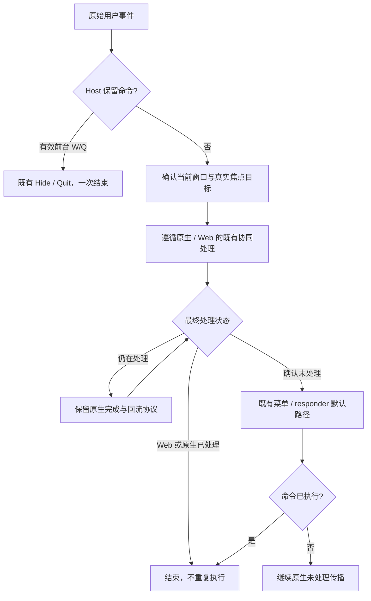

# Design

## Context

动机与范围见 [proposal.md](proposal.md)。本 Change 在 `5acdd00` 的干净工作区上创建；上一轮 ConfigLens 变更已归档。下表是提案阶段重新核对的事实，不是本次修复结果。

| 证据 | 已确认事实 | 结论边界 |
| --- | --- | --- |
| 用户反馈 | Host 搜索框 `Cmd+A/C/V` 失效；Monaco 正文与 Find 输入框 `Cmd+C/V` 失效；Find 右键复制粘贴可用 | 指向共同的快捷键／原生编辑衔接，尚不能确定具体失败分支；普通外部插件是待覆盖对象，未假定已复现。 |
| `src/App.tsx` 的 `handleInputKeyDown`、`handleInputPaste` | A/C/V 未被 React `preventDefault`；paste handler 仅清理输入法旧状态 | 不证明原生事件已到达，也不排除其他组合键的独立前端行为。 |
| `src-tauri/src/macos_launcher.rs` | 保持 Accessory，无普通应用菜单栏／Dock | 没有可见菜单栏不等于没有内部菜单，也不能单独证明故障原因。 |
| `src-tauri/src/launcher_window.rs` | 已创建 Undo/Redo/Cut/Copy/Paste/Select All；本地 monitor 只补偿 W/Q，注释记录隐藏菜单 accelerator 不可靠 | 菜单已注册不等于实际匹配、目标验证和 action 已执行；历史注释不是本次断点报告。 |
| `vendor/frame-aware-navigation/wry/src/wkwebview/class/{key_equivalent,wry_web_view}.rs` | Child 资格检查后统一调用 superclass，生产代码无 A/F/C/V 或插件白名单 | 同步 BOOL 和一次调用不证明编辑动作完成。 |
| `plugins/config-lens/src/editor/` 与锁定 Monaco | 原生 copy/paste 通过 `ClipboardEvent.clipboardData`；内存 clipboard service 是另一条服务／fallback 路径 | 不为试错移除内存适配或扩大剪贴板权限；少导入 clipboard contribution 不是标准键盘路径失效的充分解释。 |
| `tests/launcher-input-focus-ui.test.tsx`、vendor policy 与 Monaco 测试 | Host paste 用例直接派发 paste 后再 change；原生策略用 fake superclass；Monaco 覆盖 F/A 与搜索但缺 C/V 默认动作闭环 | 这些历史通过结果不能作为真实 AppKit／系统剪贴板往返的证明。 |

提案时本机信息为 macOS `27.0.1`、系统 WebKit `22625.1.29.11.28`；锁文件为 Tauri `2.11.5`、Wry `0.55.1`、Tao `0.35.3`、muda `0.19.3`，Monaco 为 `0.56.0`。实施诊断必须重新记录所运行二进制和依赖身份，不能把今天的磁盘版本当作后来运行版本。

[WebKit 固定提交的事件回流实现](https://github.com/WebKit/WebKit/blob/c2c1343a292141aa20c260463e8cbb95042c544a/Source/WebKit/UIProcess/mac/WebViewImpl.mm#L5188)提供机制参考：WebView 可以先接管事件并返回 YES，等待 WebProcess 结果，再把未处理事件回送 AppKit。该提交尚未与本机系统 WebKit 构建建立对应关系；不得据它宣称目标版本的断点已确认。

## Goals / Non-Goals

**Goals:**

- 用一套平台交付语义覆盖 Host 和任意当前 Child，目标始终来自真实 native first responder，不来自插件身份、Monaco 类型或 DOM selector。
- 区分 Web 自定义命令已处理、原生默认编辑动作已执行、未处理和异步仍在处理；一次用户操作只有一次编辑结果。
- 把具体断点及其因果证据作为修改生产路由的阻断前置条件，避免再用局部修补推断整条链已恢复。
- 保留 Accessory、W/Q、唤起、输入法、焦点、生命周期和现有隔离／权限边界。

**Non-Goals:**

- 不建立 A/C/X/V/Z 的新 key-code 分发表，不复制各编辑器业务命令，不为某个插件注入脚本／快捷键 handler。
- 不新增 Host／SDK clipboard API、任意 responder selector 接口、原生 handle、通用 Tauri 能力或后台剪贴板读取。
- 不新增常驻 tracing、遥测、用户正文／剪贴板日志，不重开已退役的 GUI／browser／native harness 验证路线。
- 不改应用可见性政策、依赖版本、ConfigLens UI 或格式化／识别功能；本阶段不进行实现。

## Decisions

### 实施诊断与最小修复顺序（2026-10-21）

用户已授权当前源码构建与一次临时 LLDB 排障。目标进程加载的 WebKit UUID 为 `70BEE322-37EE-3B22-8012-4F76BA105C29`；详细身份、人工复现和证据限制见 [tasks.md](tasks.md)。实测 Host Cmd+A 与 ConfigLens 正文／Find Cmd+C 都经历：有效原生焦点接管事件、收集 `noop:`、输入法未消费、WebKit 将保存的命令交回响应链、Tao 的空 `doCommandBySelector` 截断命令，随后 WebKit 报告 handled=true。另对 Host 的真实 DOM keydown 确认未取消默认行为、未组合输入，但选区与编辑事件均未变化；本轮没有把相同 DOM 观测施用于 ConfigLens。此前“缺少 Child 父视图菜单回退”的静态候选不足以单独解释故障；更早的响应链假消费已得到直接证据。

最终生产修复限于同版本 Tao macOS 父视图：当当前 native first responder 为该父视图的有效、同窗、可见后代时，把原 selector 交给 NSView superclass 正常传播。保留 TaoView 自身持有焦点时的 raw-input 行为，不按 `noop:`、编辑器、插件或按键挑选例外。通过生产纯策略提取及原生适配接线测试证明此边界，先运行旧行为的失败用例，再实现修复。

修后实际轨迹确认 saved-command=false、final=false、同一原事件合法回流、WebKit 回流分支返回 false，随后既有 Host mainMenu 匹配并执行一次 Select All action。用户在移除 LLDB 后确认快捷键恢复、诊断期间的卡顿消失。因此无需第二处菜单修复：Tao `keyDown` 保持原样，不增加菜单调用、完成回调、事件队列、私有 WebKit hook、延迟目标缓存或重放。最终共享边界是正常 selector 传播，不是新的编辑命令分派器。

普通外部控件与 ConfigLens 使用同一 `WindowChild`、Wry 资格检查和 Tao 父视图路径；此比较是源码／接线事实，并非普通外部控件的现场验收。外部标准控件和 Monaco DOM 结果继续由第 3 组独立验证，现场恢复状态另行记录。原生诊断中对私有 WebKit 符号的观测只用于确认目标版本机制，不进入产品实现或维护验证。

### 1. 先定位可证实的断点，再冻结生产修改位置

以下是明确的前置调查，不是泛化的“继续探索代码”任务。实施开始后必须在本 Change 的任务证据中完成一份断点记录，至少包含：

1. **身份与入口**：受影响 Host 二进制、目标 macOS/WebKit、Cargo patch/锁定依赖；分别列出主 WebView 与 `add_child` 的原生事件入口及当前 first responder 归属。
2. **事件轨迹**：应用保留键是否消费；WebView 是否接管；何时才能知道 Web 是否处理／取消默认行为；未处理事件是否回流；原生菜单是否匹配且可执行；action 是否投递到正确 responder；对应 Web 编辑事件是否发生。
3. **失败分类**：区分菜单从未参与、item 验证失败、responder 丢失／错误、Web 主动消费、事件已接管但尚未完成、默认编辑事件缺失或编辑结果失败。报告必须明确停止在哪一条边，且说明最接近的竞争解释为何不成立。
4. **对照**：至少比较普通 Host Input、普通外部插件编辑目标、Monaco 正文／Find；结合已确认的右键可用现象，比较标准编辑与页面自定义快捷键，不假设所有表面一定有同一细节故障。
5. **可回归原因**：把已确认的策略缺陷提炼为会在旧生产策略上失败的确定性用例；独立列明原生观察、源代码推导和模拟结果各自支持什么，不用自设成功返回值填补原生证据。

证据优先来自已取得的用户反馈、现有运行诊断、当前适配源码及与目标版本有对应关系的原生机制说明。本次提案不运行应用或注入诊断。后续若现有证据不足，应准确记录缺少哪个观察并保持前置任务未完成；确需额外的一次性运行排障时，先确认其符合用户授权和项目规则，不把它添加为维护脚本、Gate、CI 或兼容 harness，也不以本提案自动授权。不得因“测试全绿”跳过这一门槛。

调查记录仅保留最小必要的阶段、事件关联与布尔结果，不记录正文、剪贴板内容、用户输入字符、绝对用户文件路径、秘密或跨会话稳定标识。若需记录测试组合键，使用明确的合成测试输入。不得为了观测读取系统剪贴板。

本设计确定共享所有权、分派语义与验收结果，不预定未经证实的 hook。若无法用当前公开原生接口实现这些约束，或诊断证明需要改变上述范围，必须先修订设计和任务；不能将猜测直接写入生产路由。

### 2. 标准编辑属于 Host 平台，业务命令属于页面

标准编辑沿当前系统菜单／responder 语义工作，包括现有菜单中的 Select All、Copy、Cut、Paste、Undo、Redo。`Cmd+A/C/X/V/Z/Shift+Z` 是当前 macOS 键盘布局下的回归样本；生产实现应使用原生事件修饰键、菜单 accelerator 和 action 定义，不另外保存一套字母或物理 key code 到编辑命令的映射。

Host Input、普通外部插件的 `input`／`textarea`／`contenteditable`、Monaco 正文和 Find 都必须获得该交付能力。控件选择范围、只读／禁用、空选区、空剪贴板、空撤销栈等继续采用其自身合法语义；例如 Monaco 的空选区复制策略不应被 Host 改成普通 input 的行为。查找框和正文分别编辑自己的目标。

插件自己的查找、格式化或快捷键仍由正常 Web 事件／编辑器命令实现。平台不要求插件修改 Host、重打包既有合规插件或增加权限；也不承诺把一个从未实现业务命令的任意 canvas 变成编辑器。普通原生编辑与主动程序化系统剪贴板 API 是不同的权限边界。

### 3. 保持原生与 Web 的协同和一次执行语义

以下图示描述语义，不是声明 AppKit 的具体回调顺序：

- 不能把 `WKWebView.performKeyEquivalent` 的同步 YES 当作 Web 最终消费的证据；也不能在调用 superclass 后立即无条件再跑菜单。
- 页面已经处理或取消默认行为的非保留命令，不得再次触发系统默认编辑；标准菜单已经执行的事件不得再投递一次页面编辑。合法的 WebKit 事件回流不等于新的用户操作。
- 未处理或无可用命令时沿原生约定传播，不通过广播、伪造 keydown、强行聚焦或退回 Host 搜索框执行。
- 涉及延迟／回流时，重新验证窗口、实际焦点与 Child 当前性；页面已关闭、替换、隐藏或脱离窗口时，旧目标不能执行或恢复焦点。新增延迟补偿必须关联原事件最初的窗口、焦点目标与 Child 代次，等待期间身份或焦点变化时取消该补偿，不将旧事件改投新焦点；此约束针对新增补偿，WebKit 自身合法回流仍遵循其既有机制。不能长久保存裸 responder 指针，也不能让插件声明焦点以获得处理权。
- W/Q 的前台 Hide/Quit 仍只有一条权威路径；全局唤起键、其他前台应用及已有窗口恢复策略不变。

### 4. 候选选择顺序与排除方案

**首选**是修复现有菜单／原生 responder 共同配置或正常分派中的已证实缺口，使主 WebView 与 Child 自动受益；保留已有框架语义，尽量不增加新的接管状态。

**条件候选**是在明确可观察到“未处理”且具有正确回流语义的共享边界复用现有菜单分派，例如 `NSMenu.performKeyEquivalent`。它可以使用当前菜单定义匹配并执行原生 action，但必须先证明调用时机、适用目标、item validation、重入防护以及它和正常菜单路径之间的去重方式。不得默认在全局 local monitor 中先对所有 Command 调用它。

两者都必须满足前一节语义。生产分支如确需纯策略提取，测试调用的应是生产策略，适配层负责真实 AppKit 状态；不写一个只在测试里成立的平行分派器。

不采用：逐键扩展 `route_macos_local_key` 来模拟全部编辑；ConfigLens／插件 ID 分支；给每个插件加 JS 剪贴板 handler；恢复一个会在普通手势中预先写剪贴板的服务来碰运气；合成 DOM 按键；扩大 Host 权限；改为 Regular 显示菜单；未证实必要性就升级框架。现有 W/Q 保留命令例外不扩散为编辑白名单。

### 5. 与稳定规格及现有文档的协调

`launcher-window-lifecycle` 继续拥有 Accessory 与应用级命令，本次增加标准编辑交付要求。`plugin-child-webview-runtime` 继续拥有 Child 资格／隔离，补足编辑结果、页面自定义处理及验证分层；其中现有“non-Child behavior unchanged”需明确为保留非编辑业务与隔离语义，允许对 Host 和 Child 共同修复标准编辑交付，不能把它解读为禁止修 Host 搜索框。

`official-config-lens-plugin` 的原生 Web 编辑与无新增剪贴板权限约束保持，Monaco 仅是验证目标。本次不创建近似重复 capability，也不把多个 Runtime 实例的编辑状态集中到 Host。必要的内部 payload／结果使用有界、明确的类型；不新增跨 SDK／Host API 的命令通道。测试覆盖英文／中文、明／暗模式，原则上不引入产品文案；任何新增可见错误必须双语并使用现有 i18n。

### 6. 分层验证与完成标准

| 层 | 需要证明 | 不足以证明 |
| --- | --- | --- |
| 断点调查 | 对应版本的真实故障阶段、处理时序、合法修复位置 | 用户症状或孤立的 superclass BOOL 不是唯一根因。 |
| Rust 生产策略 | 当前目标、已处理／未处理／待完成、菜单与 Web 次数、回流防重复、W/Q、失效目标 | fake responder 不证明 AppKit 实际调用或系统剪贴板完成。 |
| 原生接线与构建 | 所选共享路径确实接入主／Child；受审查依赖与 macOS 编译有效 | 字符串包含或编译成功不代表运行交付正常。 |
| Host／外部 Web 控件 | 普通组合键未被业务 handler 错误阻止；编辑事件与焦点按控件规则处理 | Happy DOM 不会执行浏览器默认剪贴板／撤销；人为 change 不能伪装 Cmd+V。 |
| Monaco | 实际编辑器 copy/cut/paste 事件处理器使用测试 DataTransfer，选择／插入／删除／撤销及 Find 目标正确 | service 内存自写自读不能代表跨应用剪贴板，合成 ClipboardEvent 不代表原生投递。 |
| 用户实际现象 | 与调查中的受影响构建分别记录恢复／未恢复／尚未复核 | 全套确定性检查不能自动改写为真实原生验收。 |

普通外部插件 fixture 使用测试自有、无特权的标准 HTML 控件，覆盖公开 Runtime 的普通身份和生命周期；不要为验证把测试页面植入生产 Host。根 Rstest discovery 是 `tests/**/*.test.{ts,tsx}`，Monaco 沿用插件 tests；新用例无需新增根脚本。模拟编辑命令时只证明策略／handler 语义，不称之为 DOM 默认动作。

聚焦检查使用现有 `launcher-input-focus`、`plugin-child-webview-runtime`、`plugin-child-webview-window-lifecycle`、`frame-aware-webview-navigation-policy`、`frame-aware-navigation-dependency-drift` 与 `validation-governance`。完整验证单独执行 workspace test／typecheck／check／build、Rust format／test／check／build、`ci-lensx` 与 `ci-plugins`。本 Change 不新增 browser、真实 WebView、GUI、native harness、截图、性能或其手动兼容 Gate；生产诊断的事实与维护中的确定性验证分别记录。

### 7. 仅在需要时修改 vendor

先按断点报告确定 Host 修正是否足够。若必须调整 Tao/Wry：审阅当前相同版本上游差异，更新既有 reviewed paths、匹配的 rustfmt／纯策略测试覆盖与 vendor 所有者说明，然后在实施授权内显式执行 `pnpm run generate -- frame-aware-navigation-dependency-drift --write`；只读 Gate 不更新基线。若 vendor 未改，明确记录“不适用”及依据，不为了任务勾选而重写基线。

## Risks / Trade-offs

- [把异步接管误作处理完成] → 先确认目标版本的完成／回流协议；禁止 super 后立即补发。
- [抢先运行菜单破坏 Monaco 撤销或插件自定义命令] → 保留 Web 消费与原生默认动作的协同，覆盖 preventDefault、未处理和重复路径。
- [将焦点或旧 Child 当作缓存路由] → 在每次实际分派时核实 native ownership 与当前性，不复活旧页面或窃取焦点。
- [测试替身再次产生虚假完成结论] → 断点、生产策略、真实 handler、构建和用户反馈分别列证据；无法确认时保持前置／完成状态未通过。
- [为确认断点引入被禁止的验证设施或敏感日志] → 不新增环境 Gate/harness，不记录正文或剪贴板；证据不足时报告具体缺口而非扩张权限。
- [统一修复影响 Host 保留命令或其他平台] → W/Q 与唤起单独回归；修改限 macOS 路径，其他平台只证明未受源码／配置影响，不宣称未执行的平台验收。

## Migration Plan

没有用户数据、Manifest、SDK 或 Host API 迁移。按“断点记录 → 方案复核 → 共享实现 → 三类目标的分层回归 → 文档／stable specs 同步 → 治理审计”执行。新 Host 交付后，正常使用公开 Web 能力的既有外部插件直接受益；旧 Host 仍保留原缺陷，不能用仅更新 ConfigLens 替代 Host 更新。

回滚只恢复本次原生分派修改及其配套测试／文档／必要 vendor 基线的一致版本，保留先前 ConfigLens 功能和 Child 隔离。回滚不恢复用户剪贴板或已关闭页面状态，不改变激活政策。本提案不执行发布、安装、归档或 Git 操作；规划齐备只表示可审阅，不表示具体断点已确认或缺陷已修复。
