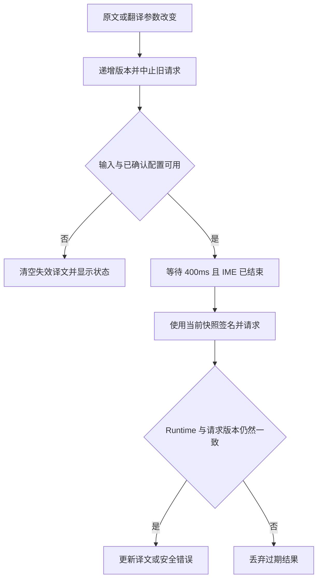

# Design

## Context

动机与产品范围见 [proposal.md](proposal.md)。本设计记录变更前的基础与实施决策，当前实现和验证进度见 [tasks.md](tasks.md)；不把探测结果、平台能力或确定性测试当作真实账户和 WebView 联调验收。

已核对的项目基础：

- [插件工作区](../../../../docs/en/development/plugin-workspace.md)允许直接位于 `plugins/*` 的独立成员；[ConfigLens](../../../../docs/en/development/config-lens.md)提供公共 SDK 初始化、Context 更新、插件私有 React/Semi、资源打包和异步失效的参考，但翻译插件不导入其源码。
- [开放 Web Runtime](../../../../openspec/specs/open-isolated-plugin-runtime/spec.md)允许普通 HTTPS 请求，官方插件与外部插件具有相同隔离边界。[当前 CSP](../../../../src-tauri/src/plugin_runtime_security_policy.rs)允许 HTTPS；变更前没有 Host HTTP、凭据或通用插件设置 API；本轮新增公共 Host HTTP，后两者仍不增加。
- [插件存储规范](../../../../openspec/specs/plugin-scoped-storage/spec.md)和 [Rust 实现](../../../../src-tauri/src/plugin_scoped_storage.rs)提供按可信插件身份隔离的 JSON 持久化。该实现未加密；用户明确接受将 AK/SK 保存在这里。浏览器 origin storage 按 Runtime generation 隔离，不适合作为跨升级配置来源。
- Runtime 实际使用 `lensx-plugin://...` 资源入口，仓库没有 `crypto.subtle` 可用性保证。可联网不等于可使用 Web Crypto。
- 2026-10-22 探索时，向火山翻译接口发出的无凭据 OPTIONS（测试 Origin 为 `tauri://localhost`）返回允许 POST 和 `Authorization`、`Content-Type`、`X-Date`、`X-Content-Sha256` 的 CORS 头。这只是网关预检证据，不是当前自定义 scheme 的实际请求、有效签名翻译或真实 WebView 验收。

外部依据：用户指定的[文本翻译 API](https://docs.volcengine.com/docs/MachineTranslation/TextTranslationAPI?lang=zh)及可读取的[同文档数字路径](https://docs.volcengine.com/docs/4640/65067)、[语言支持](https://docs.volcengine.com/docs/MachineTranslation/Languagesupport?lang=zh)、[接口错误](https://docs.volcengine.com/docs/MachineTranslation/Interfaceerrormessage?lang=zh)、[签名方式](https://docs.volcengine.com/docs/APISignatureCallGuide/Signaturemethod-9?lang=zh)、[官方 SDK 签名源码](https://github.com/volcengine/volcengine-nodejs-sdk/blob/master/packages/sdk-core/src/utils/signer.ts)。少数文档页面的正文通过官方搜索索引或数字地址读取；不将网页壳成功加载视为正文核验。

## Goals / Non-Goals

**Goals:**

- 将产品 UI、输入状态、服务适配和错误映射留在插件内；Rust 继续通过既有 `storage.*` provider 负责磁盘持久化。
- 让原文、语言和已确认配置共同确定一份译文；无论网络顺序、设置写入、输入法或 Runtime 如何变化，旧操作不能恢复已失效结果。
- 用可离线验证的浏览器签名和固定 API 契约完成首版，保留新增 provider 所需的局部适配边界。

**Non-Goals:**

- 不为单个官方插件增加 Host 私有捷径。仅新增公共 Host HTTP 与 Host API 次版本；不更改 Manifest 格式、SDK wire、权限、Child WebView 隔离或 Rust 存储协议。
- 不设计动态 provider 注册平台、动态脚本加载、翻译插件自定义 endpoint、Node sidecar 或远程中转服务。Host HTTP 是固定公共方法，不允许插件注入传输实现。
- 不以真实账号、计费请求、浏览器或 GUI 验证作为维护 Gate；不承诺当前环境或全部语言对已经联调通过。

## Decisions

### 1. 独立插件与同文档设置面板

采用 `plugins/translation` / `@lensx/official-translation` / `dev.lensx.translation`，贡献 `main` Page、`open` Action，Launcher 名称为 `Translation` / `翻译`。沿用 Manifest `0.4.0`；翻译插件要求 Host API `>=0.3.0 <0.4.0`，初始窗口采用 800×600、允许调整大小。贡献和安装方式走公共 CLI 与普通 `.lxp` 路径，不自动预装。

插件文档建立一份 Runtime client、Context 和页面状态，初始化完成后才挂载工作区。上方原文、下方译文纵向分配可用高度，各自滚动；工具区域提供源语言、目标语言、设置和重试。使用 Semi 的多行文本、选择和表单控件，不引入 Monaco 或另一套 UI 库。实现阶段按仓库 Semi skill 核对真实组件 API、组合输入及焦点行为。布局的复杂状态和主题样式使用插件私有 Less，简单局部工具样式可使用既有 UnoCSS。

设置是在同一文档中打开的插件内面板，不贡献 Host 设置，也不跳转到会销毁当前 Runtime 的另一 Host Page。打开时暂停未完成翻译并保留原文、当前有效译文和语言；设置草稿独立于已确认配置。取消丢弃草稿；保存成功后提交配置，关闭面板时对当前原文重新调度需要的翻译。返回工作区恢复设置入口焦点，不重建原文控件。未改变请求内容时保留已成功的译文，避免无意义重复请求。

相比独立 settings Action，此方式直接保证配置服务时不会丢失待翻译文本。相比在 Host 设置增加表单贡献，它不扩展平台契约。

### 2. 配置模型、保存与语言初始化

通过 SDK 的 `storage.get` / `storage.set` 使用单个插件私有 key `settings.v1`，值包含 `version: 1`、`provider: "volcengine"`、可选 `targetLanguage` 和可选 `credentials: { accessKeyId, secretAccessKey }`。凭据要么同时存在且通过基本格式验证，要么同时缺省；去除输入外围空白后验证，不修改密钥内部字符。存储采用现有明文 JSON 语义，UI 提供掩码凭据输入和简明保存说明，不描述为加密或钥匙串。

读取结果须运行时校验，区分 key 不存在、有效记录、不支持版本/结构损坏、目标语言已不受支持、Host 方法不可用和读失败。只有明确 `found: false` 才按新配置处理；未知或失败状态不以默认记录覆盖磁盘。允许编辑原文，但配置未解析或读取失败期间不发送请求，提供重读恢复。

已知版本且结构与其余字段均合法、仅目标语言不受支持时，保留磁盘原值及已验证的服务/凭据，进入可修复的目标语言状态：不推导替代目标、不发送翻译，但允许用户明确选择有效目标并按同一串行提交规则保存完整修复记录，确认后恢复。未知版本或结构损坏不能使用这一路径猜测恢复，继续保留原值并阻塞写入。

所有写入使用同一串行提交入口，基于最新 confirmed snapshot（或上述字段已验证的修复基线）合成完整记录，避免目标语言更新覆盖 AK/SK。写入期间禁止冲突的配置提交，原文仍可编辑；成功返回后才更新 confirmed snapshot。明确失败保留原配置，提示保存失败；取消/超时/断线等提交结果不明确时，暂停相关请求并重读，不能假装磁盘回滚。重读后以实际存储收敛，失败时保持受阻状态。SDK attempt 失效后的回调不能更新新页面。

持久化确认不等于翻译参数变化。只有 provider/凭据或有效语言值等影响请求的内容实际改变，才递增请求配置修订并使译文失效；无变化保存、或将当前推导目标明确保存为同一个值，均不因磁盘写入本身重译。

语言规则分为三类：

| 状态 | 规则 |
| --- | --- |
| 界面语言 | 始终来自当前有效 Host Context，支持 `en-US` 和 `zh-CN`；主题同样跟随 Context。 |
| 首次目标语言 | 先等存储恢复；有已保存且有效的目标语言则使用它，否则以当前页面首次有效 Context 映射 `en-US → en`、`zh-CN → zh`。自动推导本身不写入 `targetLanguage`。 |
| 用户目标语言 | 下拉选择自动发起持久化，不另设保存按钮；写成功才提交有效选择并对当前原文重译。失败保留上一有效选择并提示。已保存选择优先于此后的 Host locale。 |

当前页面初始化后，Host locale 变化只更新界面，不改变有效目标语言，也不触发翻译。没有持久目标记录的下一次真实打开重新按当时 Host locale 推导。若存储读取晚于 Context 事件，仍使用该页面首次有效 Context，不能用一次晚到事件覆盖用户选择。

源语言每次真实打开均为 Auto，可手动选择；手动源语言只在当前页面存活。切回 Auto 时省略接口字段，不发送字符串 `auto`。源语言识别结果仅作为信息展示，不反向改变用户目标语言。

服务下拉仅有火山引擎；provider ID 保留在数据模型中以便将来演进，但本变更没有其他 provider 或动态注册系统。

### 3. 语言目录与输入限制

插件内置一份审核过的火山语言目录，使用官方 API code，提供英文和中文标签。发布快照来源和日期写入维护文档，不运行时抓取文档或接受任意代码。`zh` 是简体中文，不能与 `zh-Hant`、`zh-Hant-hk`、`zh-Hant-tw` 混用。

目录记录角色和语向，尤其 `sk` 只能作为目标，`bo`、`nan`、`wuu`、`yue`、`cmn`、`ug` 只能作为源且目标仅限 `zh`。手动选择不支持组合时停止请求并提示调整，不静默覆盖已保存目标。Auto 源无法提前检查具体语向时，允许请求，由服务 `-415` 转换为可恢复错误。语言目录不宣称自动识别覆盖每一种源语言。

单次发送完整原文作为 `TextList` 的唯一元素。先判空白、再对非空白原文应用上限，超过 5000 个纯空白字符仍为空状态且不请求。空白判断可用 trim，但请求保留原文空格、换行和 Unicode；不预先改写、截断或拆段。插件使用 Unicode code point 数量落实最多 5000 字符的本地上限，覆盖 emoji 和边界测试；服务仍是实际限制的最终判断方，返回超限时展示错误，不自动拆分再收费。

### 4. 请求调度、结果身份与生命周期

由插件本地 controller 管理 `empty`、`unconfigured`、`debouncing`、`translating`、`success`、`error` 和受阻状态；React 负责控件、焦点和展示。请求身份包含 Runtime attempt、单调 generation、原文、源/目标语言和 confirmed provider 配置版本，凭据只在请求上下文中使用，不进入可记录的状态摘要。

- 输入值或翻译参数实际变化时，立即让旧请求失效并清空已不对应当前输入的译文；连续变化重新计时。相同输入重复通知不发新请求。
- IME 开始时中止此前工作；组合输入只更新草稿，不发送请求。组合提交后的最终值去重后启动一次 400ms 调度。清空或卸载退休旧组合会话，迟到的 composition end 不能恢复文本或请求。
- 清空、纯空白、超限、无凭据、配置读写待确认、设置面板打开或会话断开时不调度。面板关闭/配置恢复后，从当前文本重算；恢复不复活旧快照。
- 每次 dispatch 有 15 秒总期限，覆盖签名与响应读取。AbortController 负责资源取消；版本检查独立负责正确性，因为取消不保证远端没有处理或不会计费。
- 不做自动重试、轮询或持久缓存。手动重试对当前合法输入立即发起一次请求，清理旧错误；同一失败不会自动形成请求循环。
- theme/locale 只改变表现，不改变翻译请求身份。真实关闭、禁用、替换、卸载、开发重载或 SDK retry/disconnect 清理 timer、fetch、监听器和文档内文本；同 attempt 的 Launcher hide/restore 保留页面状态，不主动重复请求。

### 5. 固定火山接口与浏览器签名

provider 的输入/输出是插件内 typed DTO，外部响应从 `unknown` 校验后才进入 UI；它接收可注入的 HTTP transport、clock 和 AbortSignal，以便离线确定性验证。公共 SDK 用于 Runtime Context、存储及 `http.request`；Rust 仅执行受控传输。

| 项目 | 选择 |
| --- | --- |
| URL | `https://translate.volcengineapi.com/?Action=TranslateText&Version=2020-06-01` |
| 方法 | `POST`，路径 `/`，JSON body |
| 签名 scope | UTC 日期 / `cn-north-1` / `translate` / `request` |
| Body | `TargetLanguage`、`TextList: [原文]`，手动模式才包含 `SourceLanguage` |
| HTTP 策略 | 公共 `http.request`，不共享 Cookie/系统凭据、不重定向、不重试，固定服务地址，总期限 15 秒 |
| 响应边界 | 最多 1 MiB UTF-8 响应体；越界或不符合响应结构视为协议错误 |

采用 `@noble/hashes@2.4.0` 的公开 `sha2.js` / `hmac.js` 子路径及必要编码工具，作为本插件精确固定的私有 runtime dependency。当前[官方包与文档](https://github.com/paulmillr/noble-hashes)显示 ESM、零运行时依赖、MIT；SHA-256/HMAC 使用纯 JS/TypedArray，不需要 `crypto.subtle`，也不使用随机数。实现时审核实际发布 tarball、导出和构建图，锁定版本并记录证据；历史审计不能代替对该版本的核验。

签名过程对 method、路径、排序/编码后的 query、canonical headers 和 body SHA-256 构造 canonical request，再按 UTC 日期、region、service、request 派生 HMAC key，生成 Authorization。JSON 只序列化一次，签名字节必须就是发送字节。设置 `Content-Type`、`X-Date`、`X-Content-Sha256` 和 `Authorization`；canonical host 来自固定 URL，实际 Host 头由 Rust HTTP 库根据已校验 URL 生成；插件不提交该受保护请求头。

固定 AK/SK、时间、Unicode body 和 query 的测试采用官方示例或独立官方签名参考生成的固定期望值，并保留来源说明；不能只用同一被测函数重新生成期望。覆盖日期跨日、字段省略、JSON 字节差异和编码差异。

备选方案不采用：

- 官方 Node SDK 依赖 Node `crypto`、`Buffer`、文件系统和 Node HTTP；当前[翻译客户端](https://github.com/volcengine/volcengine-nodejs-sdk/blob/master/service/translate20250301/src/api.ts)的 API `2025-03-01` / 默认 region `cn-beijing` 也不同于用户指定文档，不能混用。
- 仅依赖 Web Crypto 会把未确认的 secure-context 能力带入产品；Host 签名会把翻译业务泄漏到平台层，因此签名保留在插件；通用 HTTP provider 已经用户授权纳入本轮范围。自行实现 SHA-256/HMAC 没有必要。

插件仅打包本地脚本与样式，使用插件文档自己的 CSP 设置 `connect-src 'none'`，生产翻译仅经公共 SDK 传输，不改 Host CSP。不能通过远程脚本、动态 endpoint 或第三方代理取得请求能力。

### 6. 响应校验与错误恢复

记录 HTTP 状态后，有界读取响应并尝试解析 JSON，非 2xx 也解析 `ResponseMetadata.Error` 以保留可识别的厂商错误类别；不能先抛出 HTTP 错误而跳过厂商错误码。只有 HTTP 成功且不存在服务错误才能进入成功校验，HTTP 200 不等于翻译成功。非 2xx 的非 JSON 响应回退为安全的 HTTP 类别；成功 HTTP 的畸形 JSON、缺字段、超大响应进入协议错误。

成功必须包含恰好一项 `TranslationList`，该项 `Translation` 为字符串；零项、多项或非字符串译文均不是成功。允许响应携带不参与业务的额外字段；检测语言字段允许缺省，但存在时须是可显示的合法 code。

错误分为未配置、输入超限、不支持语向、凭据/签名、权限、时钟、限流、Host 网络/不可用、超时、服务故障、协议和存储错误。使用本地双语消息；不直接显示服务 `Message`、异常对象、请求 body、Authorization 或 AK/SK。仅在服务提供 1–128 个 ASCII 字符、匹配 `[A-Za-z0-9._:-]+` 的 RequestId 时显示诊断 ID。Host 传输错误只显示安全网络类别，不把网络、TLS 或 DNS 失败伪装为已知原因；不再推测原生请求发生浏览器 CORS。

鉴权/权限错误引导检查配置，语向错误引导调整语言，限流不自动重试，其他可重试错误提供显式重试。错误不修改原文，不把旧译文冒充当前结果。页面以简明说明告知原文会发送至所选服务；不新增权限弹窗。

### 7. UI 本地化与可访问性

使用 `PluginUiProvider` 接收完整 Context，复用公共主题机制和插件文档内 Semi locale。插件拥有英文基准和简体中文消息资源，语言标签、配置帮助、加载和错误使用同一词条层，不导入 Host i18n 实例。

两个文本区域均有明确可访问名称；译文是可聚焦、可选中的 readonly 控件，不能用 disabled 代替。使用当前文本焦点的原生复制/选择行为，不加全局剪贴板处理。请求中不抢焦点；loading/error 通过适当 live region 公告，状态不只靠颜色表达。设置打开、取消、保存和返回保持可预测焦点；Escape 在设置内先关闭面板，IME 使用中的按键保留输入法默认处理。

### 8. 验证与文档接入

新增插件自己的 `build`、`typecheck`、`test`、`check` 和纯 Node post-build `test:e2e`。现有 `ci-plugins` 会自动发现直接插件并准备其声明的公共依赖，但不会代替插件实现 `.lxp` 检查。

`test:e2e` 使用公共 CLI 的 `validate`、两次 `pack --no-build` 和 `inspect`，将 `.lxp` 写入系统临时 consumer 目录，比较确定性字节、检查资源闭包、Manifest、bundle 依赖和禁止的 Host/Tauri/Node shim。不得导入 CLI 私有源码，不从仓库根使用独立 pnpm store，不修改根 `node_modules`。使用现有 `plugin-developer-cli` Gate 验证 CLI 与 Rust 包格式兼容边界。

单元/组件测试使用 Rstest、真实组件以及可控 clock/SDK HTTP 与 storage transport，验证固定签名、请求字节、配置恢复/提交不明、IME、防抖、旧响应、双语主题、键盘、生命周期和错误。测试不访问真实翻译服务，不使用凭据，不启动浏览器或真实 WebView，也不声称 DOM 模型证明 OS 输入效果。标准根生命周期与适用 Gate 见 tasks，不新增根命令入口，通用 HTTP 证据使用稳定能力 Gate。

实施时新增英文 `development/translation.md` 与中文同路径镜像，更新两语言索引和现有插件工作区/开发入口/验证说明，说明设置格式、明文存储、语言快照、API 版本、网络及验证局限。导航变化触发项目级治理审计；归档前先同步英文稳定规范，再对最终实现、双语文档、链接、Gate 引用和临时材料边界审计及验证。

### 9. 用户授权的 Host HTTP 修订

2026-10-22，用户在真实 lensX 插件页面报告 HTTP 200 的 CORS 拦截：插件 Origin 未被 `Access-Control-Allow-Origin` 允许。无凭据/合成无效凭据探测也观察到预检允许，但实际鉴权错误响应不含该头；这不证明用户凭据错误。用户随后明确选择通用、受控的 Host HTTP，并要求先更新本 change 的设计、规范与任务再实施。以下决策替代原来的 WebView 直连约束；既有通过的确定性验证保留为历史证据，涉及传输的任务重新打开。

#### 公共 DTO 与固定边界

新增 `http.request`，参数为 `{ url, method, headers?, body?, timeoutMs? }`；header 为 `{ name, value }` 数组。只支持 `GET`、`HEAD`、`POST`、`PUT`、`PATCH`、`DELETE`、`OPTIONS`，GET/HEAD 不允许 body。返回 `{ status, headers, body }`，所有 HTTP 状态（含 3xx/4xx/5xx）均是普通结果，供插件解释；不会把 CORS 响应头作为 Host 返回结果的条件。

- URL 最多 4096 UTF-8 字节，只允许 HTTPS、443 端口、DNS 公网主机或公网 IP；拒绝 userinfo、fragment、单标签主机和本地/保留名称。
- DNS 必须在总期限内解析；答案为 1–16 个地址，任何非公网地址使整个请求失败；云平台服务地址 `168.63.129.16` 也明确拒绝。IPv4/IPv6 的回环、私网、链路本地、未指定、多播、共享地址、文档/保留/隧道地址均拒绝；IPv4-mapped IPv6 仍按 IPv4 策略检查。校验后的地址集合直接固定到实际连接，TLS 仍验证原主机名，禁止另一次不受控 DNS 解析。
- 请求 header 最多 32 项，名称最长 128 字节、值最长 8192 字节、总计最多 16 KiB，采用合法 ASCII token/value，拒绝大小写不敏感的重名。禁止 `Host`、`Content-Length`、`Connection`、`Transfer-Encoding`、`Cookie`、`Cookie2`、`Origin`、`Referer`、`Accept-Encoding`、`Upgrade`、`TE`、`Trailer` 和 `Proxy-*`/`Sec-*`，阻止伪造传输与环境身份。`Authorization` 与服务签名 header 可由插件明确提交，不由 Host 自动补充。
- 请求 body 最多 1 MiB UTF-8 字节；响应在流式读取时最多 1 MiB 字节，必须为有效 UTF-8。响应 header 同样有 32 项/16 KiB 边界，过滤 Set-Cookie/Set-Cookie2 和 hop-by-hop header。序列化语义结果最多 4 MiB，保留现有 5 MiB wire frame 上限；不得截断或透传半个结果。
- `timeoutMs` 范围 1–15000，默认 15000，覆盖 DNS、连接、TLS、发送与响应读完。每 attempt 最多 4 个、全局最多 16 个在途请求，无等待队列；超额立即失败。
- 不使用系统/环境代理，不共享 Cookie、系统凭据或 HTTP cache；不自动重定向、重试、解压。远端返回非 identity Content-Encoding 时失败。保留 TLS 证书验证，不暴露跳过验证开关。
- 使用现有稳定 Host 错误：`invalid_params` 表示参数/目的地策略拒绝，`limit_exceeded` 表示大小或并发限制，`timeout`/`cancelled` 表示终止，`unavailable` 表示网络/TLS/DNS/无法支持的响应，`internal_error` 兜底。Host 不解释翻译错误，不记录 URL 查询、headers、body、凭据、签名或原始异常。

#### 原生执行与生命周期

`PluginChildWebviewHostDispatcher` 在已经通过来源与语义校验的原生 RPC 路径识别 `http.request`，直接调用 Rust provider。执行身份来自可信 `(attempt, source, request_id)`，请求 DTO 不接受 plugin identity/Session/dispatch token。无需新增插件 Tauri command，也不将传输反向交给 Host React 再 invoke。

系统 DNS 使用现有 OS resolver，独立限制最多 16 个在途解析 worker，无队列；worker 名额由阻塞 OS 调用持有至真正结束。请求取消立即结束 HTTP future/等待、丢弃迟到解析，绝不在取消后建立连接；已经启动且 OS 不支持中断的 DNS lookup 可以在后台完成，但不会突破 16 个 worker 上限或恢复旧请求。16 KiB header 上限是可接受语义值上限，在读取正文前验证；底层 HTTP parser 仍使用其有界解析缓冲，不承诺完全不分配解析缓冲。

取消句柄先登记再启动异步工作；SDK cancel、RPC deadline、页面关闭/禁用/替换/重载/disconnect 均直接取消对应 Rust future。资源释放和并发名额回收必须幂等；旧 attempt 完成后不能 settle 到新页面。HTTP RPC 截止时间为参数期限加 1000ms（最多 16000ms），其他方法维持 10000ms，避免已有 RPC 10 秒上限提前截断 15 秒 HTTP。翻译插件维持签名开始至读取结束 15 秒总期限，向 HTTP 提交剩余时间，SDK 等待与本地取消对齐。

Rust 使用已有依赖树中的 `reqwest 0.13.4` 和 `tokio 1.53.1` 作为显式依赖；关闭 reqwest 默认特性，启用审核过的 Rustls TLS，显式关闭 proxy/redirect/retry/compression，首版传输仅用 HTTP/1，保留已审核 Hyper parser 的有界缓冲（最多 100 个字段、417792 字节），随后在正文读取前应用更严格的 32 项/16 KiB 语义上限；不承诺 HTTP/2-only endpoint。注入 resolver/transport 进行离线测试。普通 WebView fetch 的浏览器安全机制保持不变。

Host Context 仅在当前原生 dispatcher/provider 已组合的页面会话宣告 `http.request`。Host React 负责 Context 投影，若 HTTP 意外进入 JS 业务 dispatcher 则返回 unavailable；无 provider 的测试/浏览器 Host 不宣告该方法。SDK 使用既有 typed `client.request`，不暴露原始 bridge 或 native 实例。

#### 版本与迁移

按已有新增方法的 minor-version 规则，Host API=`0.3.0`、Contract package=`0.3.0`、SDK=`0.4.0`。新 SDK 支持 `>=0.2.0 <0.4.0`，在旧 Host 不宣告 HTTP 时明确报告不可用；保留旧 8 个方法语义。Manifest=`0.4.0`、WebView wire=`0.2.0`、root lensx=`0.1.0` 不变。UI/Testkit/CLI 公共包版本不因重新构建而自动发布，其依赖/peer 与打包夹具对齐新 Contract/SDK。

维护模板和 ConfigLens 使用新 SDK，并把 Host 上界扩展到 `<0.4.0`；Translation 的 Host 下界为 `0.3.0`。旧已打包插件若 Manifest 上界 `<0.3.0` 或 SDK 只接受旧范围，会明确保持不兼容，必须升级依赖/兼容声明并重打包；不实现隐式多版本协商、不扩大既有包声明、不声称旧 bundle 自动兼容。

#### 翻译集成与验证

插件签名生成同一 URL/header/body 字节后，通过注入的 SDK HTTP transport 发送。Host 返回 HTTP 状态与有界文本后，provider 继续校验 `ResponseMetadata.Error`、单项译文、RequestId，并补齐已观察到的 `InvalidAccessKey`/`InvalidCredential` 和 `CodeN` 分类；不因平台传输扩展把翻译规则搬入 Rust。缺少 HTTP capability 时给出升级/不可用提示，不回退浏览器 fetch、私有代理或其他服务。

确定性证据覆盖跨 TS/Rust Schema、typed SDK、公网地址与 DNS pinning、headers/bytes/JSON预算、时限、并发、请求cancel/teardown、真实 native dispatcher 接线及插件成功/错误解析。以假 resolver/transport/HTTP 响应验证，不进行真实计费请求或 GUI 验收；不得削弱现有其他协议与恶意夹具。沿用已有 Generate/Gate 稳定入口；增加通用 `plugin-host-http` Gate 来编排新增跨层证据，不增加根脚本。最终重跑全工作区及 Rust 验证、文档与治理审计。

## Risks / Trade-offs

- [AK/SK 为本机明文] → 用户已接受；使用既有命名空间隔离、掩码输入、无敏感日志，并如实说明保存语义。普通本机文件访问者和插件自身仍可能读取，不宣称加密保护。
- [CORS 或服务契约发生变化] → 已由真实错误确认 WebView 直连存在 CORS 拦截；改用受控公共 Host HTTP，保持固定 endpoint/版本并校验真实响应。不关闭 Web 安全，不增加插件私有代理。
- [远端请求可能已处理] → 防抖、组合输入去重、显式重试降低重复；取消只是本地资源控制，不承诺退费或撤回原文。
- [语言目录与厂商变更不同步] → 维护有来源的版本快照、语向约束和 `-415` 错误，不声称所有语向已实测。
- [系统时间偏差导致签名失败] → 将服务时间错误映射为检查设备时间的本地提示，不偷偷调整系统时间。
- [新哈希依赖的供应链/构建风险] → 精确固定 2.4.0，审核许可证和发布字节，检查生产图中无 Node builtin/Buffer polyfill，固定向量作为回归约束。
- [配置提交成功但回复丢失] → 读回收敛与串行 mutation，不以乐观回滚覆盖真正的持久值。

## Migration Plan

这是新插件，无存储数据迁移。平台 Host API 从 0.2.0 升至 0.3.0，维护消费者按下述版本策略重建；不会静默绕过旧包的版本范围。首次安装没有配置记录；配置为插件私有版本 1，在用户保存服务设置或提交目标语言选择时写入，成功后才作为 confirmed snapshot 生效；推导默认值不写盘。未知版本保留并报告，不做猜测性迁移。

交付先通过包内与根验证，再通过现有本地 `.lxp` 安装或开发目录手工重载路径使用；不会自动打包进 Host、发布或安装到用户应用。禁用插件保留配置，Host 清除插件数据或删除数据卸载遵循现有语义；保留数据的同 ID 重装恢复配置。回退插件不自动回退 Host API；回退平台需整体恢复 Contract/SDK/Host 与对应消费者版本，保留数据不会自动删除。任何将来的 schema 升级必须另行定义迁移和回退行为。
