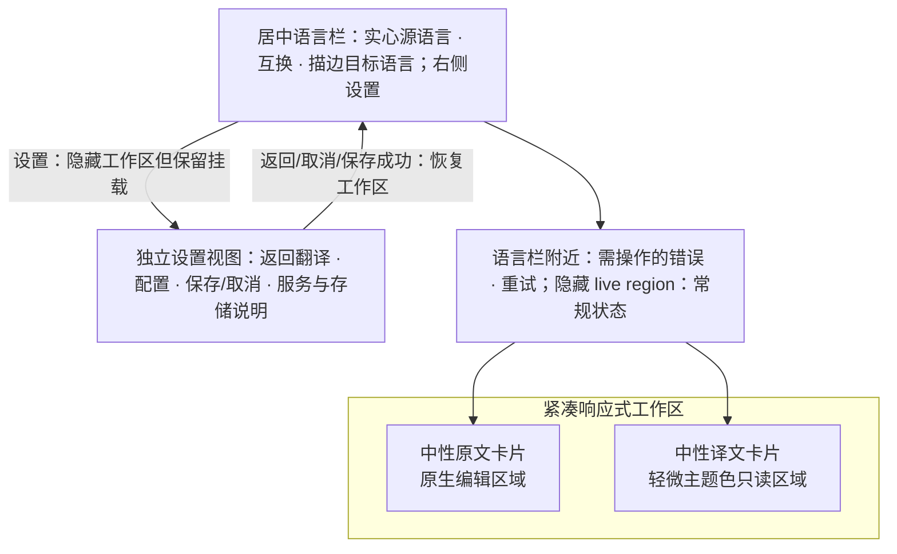

# Design

## Context

动机与最终范围见 [proposal.md](proposal.md)。前一轮已将两个文本控件组织为响应式卡片并保留 400ms 自动翻译。此次用户反馈要求修复中文原生组合输入，增加语向互换，压缩工作区高度，移除计数、清空、常驻空状态/服务文字与译文下方状态区，并进一步取消标题聚焦下划线和原文自动更正提示。之前关于这些元素必须显示、不得互换语言以及保持 `800×600` 的设计已被本轮授权替代。设置也改为插件内独立视图；工作区与设置不同时显示，不再把表单追加在卡片下方。

`controller.ts` 继续拥有调度、5000 code points 限额、请求身份和组合会话失效；`settings.ts` 继续拥有目标与凭据的确认持久化。新增互换必须协调这两个边界，避免保存尚未确认时出现半反转语向或中间请求。已定位的中文输入根因是旧路径把组合过程中暂时出现的空草稿视为普通清空，提前退休会话 token，导致后续候选与最终中文提交被当作迟到事件拒绝。单纯触发非空值回调无法覆盖此事件序列。

## Goals / Non-Goals

**Goals:**

- 同一套文本节点支持紧凑并排/堆叠布局，保留焦点、选择、原文与请求状态。
- 通过真实可用的语言互换、不同语言胶囊样式和内部文本表面建立清晰方向。
- 中文组合输入保持原生草稿与提交字符，提交后仅启动一次 400ms 调度。
- 精简常驻控件，同时保留限额、错误恢复、服务告知、双语主题和键盘可访问性。
- 进入设置时提供单独操作空间，返回后保留工作区节点、内容、语言、选区、编辑历史和滚动位置。

**Non-Goals:**

- 不引入手动翻译、文本互换、一键复制、多模态、历史、新 Provider 或新持久化字段。
- 不新增 Host 尺寸协议、断点监听、公共包能力、原生键盘或剪贴板处理器。
- 不引入依赖、截图基线、浏览器、真实 WebView 或原生交互验证入口。

## Decisions

### 1. 紧凑窗口继续通过 CSS 重排同一组控件

Manifest 沿用现有可缩放 presentation，只将初始尺寸设为 `800×480`。实际布局仍服从 Host 限制：`min-width: 720px` 使用两列等宽 `minmax(0, 1fr)`，更窄时按原文、译文顺序堆叠。页面与卡片采用更短的内边距和间距，正文约 140px 最小高度；正文保持可读排版，长文本内部换行/滚动，短窗口或较长设置内容分别由当前视图纵向滚动。

保留文本控件 ID、标签关联、DOM 身份及受控值连续性，不用 `matchMedia` 分支或宽度 key 重挂载控件，不因重排调用控制器、重置 debounce 或写入存储。语言栏允许窄宽换行，所有控件具有可收缩宽度，不能通过固定高度隐藏反馈或设置。

### 2. 居中的语言胶囊与真实互换

源语言与目标语言保留现有 Select 和完整本地化选项。源控件为主题主色实心胶囊，目标控件为描边胶囊；两者之间放置可操作的互换按钮，组成居中组，设置入口留在右侧。源/目标标签保留 ID 和可访问关联，只做视觉隐藏；互换有双语名称、禁用语义和不能互换时的本地化说明。图标使用明确宽高及 viewBox 的插件本地 SVG，继承主题颜色，在启用和禁用状态下均保留可辨认的箭头，不依赖缺省 SVG 尺寸。

手动源模式先验证当前目标可用作源、当前源可用作目标，且反向方向受支持。Auto 模式只采用当前请求条件下已确认成功结果的 `detectedLanguage`；缺少检测结果、检测码不适合目标或反向方向不受支持时禁用互换。不得猜测 Auto 对应语言、提交 `auto` 作为目标或自动改变方向。

互换只改变语言，不将译文回填到原文，也不交换文本。先按现有完整记录规则持久化反向目标，期间保留原语对并暂停请求，禁用源/目标选择和重复互换；确认成功后再共同采用反向源和目标，按当前原文重新进入既有 400ms 调度。明确保存失败保留原语对并展示反馈。结果不明时遵守既有重读核对规则，核对前不采用未确认目标或中间语对。新 attempt 或失效回调不能完成旧互换。

### 3. 原生中文组合输入优先于受控回写

原文控件使用真实原生 composition/input 事件建立组合会话。继续只使用控制器的一份输入状态；页面读取公开原生 `isComposing` 或 composition 类型的 `inputType` 标记，经 `input(text, { composing })` 告知控制器。组合标记的空草稿仍更新当前值，但保留同一会话 token。若原生 input 缺少布尔 isComposing 和 inputType，则仅在当前有效组合 token 与 controller.composing 均存在时作为组合草稿处理；显式非组合 InputEvent 或普通 change 不使用此回退。只有非组合的普通清空才退休会话。

组合开始时取消旧调度与请求。`compositionstart → input n → input 空串 → input ni → compositionend 你` 中的三个 input 均带组合标记，草稿与最终中文必须连续保留，不能被退休逻辑或旧值回写覆盖。结束时读取最终 DOM 字符串，按会话身份提交一次；后续同值事件不重置计时。字符确认后 399ms 不请求，400ms 仅发送完整最终文本。

组合过程中不提前翻译，不使用确认键手动提交，也不拦截原生编辑快捷键。用户原生删除至空或 Runtime 结束会退休旧会话，迟到 composition-end/input 不能恢复文本。主题、locale、设置呈现和宽度变化保留同一输入节点与会话；设置 Escape 继续优先服从输入法。

### 4. 中性外层卡片与无装饰文本焦点

两张外层卡片共享中性主题表面和边界。原文文本区域使用中性内部表面，译文文本区域采用轻微主色表面；区分只作用于内部阅读区域，不将整张译文卡片着色。使用现有主题 tokens，兼容明暗主题，不写死颜色。

文本区移除蓝色边框/阴影式焦点大框，以及原文/译文标题的 focus-within 下划线；不增加替代的标题装饰或焦点框，保留原生光标、选区和可访问标签。语言控件、互换、设置和恢复按钮继续保留可见键盘焦点。相关样式留在插件 Less，使用既有组件和原生控件公开交互边界。

原文通过原生属性 `spellCheck=false`、`autoCorrect="off"`、`autoCapitalize="off"`、`autoComplete="off"` 请求关闭自动拼写/更正、自动大写与自动完成提示；不通过取消事件、改写文本或修改系统全局设置来实现。该设置不禁止中文输入法候选窗口和组合输入，真实平台是否呈现其他系统输入 UI 不由确定性 DOM 测试证明。

### 5. 精简工作区但保留安全与恢复语义

移除原文计数和清空按钮，用户通过原生编辑删除文本。控制器继续按 `Array.from(text).length` 限制 5000 个 Unicode code points，不使用截断式 `maxLength`；代理对计一个码点、组合字符逐码点计算，纯空白优先进入 empty 状态。超限文本完整可编辑，错误关联原文与输出状态，恢复范围后正常自动调度。

空译文保持空白，不显示“输入原文开始翻译”等空状态指引；空状态不请求。译文卡片下方不再有可见状态、RequestId 或检测语言区域。等待、翻译中、成功、暂停等常规状态只通过视觉隐藏的单一 live region 提供给辅助技术，忙状态保留 `aria-busy`。输入限额、语向、HTTP 不可用及请求失败等需要操作的反馈显示在语言栏附近，失败才提供符合条件的重试；同一错误不在多个 live region 重复播报。配置重载、目标修复与请求重试仍保持独立。检测语言继续仅供当前 Auto 互换判断使用，安全 RequestId 过滤与不暴露原始响应的边界保持不变。

移除卡片下方的服务发送行，设置中明确说明原文发送到火山引擎，并继续解释凭据本地未加密保存。设置切换为同一文档与 Runtime 中的独立插件视图，不创建 Host Page、路由或新窗口。工作区整体隐藏且不能参与指针、键盘或辅助技术交互；源/译文节点与控制器继续挂载，避免清空内容、语言、选区或原生编辑历史。

设置页顶部提供“返回翻译”，保留保存/取消。进入前记录工作区滚动位置，切换后滚动到顶部并聚焦第一个凭据输入；返回、取消、Escape 或保存成功后，先恢复可见工作区，再恢复其滚动位置并聚焦仍存在的设置入口。关闭动作不能在隐藏节点仍不可聚焦时抢先执行 focus。IME 正在使用 Escape 时不离开设置。明确保存失败保持当前视图和草稿；旧保存响应不能关闭后来重新打开的设置会话。

设置显示期间继续暂停并取消翻译工作；返回时按已确认条件恢复，不因视图切换重发有效成功结果。保存尚未完成时仍可返回工作区并继续编辑原文，但请求和冲突配置提交保持等待，直到持久化确认或核对完成。返回/取消丢弃未保存草稿，不把已经提交的持久化操作伪装为取消或回滚。

### 6. 确定性验证覆盖事件与确认边界

扩展真实页面/控件测试，按原生 compositionstart、input、compositionend 顺序覆盖连续中文输入、空组合起始、提交后输入事件、清空与迟到事件；同时验证 399/400ms、同值通知、旧响应丢弃。语言互换覆盖手动方向、Auto 当前检测、无检测或非对称语言限制、保存等待、失败/重读核对、重复激活与 Runtime 失效，证明原文不变且无中间语对请求。

双语 × 明暗主题检查可访问名称、视觉隐藏标签、只读选择、空指引/计数/清空/底部告知的移除、设置告知、状态归属与节点连续性。设置测试覆盖工作区隐藏且不可交互、独立返回入口、进入滚动清零与退出滚动恢复、返回后的焦点、保存失败和旧会话完成；保存中返回后仍可编辑原文，不能用隐藏表单下方仍能看到工作区作为通过条件。样式契约验证 720px 断点、紧凑尺寸、相同外层表面、不同内层表面、无标题聚焦装饰、明确 SVG 尺寸、原生自动编辑属性与滚动回退；Happy DOM 不验证真实几何或原生输入法平台投递。

复用 `ci-plugins`、现有插件生命周期、完整根前端与 Rust 验证，不新增 Gate 或根脚本，不调用真实翻译服务。确定性证据不等同于真实 WebView 外观、原生复制/输入法平台验收或真实服务可用性。

### 7. 扩展的历史规格整理

用户在实施验证阶段授权清理全部历史正文长度警告。每条要求保留原标识与既有场景；正文保留简明规范总述，细节义务放到匹配的既有场景或针对具体上下文补充的场景中。优先逐句移动原文，核对约束、否定条件、数量边界和恢复规则均未丢失，不通过删除义务、通用占位场景或修改校验规则规避警告。翻译插件修改要求的中英文 delta 与稳定文本同步保持一致。全仓规格重新严格校验后，复核治理规格与文档之间的契约一致性。

## Risks / Trade-offs

- 中文事件顺序可能被组件回调重排 → 使用原生事件语义和会话 token，覆盖提交后同值事件与退休后的迟到事件，不用延时重试掩盖问题。
- 互换可能先采用半个语对 → 在持久化确认前维持原语对和暂停状态，确认后一起提交源/目标并重新调度。
- Auto 的检测结果可能已过期或不可反向使用 → 只使用当前已确认结果并验证两个方向的语言角色；禁用时提供原因。
- 更短页面可能挤压内容或焦点 → 最小正文高度、可换行语言栏与当前视图/正文两层滚动共同保持可达性。
- 视图隐藏可能导致返回焦点丢失或滚动跳转 → 保持工作区节点挂载，并在可见性更新后恢复滚动与入口焦点，不从隐藏工作区继续接收输入。
- 移除文本焦点装饰 → 保留原生光标与选区，验证标签关联、键盘编辑和非文本操作的可见焦点；不额外加入用户已要求移除的装饰。
- 原生自动更正与输入法候选容易混淆 → 只使用文本控件的自动编辑 opt-out 属性，不阻断组合事件或系统候选选择。

## Migration Plan

1. 按已授权范围实现原生组合事件、互换协调、紧凑样式、Manifest 初始高度及测试；无需存储迁移或公开 API 升级。
2. 同步双语文档和 active/stable 规格，移除旧显示计数、清空、常驻空提示/服务行及禁止互换的要求；保留完整限额和服务安全契约。
3. 运行现有最终验证并更新后续任务证据；旧轮次审计不冒充新范围验收。
4. 如需回退，仅回退本轮插件代码、Manifest、文案及对应规格/文档，不改用户配置或历史规格整理成果。实际归档、安装、重载和发布等待独立请求。
