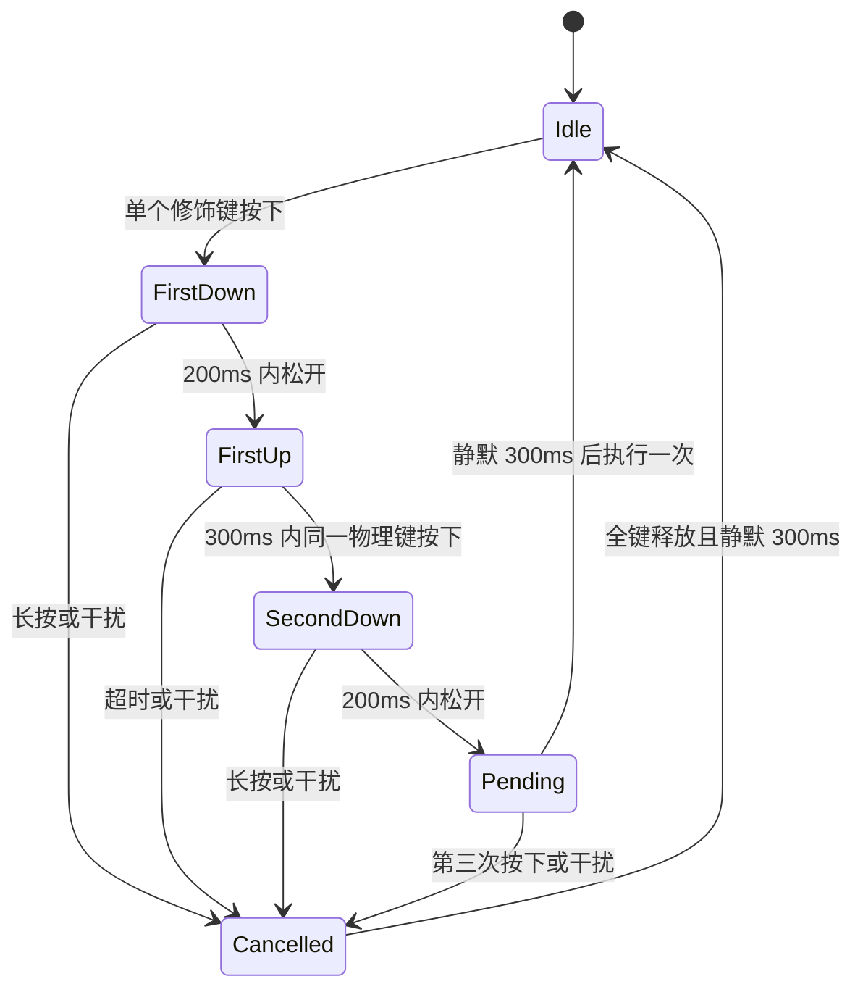

# Design

## Context

动机与范围见 [proposal.md](proposal.md)。本变更跨越原生输入、窗口恢复、Action 分发和插件公共协议，因此需要设计文档。

初始规划时检查的实现与规范（下述描述保留为实施前基线）：

- `src-tauri/src/launcher_window.rs` 固定注册 `Ctrl+Shift+Space`，按下执行 Toggle；注册成功后才启用关闭/失焦隐藏。现有 macOS `Cmd+W/Q` monitor 仅作用于前台 lensX，不能用于后台修饰键双击。
- `src-tauri/src/app_preferences.rs` 只保存主题与语言；`SettingsPage.tsx` 只有 Preferences/Plugins。
- `src/app/launcher/actions/dispatcher.ts` 的执行器无参数；`src/App.tsx` 的 pending 防重仅覆盖 UI，插件 `actions.open` 不经过该保护。
- 页面导航的 `ActivePage` 只有 owner/page/opening Action identity；相同页面复用 Child WebView。将调用来源只放在初始化 Context 会漏掉再次进入。
- Contract 当前为 `0.3.0`，Host API 为 `0.3.0`，SDK 为 `0.4.0`。Context 与事件都是封闭校验；旧 SDK 会拒绝未知字段/事件。现有规范明确采用一个当前语义协议，不隐式兼容旧 catalog。
- 当前全局快捷键依赖只表示修饰键集合加主键，不能表达双击；`is_registered` 只检查本应用；批量注册不提供跨多键与文件的原子性。

## Goals / Non-Goals

**Goals:**

- Rust 是配置、规范化、原生注册和手势识别的权威；Host 协调所有入口，每次调用携带可信来源。
- 用户修改失败时仍有可用恢复方式；允许未授权双击或不可用 Action 保留配置，但明确区分保存与生效。
- 快捷键触发与插件页面生命周期解耦，重复进入保留输入；插件只处理语义调用。
- 形成可用确定性测试、编译及公共包消费验证的契约，不把它们表述为真实系统键盘交付证据。

**Non-Goals:**

- 不引入通用键盘监听 SDK、按键内容采集、宏、三击、任意字符/组合键双击、插件后台运行或自动读取剪贴板。
- 不自动执行翻译、格式化等业务；回调由插件选择实现。
- 不增加历史 Host API 协议协商，不修改已安装外部包，不发布包或应用。
- 不增加浏览器、真实 WebView、原生 GUI harness、截图或性能验收入口。

## Decisions

### 1. 独立快捷键配置与 typed Host 服务

2026-10-29 用户确认唤出只保留所选的一种类型。版本化 `shortcuts.json` 使用 v2：`{ version: 2, revision, launcher: Trigger, actions: Record<ActionId, Trigger> }`，独立于 `AppPreferences`。Launcher 使用唯一目标 `launcher`；每个 Action 最多一个绑定。

trigger 保持封闭 union：`chord { modifiers, key }` 或 `modifier_double_tap { modifier }`。主键范围、物理键代码、布局标签、保留语义检查、修饰规范化与现有策略不变。切换类型必须经完整保存事务，旧类型停止执行，不保留隐藏的常规恢复组合键。

typed 边界继续返回确认配置、逐项运行状态与安全诊断，写入带预期 revision。状态包括 active、permission_required、target_unavailable、registration_failed、monitor_unavailable、degraded。未授权双击允许保存为未生效，但没有任何有效唤出入口时保持窗口可见，并提供更改设置、主动授权、恢复默认或退出。

旧 v1 只有 chord 时读取可无损投影为 v2，读取不重写文件，后续明确保存写 v2。旧 v1 同时有 chord 与 double_tap 时不能猜测用户偏好：保留原文件和两个候选，在快照的 `launcher_migration` 暴露选择要求，暂以旧 chord 作为数据占位但不注册/执行 launcher，显示 degraded 并保持可见。用户在单行类型选择后取得对应旧候选并明确保存；只有带 `resolveLauncherMigration: true` 的完整事务能提交该选择。待选择时阻止其它配置写入，避免 Action 保存隐式丢弃旧入口。失败保留旧文件与选择要求；若不确定提交已由重读确认写入 v2，则返回真实快照并清除已解决的迁移事实。

### 2. 一份保留策略与唯一性域

保留表覆盖 [launcher-shortcuts delta](specs/launcher-shortcuts/spec.md) 列明的完整组合，按完整 modifiers + key 比较，不禁止一切含 W/Q 的组合。产品内统一规范化表生成前端预检视图，Rust 保存和启动加载再次校验。保留表扩展必须作为可审查规则与测试一起变更。

唯一唤出 trigger 与所有 Action 的配置，包括暂不可用目标，参与唯一性检查。清除配置才释放内部占用；不可用目标只释放原生注册。Action 行更换目标时，在一个完整候选内移除旧 ID 并添加新 ID，拒绝覆盖已有目标，即使该目标当前不可用。两个不同 Action 不能借左右修饰键分别占同一种双击。录制 UI 即时指出冲突目标；目标已不存在时显示本地化不可用标签及稳定 ID，不伪造旧标题。

保留规则、内部去重、OS 注册失败是三个独立结果。系统不存在可供本方案枚举的“所有应用快捷键表”；被动手势尤其没有独占注册。文档与反馈不得扩大保证。

### 3. 串行配置事务和运行时对账

快捷键服务按配置 revision 串行提交：校验完整候选及目标事实，暂存候选文件，保留旧映射并预注册新增组合键，注销待移除组合键，提交文件替换，最后发布新的不可变映射与状态。新增注册在发布前不执行业务；配置过渡期间的事件按注册代次隔离，旧代次不能派发到新目标。

每一步失败都进入补偿：撤销新增注册，恢复旧注册，核对实际存储结果后返回确认快照。若 rename/I/O 结果不确定，先重读实际文件再决定恢复，不能盲目覆盖。注销失败可能留下 OS 占用，必须保留其诊断状态。任何补偿不能证明所选唤出入口仍有效时，立即进入 recovery-degraded，保持窗口可见、暂停会造成失联的隐藏路径，保留设置和退出操作。正常 UI 成功反馈必须代表已确认持久化；授权缺失或目标不可用的允许保存状态则单独展示未生效原因。

启动只激活经过校验的配置。缺文件使用默认值；无效版本、损坏或重复配置不自动覆盖，整个无效快照不激活，报告恢复状态并尝试注册默认常规恢复键。默认键也无法注册时保持可见。若有效自定义组合键注册失败或唯一双击未授权/监听失效，保留配置并保持可见修复/退出，不自动改用默认键，因为默认组合可能已经分配给某个 Action。监控状态变化必须在主线程显示此前隐藏的窗口；只有所选入口重新确认为 active 后才恢复可隐藏能力。插件状态变更使 Action 绑定释放/重建原生映射，每次重新注册都处理外部冲突；用户配置不自动删除。

替代方案：先注销所有旧键再尝试新键会丢失恢复入口；仅依赖 `register_multiple` 不具备所需回滚语义。两者均不采用。

### 4. 被动修饰键双击与权限生命周期

采用 macOS `CGEventTap` 的 `listenOnly` 输入观察路径，Rust adapter 将事件转换为不包含字符内容的状态机输入。双击首版只支持 Cmd/Ctrl/Option/Shift。记录物理左右身份以防混合误计，但配置只暴露修饰键种类；一次双击必须同一物理键，左右混用或同时按下取消。正常事件始终放行，不修改现有前台 W/Q monitor 或标准编辑 responder。

产品参数固定为：每次按住最多 200ms；第一释放到第二按下最多 300ms；第二次释放后静默确认 300ms。用户已确认这项延迟优先于立即触发。第三次按下、其它键、鼠标按键或滚轮操作取消候选，并进入等待全键释放与静默 300ms 的状态；不滑动重组第三/第四击。普通鼠标移动不计为按键干扰。输入在 deadline 同一时间戳到达时先处理输入，再决定确认。

授权只在用户主动配置/启用双击时引导，不因启动或设置普通组合键请求。先检查监听授权和创建结果；缺权限时允许配置保存为 inactive，UI 提供进入系统设置的明确操作。权限撤销、tap 停用、睡眠/唤醒、录制模式和配置变更都终止候选；恢复监听不补发旧输入。安全输入等无法观察的状态视为手势暂停，绝不试图关闭其它应用保护。不保留隐藏恢复组合键；所选双击不可用时主动显示窗口并暂停隐藏，恢复监听后清空旧候选再重新判定可恢复性。

Apple 文档支持被动监听与授权边界：[输入监听权限](https://developer.apple.com/videos/play/wwdc2019/701/)、[安全输入限制](https://developer.apple.com/library/archive/technotes/tn2150/_index.html)、[系统辅助功能连按](https://support.apple.com/en-gb/guide/mac-help/mchlae61a6de/26/mac/26)。300ms 是本产品选择，不是 Apple 定义的键盘连击标准。它取消本时间窗内的多击，不保证识别任意速度的系统五击意图；因为观察不拦截，系统辅助功能仍接收原始输入。

### 5. 行式设置录制与反馈

沿用现有 Settings 导航、固定 650×600 和右侧独立滚动。 内容区以“系统快捷键”和“功能快捷键”同级标题分组，左侧导航仍称“快捷键”；移除标题下介绍、录制/未保存说明与双击时限说明，编辑态只保留靠右保存/取消和必要状态反馈，空反馈不占可见间距。唤出只有一行：标题“唤出lensX”、类型 Select（组合键/双击修饰键）、当前键位。不存在单独“双击修饰键唤出 lensX”行。Action 各行依次为类型 Select、当前键位、Action Select、删除按钮；“添加功能快捷键”在功能分组末尾、底部分割线上方右对齐，创建一条本地草稿，不伪造已保存绑定。“恢复默认快捷键”在系统分组末尾、底部分割线上方右对齐，通过确认只恢复系统唤出快捷键，保留功能配置。分组分割线放在操作之后，功能行之间仅保留间距，不绘制分割线。每次编辑只操作一行，在该行下方显示紧凑保存/取消与状态辅助区，不另开大编辑面板。组合键的键位单元格可直接启动录制；双击类型的键位单元格直接显示 Cmd、Ctrl、Option、Shift 下拉框，常态和编辑态都不提供双击录制入口，也不因选择修饰键取得或续期录制 lease。

类型、键位或 Action 变更属于候选；完整有效后由用户明确保存，失败仍可修正。 组合键开始新录制时清空本地候选；通过按下/松开事件实时显示修饰键前缀和主键，完整有效组合才成为可保存候选。全部按键松开后保留最后有效组合；仅修饰键、多主键、保留键与未知键不构成新候选。原生已注册组合的候选反馈同样立即显示；IME 不进入预览，失焦或结束清除瞬时按键状态。删除草稿只移除本地行；删除已保存行通过完整事务，失败保留确认配置。每个 Action 最多一行，不允许改绑覆盖其它目标。 功能目标菜单按稳定 ID 排除内置“隐藏启动器”和“设置”，既有行的 fallback 也不能回灌；不改变其搜索/Registry 可用性，也不自动删除历史配置，保留用户明确改绑/删除路径。目标不可用时保留稳定 ID 与安全状态。空列表只展示简短空态及新增入口。使用 Semi 组件、UnoCSS 简单布局、Less 主题 token，英中语义一致，可访问名称与 live feedback 不依赖颜色。

组合键录制仍先取得 Host-owned 30 秒 lease，保留原生注册但暂停目标执行；可见录制续期、原生候选反馈及所有撤销/尾事件清理不变。裸 Escape 从任意编辑控件或弹层取消，覆盖未开始录制、等待 lease 与录制中；丢弃草稿或恢复已保存行，并把焦点还给该行键位/新增入口。修饰 Escape 是候选，IME 优先，Cmd+W/Q 保留原生前台语义。进行中的保存保持既有不可取消提交边界。读取、写入和事件响应不得将旧 revision 或旧状态覆盖新事实。

恢复默认仍先确认，仅将系统唤出 trigger 恢复为默认组合键，全部 Action 行保持不变，同时可显式解决旧双入口迁移。确认使用最新已确认快照，保留对话框打开期间的功能配置更新；默认组合被某功能占用时拒绝并显示冲突，不删除、替换或改绑该功能。保存失败保留确认状态，错误在对话框中可见；其它偏好与集合不变。

### 6. 统一调用上下文、就绪边界和页面复用

新增 Host-owned invocation coordinator，统一 UI、原生专属快捷键及插件 `actions.open` 的准入、去重与有界排队，不依赖 App 当前只覆盖 UI 的 pending ref。Host 创建不可变 `{ invocationId, source: normal | shortcut }` 并传入 executor。可信原生绑定事件才能选择 shortcut；UI 和插件发起的下一次 actions.open 一律 normal，不继承上次来源。

原生专属入口先 Show，再提交带 binding revision 的 invocation；普通唤出继续 Toggle。原生/Host 之间的 main-only 交付有就绪握手、调用标识和确认，监听未建立时允许最多 32 个候选等待，10 秒未就绪则失败。满队列、失效代次、目标变化或超时都有安全反馈，不假装已执行。相同调用标识去重；长按直到松开只产生一次原生触发。

Action Dispatcher 继续按当前 Registry 查找 enabled target，保留三个既有 dispatch failure code；准入层的忙碌/超时不扩充或伪造插件业务结果。最近使用只按成功 Action invocation 记录一次，不把插件回调业务成功当作导航成功。

导航保持 `ActivePage` 的 owner/page/opened_by_action_id 三字段身份，通过独立调用通道关联当前 Page attempt，不把 invocationId 用作 React key 或 Child Runtime identity。相同可用页面只更新调用并聚焦当前内容；不同页面走正常导航和旧 Session 撤销。启动中的同页面调用复用一次 Runtime 创建，有界保留已接纳调用；失效后不向替代 Session 重播。Action 自身仍可执行其既有语义，例如隐藏 Action 最终可隐藏窗口。

### 7. 独立激活协议与 SDK 可选回调

Host API `0.4.0` 增加独立 Action activation 契约，不把一次性调用塞进 `runtime.context_changed`。Runtime Context 继续只有 hostApiVersion、locale、theme、capabilities；通过能力发现暴露新增方法。对插件公开的 activation 是冻结的 `{ actionId, invocationId, source }`；actionId 为本插件局部 ID，invocationId 是当前 Page attempt 内单调递增的正安全整数，用于排序与去重，不持久化，不是 RPC ID、Session nonce 或原生句柄。

新增 `actions.get_activation`：空 params 返回 `{ activation: null | Activation }`；新增 `actions.subscribe_activations`：空 params 原子开启当前 Session 的单一通道并返回 `{ activations: Activation[] }` 初始批次；新增 `actions.activated` event，payload 为 Activation。初始待交付缓冲最多 32 条；初始批次缓存到 Session 结束，重复订阅返回同一批次且不再创建通道，以便响应丢失后重试。快照与事件绑定当前插件和 Page，不允许请求其它目标。

SDK 在初始化期间、Context 版本/能力验证后，仅当 capabilities 实际声明 `actions.subscribe_activations` 时先安装内部事件接收，再调用订阅方法。事件早于响应到达时暂存，按 invocationId 合并去重排序，然后进入 ready 并投递。初始化暂存上限 64 个不同调用，已处理水位防止无限 seen 集合，超限明确失败。Host 缓存的最多 32 项初始批次不占用开流后新调用的准入容量。支持该能力时 SDK 始终维护内部通道和只读 `sdk.activation`，即使没有业务回调也正常消费，不无限缓存无人处理的业务调用。普通调用同样更新当前 activation；空 capabilities 或缺少激活方法时仍可正常 ready，activation 为 null，无回调，主动查询仍单独检查 get_activation 能力。

在同一次 initialize 中对订阅请求重试，必须保留 listener 与响应前事件缓冲。已经尝试开启激活流之后若整个初始化失败，当前 transport/Session/attempt 进入终止并报告失败；不得清空缓冲后对同一 Session 声称无损恢复。显式重试创建新 Runtime attempt 和 SDK，从新的调用开始。开流前的普通可恢复初始化失败仍遵循 idle 重试语义。这一特定终止分支在 SDK lifecycle delta 中明确，而非悄然改变现有重试契约。

SDK 使用 `CreatePluginSdkOptions.onShortcutActivated?: (activation) => void | Promise<void>`，回调在 `initialize()` 前通过工厂登记，避免晚订阅与回放歧义；不额外增加动态业务订阅 API。只有 source=shortcut 才调用，且调用前 SDK 已 ready，可以使用公共 request。调用按 invocationId 顺序发起，不等待上一个业务 Promise 完成。SDK 捕获同步异常与 Promise rejection，不自动重试、不替插件取消/重置/合并业务。首次快捷键激活与后续同页激活均无需重建 Runtime。

SDK disposal、transport disconnect 或当前 Session 撤销释放内部 listener、缓冲和未发起回调；不通过普通业务取消订阅指令停止 Host 流。没有回调的插件只更新 activation 后丢弃业务通知，仍正常打开。公开通用事件订阅继续返回原有 unsubscribe，但不会替代可选工厂回调的交付管理。

具体公共订阅形态、快照字段与清理规则以本 Change 的 Host API 与 SDK delta 为准，实施必须同步 Schema、生成类型、TS/Rust validator、catalog、SDK 和公共包消费者。不能用 URL 参数、全局变量或新增插件 Tauri 权限传递来源。

### 8. 版本与迁移采用现有单协议策略

| 维度 | 当前 | 拟议 |
| --- | --- | --- |
| Host API | 0.3.0 | 0.4.0 |
| Contract package | 0.3.0 | 0.4.0 |
| SDK package | 0.4.0 | 0.5.0 |
| SDK 支持 Host API | >=0.2.0 <0.4.0 | >=0.4.0 <0.5.0 |
| Manifest | 0.4.0 | 0.4.0 |
| WebView carrier | 0.2.0 | 0.2.0 |
| 私有应用版本 / 包格式 | 当前值 | 不因本提案改变 |

用户已确认插件作者升级 SDK、调整 Manifest host_api 范围并重包；新 SDK 无回调仍工作。官方插件、两类模板、CLI 内嵌快照及受影响示例一起更新；不实现新业务回调。旧范围被 Registration 明确分类为 incompatible，不投影旧 Action，也不改写已安装插件。新增方法/事件保持原有方法的 payload、错误和 Context 形状；不需要多版本 Session 协商。

### 9. 确定性验证与文档落点

新增 `launcher-shortcuts` Gate 于现有 typed registry，不增加 root aliases。复用 `launcher-input-focus`、`plugin-action-projection`、`plugin-child-webview-session`、`plugin-child-webview-continuity`、`plugin-sdk-transport`、`plugin-host-api-contract`，并按实际修改覆盖 `plugin-management-settings`、`plugin-testkit`、`plugin-project-template`、`validation-governance`。

手势与注册使用虚拟时钟、事件序列、原生适配器 fake 和文件失败注入；设置使用真实 Semi 的确定性组件测试；Session、初始快照竞态、页面复用和 SDK 异常使用生产协调层与公共包测试。执行 `plugin-host-api-types --write` Generate 更新本次 Schema 派生物，不覆盖固定历史版本的 WebView fixture corpus，也不无关更新 vendor baseline。

同步英中 `architecture/overview.md`、`architecture/plugin-child-webview-runtime.md`、`development/frontend-guidelines.md`、`development/validation.md`、`development/plugin-project-template.md`、`development/translation.md`，以及 `plugin-development/public-packages.md`、`host-api.md`、`compatibility-and-errors.md`、两类 tutorial。优先更新既有所有者文档；如新增页面或索引调整，触发项目级治理审计。归档前仍须将接受的中文 delta 同步为英文 stable specs。

## Risks / Trade-offs

- [300ms 确认增加延迟] → 已经用户确认，换取定义窗口内连续多击取消；参数作为明确契约测试，首版不增加速度设置。
- [安全输入、权限或系统调度影响观察] → 双击状态可诊断且可暂停，唯一唤出不可用时保持可见；不声称确定性测试证明真实 OS 事件投递。
- [原生注册与磁盘不是同一事务] → 分阶段提交、补偿、对账和可见降级；明确处理注销及回滚失败。
- [来源或事件过期] → 当前 binding/Page/Session 代次验证，语义调用 ID 去重，关闭后清理并拒绝重播。
- [公共版本升级使旧插件不可用] → 显式迁移说明、官方消费者同步、保留旧包失败 fixtures，不静默降级协议。
- [回调自身业务可重入] → SDK 只保证调用边界与异常隔离，插件拥有业务并发策略；不宣称网络或其它副作用恰好一次。

## Migration Plan

1. 实施时先完成新协议 Schema、版本、共享 fixtures 与 SDK，再接入 Host 调用链及原生/设置能力；规划阶段不执行这些步骤。
2. 无快捷键文件使用 v2 默认组合键；v1 按决策 1 无损读取或明确选择，读取不改写旧文件；已有偏好不迁移、不重写。
3. 随实现更新当前官方包/模板依赖和兼容范围、文档及验证；外部插件由作者升级和重包，用户数据保留。
4. 若回退应用实现，保留新快捷键文件而旧版本忽略独立文件，恢复固定默认入口；新协议插件需匹配相应 Host/SDK 版本，不通过配置回退伪装兼容。
5. 只有实现、完整验证、英中同步与治理审计完成后才准备归档；本次不实现、不同步 stable specs、不归档、不发布。
