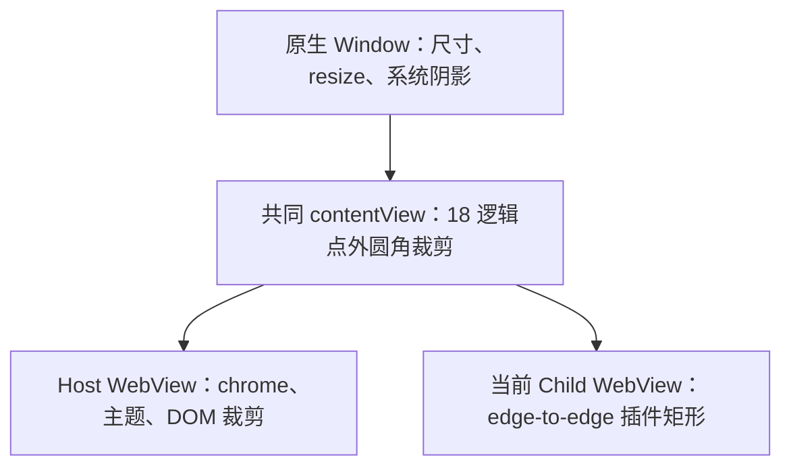

# Design

## Context

动机和用户可见范围见 [proposal.md](proposal.md)。本设计涉及 Host DOM、macOS 原生容器、窗口首次显示和 Child 呈现，因此需要明确跨层决策。

已核对的当前实现：

- `src/styles/global.less` 的 `.launcher-surface` 使用 `border-radius: 18px`、`overflow: hidden` 和 Semi 主题背景；插件 body 的 inline/bottom padding 与 gap 为零。
- `PluginRuntimeSlot.tsx` 测量矩形并通过 revisioned presentation/slot 边界提交 Rust；`plugin_child_webview_adapter.rs` 使用 `add_child` 创建原生矩形。Host DOM 裁剪不能裁到原生同级 Child。
- 当前启用 Tauri `unstable` multi-WebView 路径；vendored `tauri-runtime-wry` 将初始 Host 和后续插件都作为 native child 加入窗口。应选择完整 `NSWindow.contentView`，不能绑定到 Wry 非 Child 分支的 `WryWebViewParent`。
- `frame_aware_navigation_setup.rs` 目前直接从配置 build 主窗口；配置未指定隐藏创建。`setup_launcher_window` 安装管理器及事件/菜单，没有生产首次 Startup Show，不能只改为隐藏而遗漏首次显示。
- `macos_launcher.rs` 已有完整 `Window("main")`、`ns_window()`、主线程和 bounded error 的适配方式。产品可复用现有 `objc2` 栈；`objc2-app-kit 0.3.2` 的 `objc2-quartz-core` feature 可提供 `NSView.layer()` 所需绑定，锁文件已有对应依赖。
- `scripts/check-plugin-runtime-slot.ts` 只核对 DOM 样式包含 18px、插件无 inset/inner radius；它没有证明原生子视图裁剪。现有文档关于外 Launcher 裁剪原生内容的表述与当前实现存在缺口。

行为基线为 `frontend-foundation` 的统一外圆角要求，以及 `plugin-child-webview-runtime` 的 edge-to-edge、revision、原生权限与生命周期要求。本次 delta 明确 macOS 合成结果和呈现时序，并将 slot 中的可选外裁剪收紧为强制行为。

## Goals / Non-Goals

**Goals:**

- 将窗口外轮廓定义为 Window 级原生策略，使 Host 和所有插件自动受同一裁剪边界约束。
- 复用原生 layer 随视图 bounds 的裁剪能力，保持逻辑尺度，并避免引入独立物理坐标同步通道。
- 通过确定性策略测试、适配器失败注入、生产接线检查及真实编译分别证明可证明的部分。

**Non-Goals:**

- 不迁移原生 view 层级、不替换 contentView、不改动 vendored 输入/导航实现，不重写现有窗口或 Child 生命周期控制器。
- 不在插件内部注入 CSS/JS，不引入新的 public API、原生几何字段、插件权限或持久化配置。
- 不实现新的非矩形鼠标穿透策略，不添加输入拦截层、遮角元素、内边距或 CSS 外阴影。
- 不建立真实 WebView、GUI、截图、视觉基线或目标环境性能验证路径；本变更不宣称这些实机行为已经验证。

## Decisions

### 1. 裁剪共同原生内容容器，保留既有层级

在产品 Rust 中新增小型 macOS rounded-content 适配边界，由完整 `Window("main")` 的原生根视图安全取得所属 `NSWindow`，再解析当前 `contentView`；根视图已脱离窗口时返回有界错误，避免便利接口内部的断言。在主线程启用 layer backing，复用该 view 的 layer，设置 `cornerRadius = 18` 和 `masksToBounds = true`。四角角外保持透明，不在 native layer 填充主题色。

不替换 view/layer、不新增 wrapper、不调整 first responder 或 z-order，不持有跨线程裸指针。共同容器的裁剪属于 Window 生命周期，不由 Child teardown 删除。原生窗口阴影继续由 `NSWindow` 提供；不能转移为被 `masksToBounds` 裁掉的 layer shadow。

依据：[Apple CALayer masksToBounds](https://developer.apple.com/documentation/quartzcore/calayer/maskstobounds) 描述了 bounds 与 corner radius 对子图层的共同裁剪；该 API 能力说明不等同于 lensX 当前视图树的实机验收。

备选方案：只改 Host CSS 无法覆盖 native sibling；逐插件设置圆角依赖插件合作；只给 Child 四角加圆角会在 chrome 接缝产生不需要的内圆角；遮角色块依赖背景颜色且不能恢复透明区域。因此选择共同容器裁剪。

### 2. 使用逻辑半径与隐式 bounds 裁剪

原生半径固定为 18 个逻辑点，对应 Host 的 18 CSS px。不得再乘以 DPR；完整窗口内容 bounds 随 AppKit 布局变化，layer 的 implicit bounds mask 随之更新，不新增根据物理像素计算 path 的异步任务或全局 resize 轮询。

保持现有 Host CSS 圆角供 DOM 内容使用，Rust 用具名常量维护相应数值，通过 Rstest 跨层 drift assertion 保证一致。此处选择显式一致性检查，避免为了一个常量增加运行时 IPC 或 Generate 目标。

Child 继续接收原有矩形 `physical_bounds`。缩放、工作区适配、resize 和 chrome 变化沿现有 revision/latest-wins 路径收敛；圆角不缩小其 viewport，不改变 Page initial size、约束或 resizable 权限。固定/可调 surface 转换中若原生配置导致 layer 状态需要重设，使用同一幂等 ensure 操作，不另建状态机。

### 3. 将确认裁剪纳入实际显示前的原生操作

macOS 初始主窗口先隐藏创建，在 Host view 创建后、插件 service 可呈现前，于主线程建立裁剪并读回确认。初始化完成后显式沿原有 Host 激活/焦点语义执行首次 reveal。保留快捷键注册失败时仍可见的首次窗口兜底；不能将首次显示绑到快捷键注册成功。

Child 首次 reveal、same-attempt restore 以及父窗口恢复显示前，复用同一主线程 ensure/确认边界。重复执行是幂等的，不重建 Window/WebView、重复附加容器或夺取焦点。原生 resize/scale 的持续几何裁剪依赖当前共同 view 的 bounds；现有 surface 配置完成路径负责维持策略，不能等到下一次用户激活才修复状态。

把纯策略/调用顺序与 AppKit 操作拆开，以内部类型表达成功或 bounded failure。只有实际主线程操作完成并确认后才允许显示；`run_on_main_thread` 的投递成功不能代替执行成功。若调用经过调度，必须传回完成结果并保留现有 current-attempt 校验，不能让异步回调捕获旧 Child 后修改新窗口。

Child 在等待主线程确认前释放 registry 锁，完成后重新核对 attempt、readiness 和 handle 身份，只有当前对象才能显示或处理失败隐藏。surface 命令与环境刷新事务在主线程外执行；主线程 resize/scale 相关回调只投递合并刷新请求，保留最后一次环境变化，避免持锁等待主线程形成互锁。

无需增加公开 Tauri 命令、修改 slot/presentation wire schema 或增加插件 readiness 消息；这是 Rust Host 在已有显示路径内的前置条件。

### 4. 失败与生命周期沿原有边界收敛

- 初始 Window/contentView/layer 不可用或策略确认失败：保持窗口未呈现，返回现有 setup 错误路径，不继续启动未裁剪的可见界面。
- 已运行窗口重确认失败：若仍有可确认的旧安全裁剪，则保留；否则阻止本次 reveal、隐藏受影响内容，使用既有 Runtime/窗口错误路径。仅在 Host 仍可安全呈现时显示既有本地化 failure/retry/close UI。
- 保持错误在 Host 内部有界，插件和产品文案不接收原生指针、对象标签或平台异常，不为圆角新增用户配置或产品文案。
- Child close/replacement/retry/destroy 不清理 Window 级 mask；同一 Page hide/restore 继续复用文档、Session、模型与 Worker。旧 attempt 的延迟完成依旧无权显示、隐藏或修改新 Child。

正常加载、空白插件、错误反馈和返回 Home 都位于同一共同裁剪下。深浅主题继续由 Semi 和既有插件主题路径处理，原生层不根据语言或主题重复建 mask。

### 5. 最小依赖和验证范围

只在当前 macOS target 的 `objc2-app-kit` 打开所需 feature，复用锁定依赖，不升级 Tauri/Wry/Tao，不新增 UI 库或产品直接依赖的通用裁剪库。默认和 `plugin-development-mode` 构建均验证；非 macOS 分支保持可编译的既有行为。

验证层分工：

| 层 | 验证内容 | 证据边界 |
| --- | --- | --- |
| Cargo 生产策略 + fake adapter | 共同内容 root、18 逻辑点、幂等顺序、确认后显示、失败阻断、Window/attempt 归属 | 不启动 AppKit 窗口，不证明合成像素 |
| 已有窗口/Child 控制器测试 | startup、resize/scale、resizable 切换、hide/restore、replacement、失败与晚到回调 | 模型化 native 对象和操作，保留原生命周期断言 |
| Rstest/静态接线 | CSS/Rust 半径一致、edge-to-edge、主题/locale、默认与开发插件路径、生产实际调用测试策略 | 字符串检查只作为接线辅助，不能代替生产策略行为测试 |
| 构建和现有 Gate | 实际 macOS bindings、Cargo feature、主窗口/Child adapter 与锁定依赖共同编译 | 编译不证明阴影、抗锯齿或真实 hit-test |

复用 Gate：`plugin-child-webview-runtime`（包含 `plugin-runtime-slot`）、`launcher-input-focus`（包含 `plugin-child-webview-window-lifecycle` 与 `frame-aware-navigation-dependency-drift`）以及 `validation-governance`。确定性 repository-only assertions 放入现有 Rstest discovery 范围，跨层步骤只通过现有 typed Gate registry 编排，不新增 root script。此方案不修改 vendor 或需要 Generate 的产物。

同步更新现有 architecture/frontend-guidelines/validation 三类英文文档及其中文镜像，明确“CSS 负责 Host DOM；原生共同容器负责完整窗口合成裁剪”。现有入口和目录结构无需扩充。

## Risks / Trade-offs

- [选错原生祖先，仅裁 Host 或改变输入链] → 从完整 Window 查询当前 contentView，验证包含 Host/Child 的共同路径；不替换容器、不改变 responder，复用输入焦点回归 Gate。
- [隐藏创建后遗漏首次显示或快捷键注册失败时不可操作] → 明确独立首次 reveal，测试初始化顺序与注册失败兜底。
- [物理/逻辑半径混用或 CSS 漂移] → 原生固定逻辑点数，1x/2x/其他有效 scale 的模型断言，加跨层常量一致性检查。
- [resize、resizable style 切换或恢复后裁剪状态丢失] → 当前容器 implicit bounds 裁剪 + 幂等确认；生产 surface/显示接线须被确定性测试覆盖。
- [共同 layer 的裁剪影响系统阴影或交互] → 只裁内容、不改 NSWindow 阴影、hit-test 或 first responder；交付明确最终 macOS 像素及交互不在确定性证据内。
- [旧 attempt 清理破坏当前窗口] → Window 级所有权与 Child 级销毁分离，晚到回调测试不得操作当前裁剪或替代 Child。
- [验证误把 CSS 声明视为原生成功] → 行为策略、平台接线和编译分别记录，不新增真实 WebView 或视觉验收 Gate。

## Migration Plan

1. 在产品 Rust/macOS target 中引入小型裁剪策略与绑定，接入初始化和实际呈现路径，同时补齐确定性回归。
2. 同步已有双语文档，运行适用 Gate、全量前端/Rust 检查与构建，区分规划校验、实现校验和未证明的实机外观。
3. 归档准备时将本变更中文 delta 的接受内容同步为英文 stable specs，完成最终文档/治理审计和同步后校验，再进入独立归档流程。

不需要插件升级、数据迁移或发布包格式变化。若必须回滚，原生裁剪、隐藏创建与首次 reveal 接线应作为整体回滚，防止留下启动后永不显示的窗口；回滚会重新暴露已知插件下角问题，必须记录为未满足的外圆角契约，不以插件 CSS 补丁替代。
