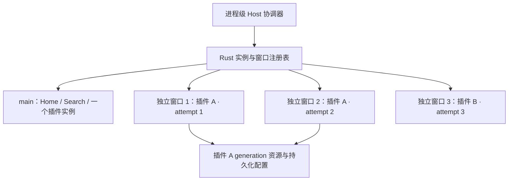

# Design

## Context

动机与用户确认的行为见 [proposal.md](proposal.md)。这是跨 Rust 原生窗口、React 导航、Session、资源授权和快捷键的能力变更，需要明确所有权及迁移事务。

规划时检查的实现与限制（历史基线；当前实现进度和验证见 `tasks.md`）：

| 现有入口 | 当前事实 | 设计影响 |
| --- | --- | --- |
| `src-tauri/src/plugin_child_webview_service.rs` | registry 只有一个 `current`，第二次 reservation 被拒绝 | Runtime 主键必须是独立实例，current 只能是窗口内概念 |
| `src-tauri/src/plugin_child_webview_presentation.rs` | 创建请求只接受 `MAIN_WINDOW_LABEL` | 创建、slot、呈现和终止必须验证窗口绑定 |
| `src-tauri/src/plugin_resource_service.rs` | 全局 `Option<RuntimeResourceAuthority>`，单来源撤销会撤销 scope | generation 资源与实例授权必须分离 |
| `src/app/navigation/service.ts` | 一个 active Page、handler、activation attempt；相同 owner/Page 复用 | 需要每 surface 的活动状态与实例路由 |
| `src/app/plugins/runtime/host-api-dispatcher.ts` | `ui.close` 仅用 owner/Page 判断当前目标 | 同插件多开必须进一步验证调用实例 |
| `src-tauri/src/plugin_child_webview_host_dispatcher.rs` | bridge 事件交付 `Webview("main")`；HTTP 按 attempt/request 跟踪 | 可保留中央 Host 协调器，但它不能随主页面退场而卸载 |
| `src-tauri/src/launcher_window.rs` | local W/Q 只判断应用前台，W 固定 Hide；main blur 隐藏 | D/W 必须验证实际 key Window 与可信 owner；Q 清理全部 |
| `src/app/shortcuts/types.ts` 与 `model.ts` | 严格 v2，只支持全局 Launcher/Action | 分离不能伪装成会 Show(main) 的普通 Action |

当前固定依赖的 `vendor/frame-aware-navigation/tauri/src/webview/mod.rs` 提供 `Webview::reparent`；Wry 的 macOS 路径移动同一个 WKWebView。源码支持选择保留原实例的方案，但 Tauri wrapper 在 native 成功前修改引用，runtime 先从旧 registry 移除视图，失败回滚不足。本设计把修正事务作为交付前置工作，不把 API 存在等同于已验证的无损迁移。

现有规格明确限制全进程一个 Child、一个源授权，并将 native presentation 固定到 main；本变更通过相应 delta 显式修改这些限制。公共 Manifest `0.4.0`、Host API 方法及 SDK payload 保持兼容。当前已进入授权实施阶段；产品与维护文档按任务推进，stable specs 在最终同步/归档准备时统一更新。

## Goals / Non-Goals

**Goals:**

- Rust 持有唯一可信的实例身份、native owner、迁移及终止裁决；React 负责每窗口 chrome、slot intent、交互和安全反馈。
- 保留原实例完整运行状态；前向阶段失败且补偿成功时回到同一原实例，仅补偿本身无法确认时进入显式 `recovery_required`，不降级为重载或自动销毁。
- 每窗口一个插件实例、全进程多个实例；所有 source、slot、activation、请求及异步完成都能精确验证实例与归属。
- 相同插件的公共持久化配置共享，页面状态独立；沿用权限、来源验证、配额和确定性验证边界。

**Non-Goals:**

- 不增加公共 instance/window 参数、权限、多开 opt-in、插件自建窗口或脱离 lensX 的后台服务。
- 不增加第二套完整 Host 启动、每窗口独立 Plugin Manager、全局快捷键注册、bridge dispatcher 或设置数据库。
- 本轮不新增合并、克隆、重启恢复或 Windows/Linux 原生迁移实现；跨平台共享代码仍须保持原有行为和构建边界。

## Decisions

### 1. 运行实例与窗口归属分开建模

复用现有 opaque Runtime attempt 作为 Host 内部实例标识，不再用 `{plugin_id, page_id}` 充当运行实例主键。Rust registry 改为实例映射，并维护 `surface -> instance` 的唯一绑定；`main` 是稳定 surface，独立窗口由 Rust 产生不可由插件选择的 label。每个实例保留 plugin/Page/entry/version/generation、source label、data-store identity、Session、readiness、visibility、资源租约与请求状态。

窗口归属包含单调 `ownershipRevision`。slot revision 仍在当前 owner 内最新值优先；完整校验键为实例、实际来源、surface、ownership revision 与 slot revision。分离保留 attempt/source/Session，不复用旧 owner 的几何更新或 focus completion。新开、重试或换 Page 创建新 attempt；终止后身份永不复用。

替代方案是以插件 ID 为 registry key 并让第二次打开聚焦旧窗，这无法满足同插件多开，因此不采用。额外创造另一套与 attempt 平行的插件可见 instance ID 也没有必要。

### 2. 保留一个中央 Host 协调器，增加受限窗口呈现器

Plugin Manager、provider projection、设置、Action registry 与中央 Host API dispatcher 保留在应用级作用域。主 Host document 隐藏或回 Home 不销毁这些服务。独立窗口加载受信任的轻量 Host shell，使用同一构建产物的私有启动模式，仅呈现内容 slot 和必要的可信反馈，窗口按钮与拖动由原生标题栏负责，不重复执行主 App bootstrap、注册全局监听或广播命令。

Rust 根据实际 Host WebView 来源绑定 window owner。窗口元数据、命令和 slot 更新使用严格版本化、字段有界的私有消息；URL/query 或前端自报 label 不能授予窗口权限。detached Host shell 只获得本窗口启动、订阅和 slot 命令，不通过通配权限继承 main 的设置、安装或全局管理命令。插件 WebView 继续没有通用 Tauri 权限。具体 Tauri capability allowlist 与动态 label 校验须一起交付。

主 Host document 仍是中央 bridge 消息消费者；它按实际实例处理 RPC，而不是读取 React 当前 Page。每个 surface 有独立 navigation/activation 状态，`ActivePage` 公共形状仍只含 owner/page/opened_by_action_id；surface 与 attempt 关系留在私有路由上下文。主页面退出分离 slot 是“解除呈现绑定”，不能调用 Runtime dispose；真实应用级 Host reload 则清理全部实例。独立 shell 崩溃/销毁只终止它拥有的实例。

替代方案是每个新窗口启动完整 Host，容易重复全局服务、设置写入和快捷键注册；另一个方案是把全部 TS 领域逻辑搬到 Rust，超出此次必要改动。中央协调加受限呈现器可复用现有 session map 和 dispatcher。

### 3. 分离是保留原实例并显式处理补偿失败的归属事务

仅 SDK ready、仍在 main、无终止或其他迁移且 Launcher 恢复入口确认有效的实例可接纳分离。提交前再次检查恢复能力；恢复入口失效或不能安全隐藏主窗口时保留/回滚原实例并保持主窗口修复入口可见；补偿本身无法确认时进入下述恢复失败态。Rust 分配一个事务 token，冻结该实例的归属变更并阻止旧 owner 的后续呈现更新；普通页面执行与已发出的任务继续。单次操作不重新 dispatch 打开 Action，不产生 shortcut activation，不重新建立 bridge。

事务顺序：

1. 校验真实 key Window、实例、generation 和 main 归属，记录窗口 presentation、activation 绑定及 owner revision；原生输入快照在首次真实修改前捕获，不能用目标准备前的旧 responder 覆盖等待期间的新输入。
2. 创建隐藏目标 Window 与受限 Host shell；准备 metadata、权限、原生无可见标题文字的标题栏和完整内容 slot。目标 ready 等待使用有界 10 秒期限，超时撤销目标而不影响原实例。
3. 目标就绪后重新检查真实 key Window、组合输入、overlay 和 Launcher recovery，再通过修正后的 native reparent 事务移动同一个 WebView。首次修改前捕获原 parent/frame/responder，跨全部阶段保留；native、runtime registry、Tauri wrapper 的归属必须一起确认成功或恢复，不能丢弃旧 registry 项。
4. 目标保持隐藏、不可交互，先确认内容槽和裁剪，再完成导航/activation 移交及 main Home 的 JS 准备 ACK。受影响 UI 保持冻结，会话及 activation 队列不重建。
5. 在同一个受 guard 约束的主线程最终批次中应用 native Home、显示/聚焦目标、隐藏 main，并发布最终归属；聚焦目标后不得再等待 JS ACK。main 最终为固定 `650×320`、不可调整的 Home，目标保持可见和焦点。批次失败时先使交互安全，再进入保留原对象的补偿；主 Home 更新不能调用原实例的 terminal cleanup。

回滚同样先准备 source DOM/导航及新 owner revision 的 ACK，再在最终原生批次恢复可交互的 source 呈现并发布取消结果。不能把已确认的 reveal/focus 步骤偷偷实现成未执行的缓存意图；driver 的准备步骤与最终交互批次必须显式区分，并由生产策略测试验证。这样避免目标已可输入后，后续异步 ACK 失败又隐藏它并中断新开始的组合输入。

从原生快照捕获到整个事务成功提交、确认恢复或明确终止，必须保留同一个跨层回滚上下文。普通创建、移动、slot、reveal、focus、main 复位或 hide 失败且补偿成功时，仍在同一事务内恢复原 owner、slot、navigation 和安全可见状态，再清理确认不承载原 WebView 的未提交目标。若补偿操作本身无法确认，不继续使用普通反向 reparent 丢弃原快照，也不清理可能仍承载原 WebView 的目标，转入 `recovery_required`。故障注入必须证明 production policy 没有“先移除再丢失”、不确定归属下误清理或伪报恢复的分支。

原实例保留仍是设计约束：不能把销毁重开、重载或部分状态复制作为补偿。`recovery_required` 仅表示补偿尚未确认，不表示分离或回滚成功；它保留同一 WebView、Session、attempt、事务 token、原始 parent/frame/responder 快照和最后已确认事实，冻结受影响实例及 source/target surface 的归属变更、普通导航替换与重复分离。保持可信 main 修复和退出入口可见，阻止 close-to-hide、blur、Toggle 或局部 `Cmd+W` 把修复入口隐藏。必须先读回确认真实 native 归属，再执行目标清理。

恢复界面提供“重试恢复”“关闭实例”“退出”三个明确操作。“重试恢复”继续同一 attempt/token 和原始快照的补偿，使用有界等待；全部恢复步骤确认后才解除冻结、恢复 main 中原实例并清理安全目标，再次失败则保留恢复失败态，不能自动循环或调用创建新 Runtime 的普通 Retry。“关闭实例”以及合法 `ui.close` 在成功响应后按同一 attempt 终止；Quit 清理全部。用户明确关闭、插件禁用/卸载/换代、应用退出或 WebView 本身崩溃仍执行既有终止边界，清理恢复上下文、请求和租约，不得由恢复回调复活。恢复状态本身不增加或绕过 native source、Session、generation 或资源租约权限，只有仍通过当前校验的原实例调用和结果才可继续。

禁止跨 native/main-thread 等待持有 registry 锁。每次异步返回重验 token、generation、attempt 与 ownership revision。重复快捷键只产生一次 admission；终止事件使事务失效，迟到回调只清理它独占的未提交目标，不能触及替代实例。归属敏感的 `actions.open` 在普通迁移期间按实例串行等待事务结束（受同一有界期限约束）；进入 `recovery_required` 后必须有界返回现有 `unavailable`，不得无限等待、换窗执行、排队到恢复后自动重放或替换原实例。`ui.close` 必须先完成成功响应交付，再由关闭效果解析同一 attempt 的当前 owner 并终止、取消未完成迁移；若响应等待期间分离已提交，则关闭移交后的该实例。失败或取消的 close 响应不产生终止效果。disable、quit 按自身已确认的终止边界取消迁移，HTTP/RPC 数据结果仍归原实例。

### 4. 资源 scope 与来源租约分离

保留现有每 `(entry_id, resource_generation)` 唯一 scope/origin 和已验证字节缓存；增加每 attempt/source 的独立访问租约。source-authenticated request 必须同时满足实例租约、generation、当前插件资格及请求来源。共享 origin 本身永远不是权限。

关闭一个实例只撤销它的租约、Session、请求及浏览器数据容器；仍有合法租约或绑定可信 attempt 的有界创建预留时不撤销共享 scope 或兄弟实例的读取。创建预留本身不授予资源读取权限，并在失败、取消、超时或终止时释放。最后一个租约和预留都释放，或 generation 失效时，永久撤销对应 scope；稍后再开即使 generation 相同也签发新 scope，旧 URL 不复活。缓存淘汰仍按原有 generation 规则，字节复用不是旧授权复活；旧 source 不能因为兄弟租约仍存活而继续读取。

数据容器保留每 attempt 的隔离标识，分离不改变它；同 generation 的多个浏览器实例不共享 DOM、Worker、撤销或页面内存。`storage.*` 继续按 plugin namespace 串行提交，配置刷新由插件既有读写行为决定，不新增自动跨窗口同步协议。

保留现有 RPC 每 Session 配额及 HTTP 每 attempt 4、全局 16、DNS worker 16 的限制，不因窗口数倍增全局额度。全局 attempt 唯一，响应和取消键不能退化为 plugin/Page/requestId。原生创建失败按明确失败处理，不驱逐已存在窗口。

### 5. 导航、Host API 和激活以来源选择 surface

入口路由固定为以下表格，避免同插件多开后按 plugin ID 猜测目标：

| 入口 | 目标 | 实例处理 |
| --- | --- | --- |
| Launcher 搜索/点击、全局 Action 快捷键 | main | main 当前相同 Page 复用；main 空闲或不同 Page 按现有规则创建/替换 |
| 实例 `actions.open` | 调用实例所属 surface | 相同 Page 复用该实例，其他合法本插件 Page 仅替换本窗口；恢复失败态有界 `unavailable` 且无导航效果 |
| 实例 `ui.close` | 调用 Session 对应 attempt | 先成功响应交付，再 compare-current 关闭；detached 销毁窗口，main 返回 Home |
| 配置的应用内分离快捷键（默认 `Cmd+D`） | main 的当前 ready 实例 | 转移原实例，不创建新的激活；恢复失败态拒绝重复分离 |
| `Cmd+W` / native close | 可信焦点/事件所属窗口 | main 可恢复 Hide；detached 终止自身并关闭 |
| `Cmd+Q` / app teardown | 全进程 | 拒绝新入口并幂等清理所有实例、事务和窗口，包括恢复失败态 |
| 恢复界面的重试恢复/关闭实例 | recovery context 绑定的原 attempt/token | 仅重试原补偿或明确终止该实例，不重载、不创建替代实例 |

每个实例保留独立 activation stream，分离移动该 stream 的呈现归属，不重置 invocationId、不重放业务回调。后续全局 Action 不广播到分离实例。窗口主题、语言由同一偏好源更新，向每个当前 Session 发送既有 context event，不扩展公共 Context 字段。

### 6. 默认 Cmd+D 作为可配置的应用内命令

快捷键私有配置升级至 v3，保留 Launcher 与 Action 语义，新增可空的 `detach` chord。新配置默认 `Cmd+D`；固定“分离插件窗口”设置行支持录制、改键、清除及恢复默认，不提供 modifier double-tap 或 Action 选择器。复用现有 reserved-key、物理键规范化、locale、录制 lease 和已确认保存规则。

native 前台 local monitor 是唯一 D/W/Q 接纳点：验证前台应用和 actual key Window，D 只在 main 有 eligible 实例、无 Settings/确认覆盖、无快捷键录制、无输入法组合或 `recovery_required` 分离接纳阻塞时执行。Host chrome 或插件 Child 获焦都能触发。接受后原事件消费一次，忽略自动重复和 in-flight 重入；不发送合成按键。其他场景原事件透传。用户已明确选择默认 `Cmd+D`，因此 eligible main 中的分离优先于 Monaco 同键业务功能；detached 中 D 不分离，可保留编辑器行为。

全局 Launcher/Action 与 local detach 使用相同 canonical 冲突空间，但 detach 永不注册为系统级快捷键、永不主动 Show main。v1/v2 迁移只读投影到 v3：没有冲突时补默认；已有全局 `Cmd+D` 时保留旧绑定，把 detach 投影为未启用并附带可解释的待解决冲突，不偷改原配置或选择替代键。首次明确保存才写 v3；用户清除或改键后保存其明确选择。待解决分离冲突采用 Host 私有的版本化迁移记录，无关设置保存必须沿带该记录，重启后仍提示，只有用户明确处理分离绑定才清除；不能仅以 `detach: null` 混淆用户主动关闭与未解决冲突。旧 v1 双 Launcher 入口待选择规则继续适用。detach 故障不改变 Launcher recovery 状态。

### 7. 生命周期按实例、插件 generation、进程分层

- 实例级：真实关闭、局部 Page 替换、普通 Runtime retry、runtime failure、对应 shell 销毁仅清理本实例；detached blur 不属于终止或隐藏。原生补偿失败本身进入非终止的 `recovery_required`，其明确“重试恢复”保留原 attempt；只有确认真实终止时才清理所保留恢复上下文。
- 插件级：禁用、卸载、quarantine、替换、升级、已提交开发 reload 撤销该 entry/generation 的全部实例及其来源租约；无关插件实例不受影响。失败的 reload staging 不失效任何现有实例。
- 进程级：主 Host document reload、app teardown、退出清理所有实例；main 从插件返回 Home、main 隐藏或被再召唤不是进程级事件。
- Circuit breaker 保持 entry/generation 聚合计数与现有 3 次/60 秒、冷却 30 秒规则；冷却只阻止新建/重试，不关闭健康兄弟实例。清除历史要求该 key 连续 30 秒无 qualifying failure 且存在 ready 实例，不能由另一个早已 ready 的窗口不断抹去新失败。分离不算失败、不重置或绕过 breaker。

### 8. 窗口展示继承当前实例，Host 管理尺寸和焦点

独立窗口使用普通的 macOS 原生标题栏，保留辅助功能和窗口切换所需的语义标题，视觉上仅显示关闭、最小化、全屏三个系统按钮。插件内容占满标题栏下方的 native content rect，不叠加 HTML 页面栏、关闭按钮或标题栏高度的额外 inset。主窗保留原页面胶囊，不再显示分离按钮或键位提示。关闭仍按精确实例处理，最小化保留实例。单击绿色按钮使该窗口进入 macOS 原生全屏，再次单击退出全屏并恢复原窗口尺寸。Page 的 `resizable` 只决定普通窗口模式下能否从边缘调整尺寸。

分离迁移当前有效 logical size 和 `resizable`；按目标所在显示器 work area 约束但不重放 Manifest 默认大小。每个窗口独立保存当前临时尺寸、slot 与裁剪，保持原有 Manifest hard bounds 和静态 resize 授权。新开或真实 close/reopen 使用 Manifest 初值，不持久化当次尺寸。原窗口晚到的 resize 不影响新 owner。

分离后的 focus intent 指向迁移 WebView 内仍有效的原输入目标。主窗口再次激活仅恢复 main 的有效输入，不对所有 Host WebView 广播 activation。native 编辑命令按当前真实 responder/Window 执行一次；IME、文本选区、撤销与 pending input 的连续性属于状态保留约束。UI 复用 Semi 组件和既有主题/国际化层，简单布局用 UnoCSS，窗口级状态和语义样式用 Less，不增加组件库。

### 9. 确定性验证与文档同步

新稳定 Gate `plugin-detached-windows` 注册到 `scripts/validation/catalog.ts`，组合实例/租约状态机、production native migration policy 的 fake adapter、真实 React handlers、Host API 路由和包边界检查。复用现有 `plugin-child-webview-window-lifecycle`、`plugin-child-webview-continuity`、`plugin-child-webview-session`、`plugin-child-webview-runtime`、`launcher-input-focus`、`launcher-shortcuts`、`frame-aware-navigation-dependency-drift`。

验证必须覆盖每个事务阶段失败、补偿再次失败进入 `recovery_required`、原始上下文保留、显式恢复再失败/成功、修复入口可见、D/导航受限与关闭/Q 仍可用、每个终止事件与迁移交错、同插件三个实例、跨窗口 RPC/requestId、pending HTTP/Worker/模型历史保留、generation 全体失效、旧 owner slot、W/Q/D 真实目标策略、录制/覆盖/不可用状态、双语/主题/可访问性及主入口恢复。保留对象身份和调用次数断言只是连续性证据的一部分，还需真实业务 handlers 在模拟的同一实例中继续运行的状态结果。

若修正 vendor 路径，先审查 diff，再通过已有 `generate -- frame-aware-navigation-dependency-drift --write` 更新受控 baseline；Gate 只读，不自更新 hash。为新增 production reparent 策略补纯 Rust 测试、vendor rustfmt 及固定依赖编译覆盖。维护验证不新增 GUI、真实 WebView、native harness、截图或环境性能路径，也不将确定性通过描述为实测原生输入或 WebKit 行为。

实现后同步 `docs/en/architecture/overview.md`、`extension-platform.md`、`plugin-child-webview-runtime.md`，以及 `docs/en/plugin-development/host-api.md`、`runtime-permissions-security.md`、`docs/en/development/validation.md`、ConfigLens/Translation 使用说明中受影响的生命周期表述，并同步相同相对路径的 `docs/zh/`。优先修改既有分类文档，按实际变更更新索引与链接；不把历史 roadmap 当作维护基线。

## Risks / Trade-offs

- [原生 reparent 或补偿无法确认] → 修复 dependency/native registry 事务并跨阶段保留原始快照；补偿成功恢复 main，补偿不确定进入已批准的 `recovery_required` 并冻结普通归属变更。缺少上下文保留、修复可见性或显式恢复/终止能力仍阻止交付。
- [主页面卸载误销毁分离实例] → Runtime 与中央服务提升至应用级，React slot 只释放呈现 lease，终止通过实例 owner 协调。
- [同插件窗口互相撤权或取消请求] → 独立 source lease、全局唯一 attempt、按实例关闭与按 generation fanout 分开测试。
- [多个窗口资源占用增加] → 保留全部已有限额、取消和有界等待；创建失败不得破坏已有窗口，不建立预加载池。
- [Cmd+D 覆盖插件编辑操作] → 明确应用内 eligible main 的优先级，提供可配置/可清除入口；detached 透传，旧全局绑定优先保留。
- [中心 Host document 仍是共同故障点] → 明确主 Host reload 为全实例清理；不声称每窗口独立进程容错。
- [实际 macOS 焦点/IME/WebKit 连续性未被本次观察] → 将原对象迁移及连续性作为产品约束，以生产策略、状态结果、接线和编译验证；保留证据局限，不添加已退役的环境验收入口。

## Migration Plan

1. 先建立实例、owner revision、来源租约和生命周期裁决，保留 main 单窗口行为的回归测试。
2. 修复并验证 native transfer/rollback 与 `recovery_required` 上下文保留、显式恢复/终止，接入受限 detached shell、窗口级导航及生命周期；最后开放 UI 和快捷键入口。
3. 快捷键 v1/v2 按上述规则投影、显式保存 v3；保持现有插件包、公共 SDK 和用户配置兼容，不重装插件。
4. 完整前端、Rust、workspace、相关 Gate 与文档校验通过后，另行按授权发布；本规划不执行发布。
5. 回滚产品版本前正常退出并关闭全部实例；不把旧版本不理解的 v3 配置直接覆盖为默认。若需要降级配置，使用已审阅的显式转换保留 launcher/actions，舍弃仅新版本理解的 detach 字段；不尝试跨版本恢复 Runtime 或自动迁回已分离窗口。

## Open Questions

用户已批准下述 `recovery_required` 契约调整，原生补偿失败不再是等待范围确认的阻塞。跨层原始快照保留、明确恢复/终止、可信来源校验与确定性证据仍是必须完成的实现任务；无法保持原实例或安全恢复入口时仍不能报告能力完成，也不能自行换成重开方案。

## Implementation Review — 2026-11-03

实施中发现原规划尚未解决的原生补偿失败分支。用户随后明确选择“批准恢复失败态（推荐）”，批准本节所列原实例保留及恢复/关闭/退出边界；本轮已将该决定同步到 proposal、design、delta specs 和待完成任务。以下原生发现作为批准前历史证据保留，批准不等于恢复功能或整体变更已经实现。

### 批准前触发评审的发现（历史证据）

1. Wry 的单次 `reparent` 在成功返回后释放原 parent/frame/responder 快照。后续 runtime registry 提交失败时再反向调用 `reparent`，取得的是目标窗口的当前快照，不能证明恢复原状态。需要跨全部阶段保留私有原生回滚 token；当前 vendor 补丁仍未完成此生命周期。
2. 即使 source Window 仍存活，AppKit 仍允许当前 responder 拒绝交出焦点，或目标 responder 拒绝接收焦点。`makeFirstResponder` 返回 `true` 也不能单独证明指定 responder 已接收，必须读回比较。依据 [Apple 官方接口说明](https://developer.apple.com/documentation/appkit/nswindow/makefirstresponder%28_%3A%29)，该失败不能被归类为实例崩溃、用户关闭或插件失效。
3. 当前 [Wry 恢复路径](../../../../vendor/frame-aware-navigation/wry/src/wkwebview/mod.rs) 的层级/尺寸确认与 responder 恢复可以返回失败；[生产策略及确定性测试](../../../../vendor/frame-aware-navigation/wry/src/wkwebview/reparent.rs) 明确覆盖 source 存活但恢复不成立的情况。这些是源码、接口契约和故障注入证据，不是实际 macOS 交互测量。

批准前，[迁移 driver](../../../../src-tauri/src/plugin_detached_window_migration.rs) 已在补偿失败时以 `RecoveryRequired` 保留原实例和恢复上下文，并明确不报告成功；这项内部保护当时不能满足原 task 3.3 的自动恢复主窗保证。用户批准后，按本节恢复契约继续实现跨层上下文及产品入口；Task 3.1、3.3、3.5 和新增 3.7、6.7 仍须按各自验证完成，不能仅更新 integrity baseline 或缩减测试就算交付。

### 已批准的恢复契约调整

用户已批准增加原生补偿失败状态并在更新规范后继续实施；以下边界为当前接受范围，不再等待同一授权：

- 普通前向阶段失败且补偿成功时，仍必须恢复同一原实例至 main；不放宽已有成功回滚要求。
- 仅当补偿操作自身无法确认时进入显式 `recovery_required`。保留同一 WebView、Session、事务和原始快照，不重载、不重放 Action、不自动销毁该实例，也不宣称分离或回滚成功。
- 冻结该实例的归属变更与重复分离。不得清理可能仍承载原 WebView 的目标窗口；先确认真实 native 归属，再执行任何窗口清理。
- 保持可信主窗口修复和退出入口可见，向用户提供本地化失败反馈及明确的重试恢复、关闭实例、退出操作；这些操作继续使用同一 attempt/token 校验。
- 明确关闭、插件失效或退出仍按原有终止边界清理，不因恢复状态复活失效实例；公共 Manifest、SDK、Host API 不增加窗口权限。

该决定将原“普通失败必然恢复 main”调整为“前向失败且补偿成功仍恢复 main；仅补偿无法确认时显式保留恢复失败态”。恢复失败态冻结归属敏感导航，`actions.open` 有界返回 `unavailable`；主窗保持修复入口可见，重复 D 不接纳，明确关闭与 Quit 仍可执行，所有操作继续受当前 source/Session/generation/租约及同一 attempt/token 约束。此处只完成授权范围和规范对齐，新增行为仍须完成生产实现、故障注入、双语文档和最终验证后才能宣称交付。
